# SOC Home Lab — Detection Engineering with Wazuh

A hands-on Security Operations Center (SOC) home lab built to practice
blue-team detection and alert triage. Three virtual machines on VMware
Workstation Pro: an attacker, a victim endpoint, and a Wazuh SIEM server.

## Lab architecture

| Role     | Machine                          | IP / detail          |
|----------|----------------------------------|----------------------|
| Attacker | Kali Linux                       | 10.10.10.130         |
| Victim   | Windows 11 (agent: win11-victim) | 10.10.10.0/24 (DHCP) |
| SIEM     | Wazuh on Ubuntu Server           | 10.10.10.10          |

Isolated NAT network 10.10.10.0/24. Dashboard: https://10.10.10.10

## Tools
VMware Workstation Pro · Wazuh 4.x (SIEM/XDR) · Kali Linux (nmap, hydra)
· Windows 11 Enterprise (Wazuh agent)
· Sysmon (SwiftOnSecurity config)

[TryHackMe progress](tryhackme-progress.md)

## Detections

### 1. Windows logon brute force (Event ID 4625)
Generated repeated failed logons on Windows; Wazuh recorded 5 failures.
- Rule 60122 "Logon Failure - Unknown user or bad password", level 5


### 2. New admin account / privilege escalation (4720 + 4732)
Created a hidden "backdoor" user and added it to the Administrators group.
- 4720 user created (MITRE: Account Manipulation)
- 4732 Administrators Group Changed, rule 60154, level 12


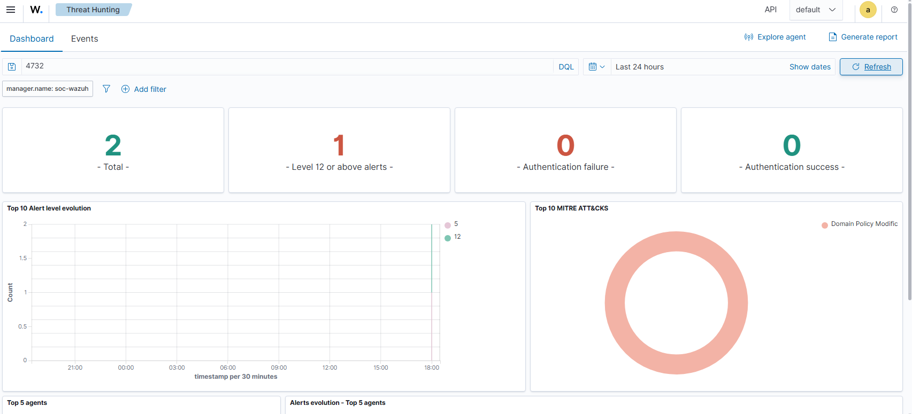

### 3. SSH brute force from Kali
Ran hydra against the Wazuh server's SSH (user analyst).
- Rule 5503 "PAM: User login failed", level 5
- MITRE ATT&CK T1110.001 Password Guessing


### 4. Custom detection rule (my own rule)
Wrote a custom Wazuh rule to flag new Windows user creation faster,
treating it as a possible backdoor.
- Rule id 100100, level 12 (high severity)
- Triggers on Windows Event ID 4720 (a user account was created)
- MITRE ATT&CK T1136.001 (Create Account - Local Account)

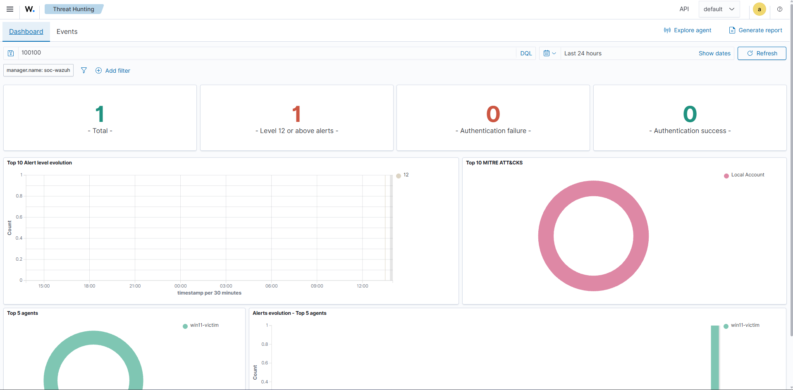
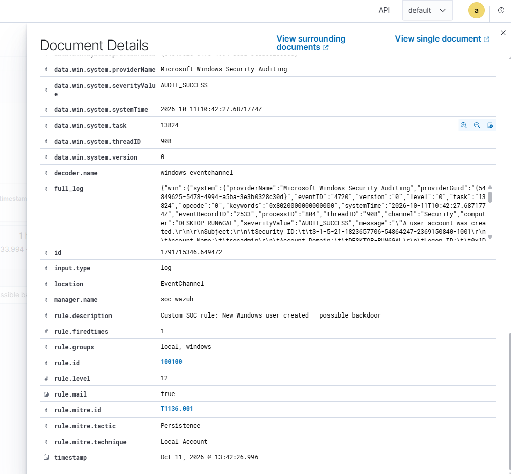

### 5. Endpoint telemetry with Sysmon + recon detection
Applied the SwiftOnSecurity Sysmon configuration on the Windows endpoint and
forwarded the Sysmon log to Wazuh for process-level visibility. Then simulated
attacker reconnaissance (`whoami`, `whoami /priv`, `ipconfig /all`, `net user`).

- Sysmon Event ID 1 (process creation) collected by Wazuh
- `net user` was caught by the built-in Wazuh rule 92031 (Discovery activity, level 3)
- `whoami` was logged by Sysmon but produced no Wazuh alert: a detection gap
- Closed the gap with custom rule id 100200, level 10, triggered on whoami.exe execution
- MITRE ATT&CK T1033 (System Owner/User Discovery)

```xml
<group name="local,sysmon,windows,">
<rule id="100200" level="10">
<if_group>sysmon_event1</if_group>
<field name="win.eventdata.image">whoami.exe</field>
<description>Custom SOC rule: whoami executed - possible host reconnaissance</description>
<mitre>
<id>T1033</id>
</mitre>
</rule>
</group>
```

**Troubleshooting:** after adding the rule, wazuh-manager failed to start
(systemd timeout). Validated the rules with `wazuh-analysisd -t` (no errors),
found stuck processes in the service status, cleared them with
`wazuh-control stop`, and the manager started successfully.


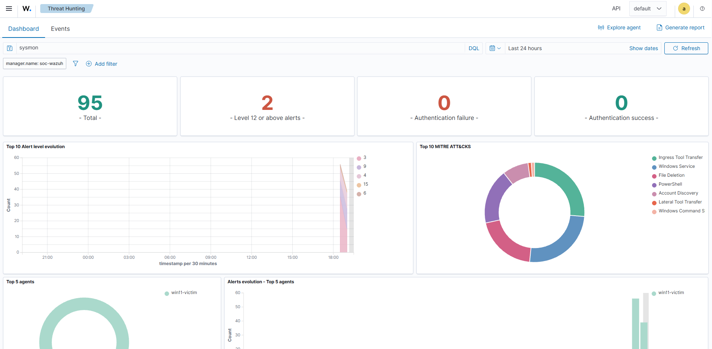


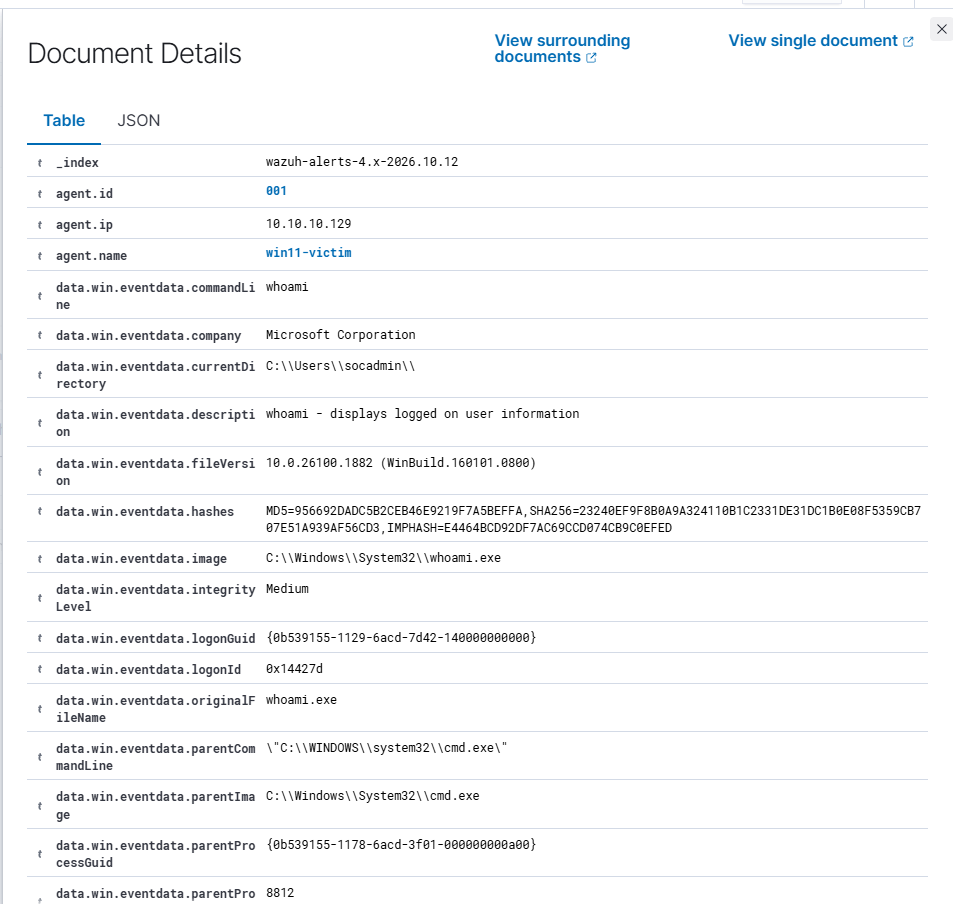
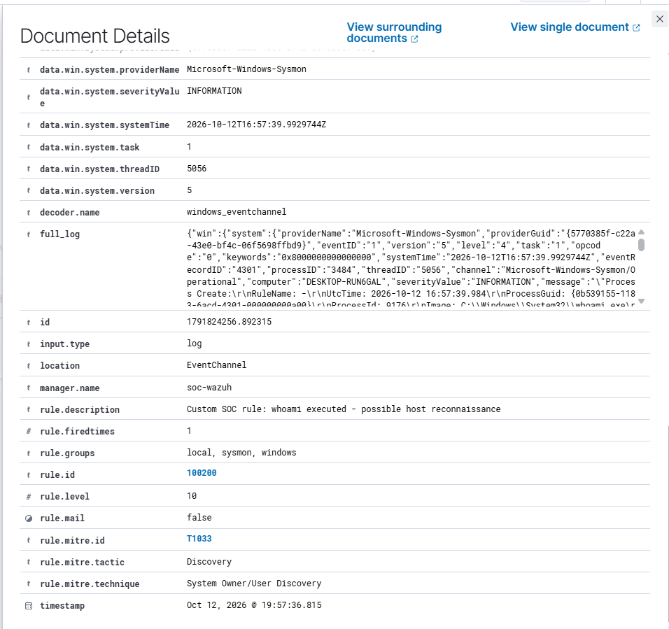

### 6. Persistence detection + attack timeline

Simulated two common persistence techniques on the Windows endpoint and
wrote a custom Wazuh rule for each, using Sysmon telemetry.

- **Run key:** added a fake "Updater" value under `HKCU\...\CurrentVersion\Run`
  - Sysmon Event ID 13 (registry value set)
  - Built-in result: rule 92302, level 6
  - Custom rule 100300, level 12, MITRE ATT&CK T1547.001
  - The built-in field path is backslash-escaped in Wazuh's JSON, so the
    regex needed `CurrentVersion\\+Run` to match
- **Scheduled task:** created a fake "WindowsUpdateCheck" task with `schtasks`
  - Sysmon Event ID 1 (process creation)
  - Built-in result: no alert - detection gap
  - Custom rule 100400, level 12, MITRE ATT&CK T1053.005
  - Two field conditions (schtasks.exe AND /create) to avoid false positives

**Attack timeline:** ran a short chain (recon, new local account, Run key,
scheduled task) and filtered Wazuh to level 10+ alerts on the victim. The
custom rules turn the serious steps into a readable story, oldest first.

**Alert triage:** investigated three unexpected built-in alerts and
documented each verdict - two false positives (a PowerShell policy-test
file, and a Windows compatibility-database task run by the system) and one
true-positive activity with a mislabelled rule.


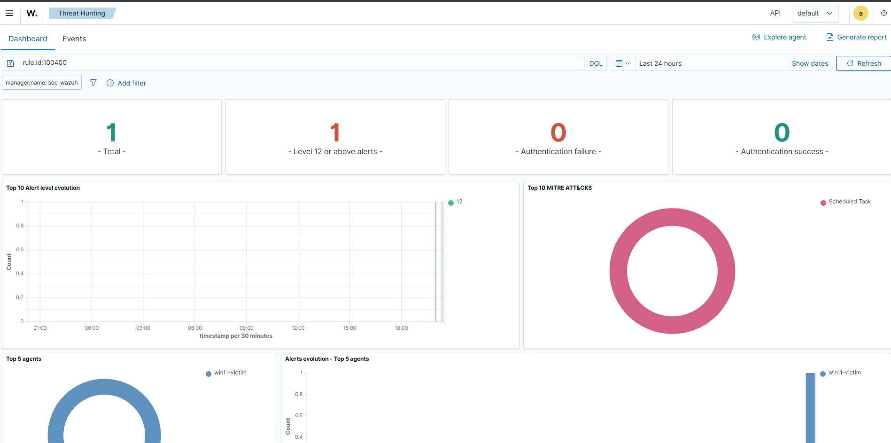


### 7. Lateral Movement, Tool Transfer & Alert Tuning

This section covers two new attack detections from the Kali attacker, tuning out false positives found earlier, and a real troubleshooting case where alerts went missing.

#### 7.1 Lateral movement over SMB (T1021)

**Attack:** From SOC-Kali (10.10.10.130) I used `netexec` (nxc) to authenticate to SOC-Win11 over SMB (port 445) with valid credentials for `socadmin`.

**What Windows logged:** Event ID **4624** (successful logon) with **Logon Type 3** (network logon) and the Kali IP as the source address.

**Detection:** The built-in Wazuh rule 92657 fired, but it did not clearly flag this as lateral movement. I wrote a custom child rule that raises network logons to level 12 and maps them to MITRE ATT&CK:

```xml
<rule id="100500" level="12">
  <if_sid>92657</if_sid>
  <field name="win.eventdata.logonType">^3$</field>
  <description>Custom SOC rule: network logon (type 3) - possible lateral movement</description>
  <mitre>
    <id>T1021</id>
  </mitre>
</rule>
```

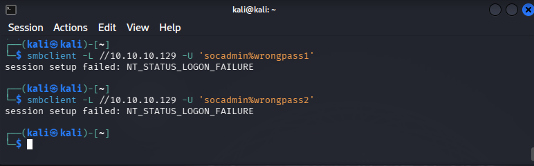

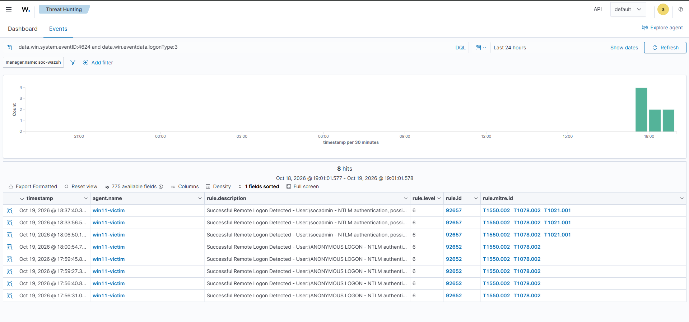
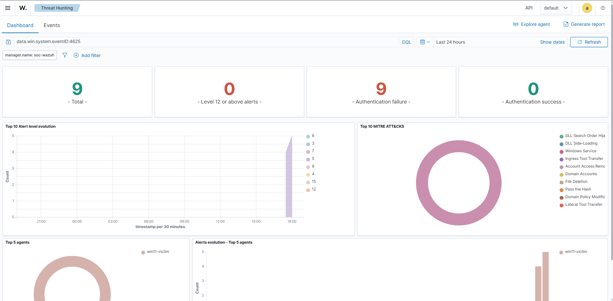
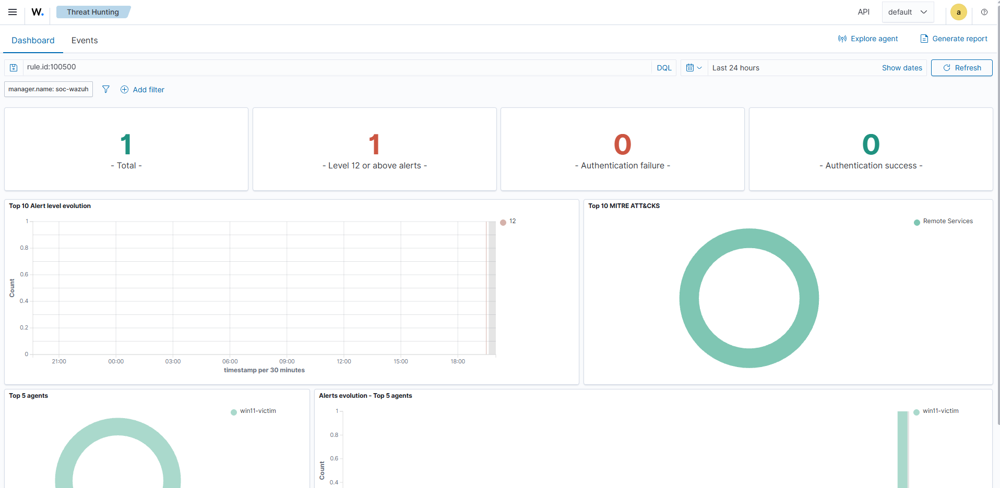

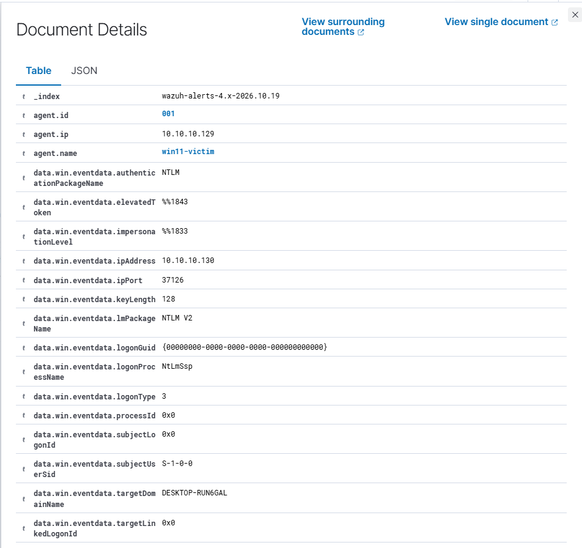

#### 7.2 PowerShell web download (T1105)

**Attack:** On the victim I used `Invoke-WebRequest` to download a file, simulating an attacker pulling tools onto a compromised host.

**What Sysmon logged:** Event ID **1** (process creation, with the full command line) and Event ID **3** (network connection).

**Detection gap:** The built-in rule 92027 only alerted at **level 4**, which is easy to miss in a busy SOC. I wrote rule 100600 to raise it to level 12.

**Lesson learned:** My first version used `<if_group>sysmon_event1</if_group>` and never fired. Wazuh evaluates rules as a tree: once an event matches 92027, only children of 92027 are checked. Changing the parent to `<if_sid>92027</if_sid>` fixed it.

```xml
<rule id="100600" level="12">
  <if_sid>92027</if_sid>
  <field name="win.eventdata.image" type="pcre2">(?i)powershell\.exe$</field>
  <field name="win.eventdata.commandLine" type="pcre2">(?i)(Invoke-WebRequest|iwr|DownloadString|DownloadFile|wget|curl)</field>
  <description>Custom SOC rule: Powershell web download - possible tool transfer</description>
  <mitre>
    <id>T1105</id>
  </mitre>
</rule>
```


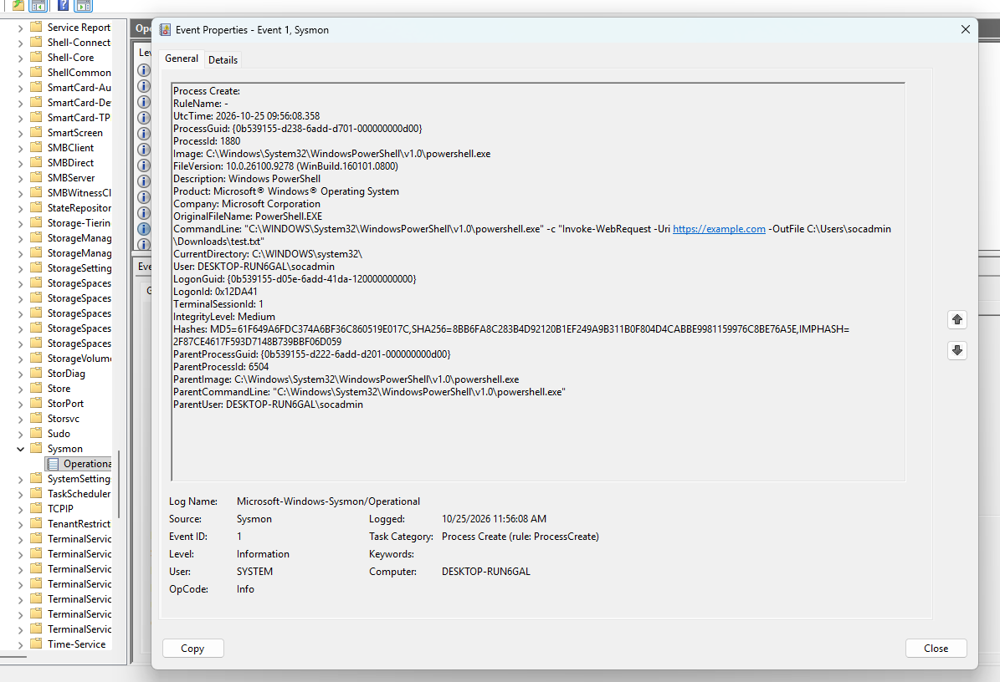
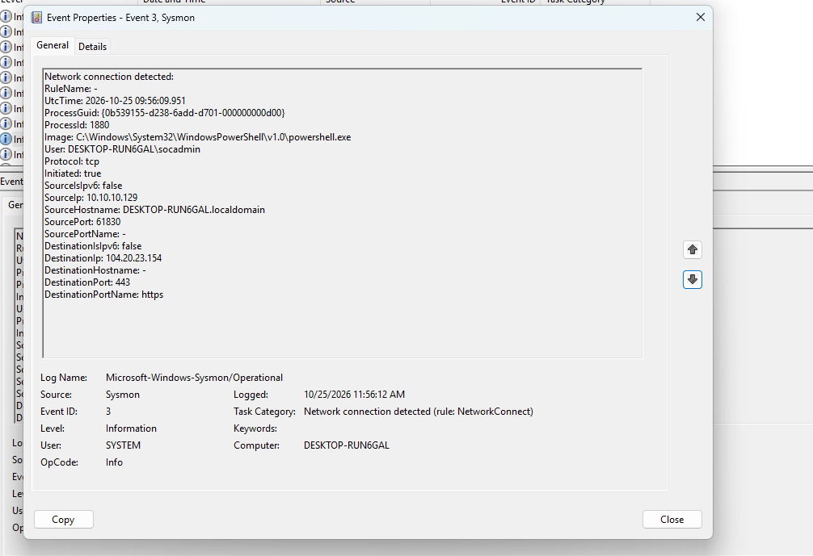


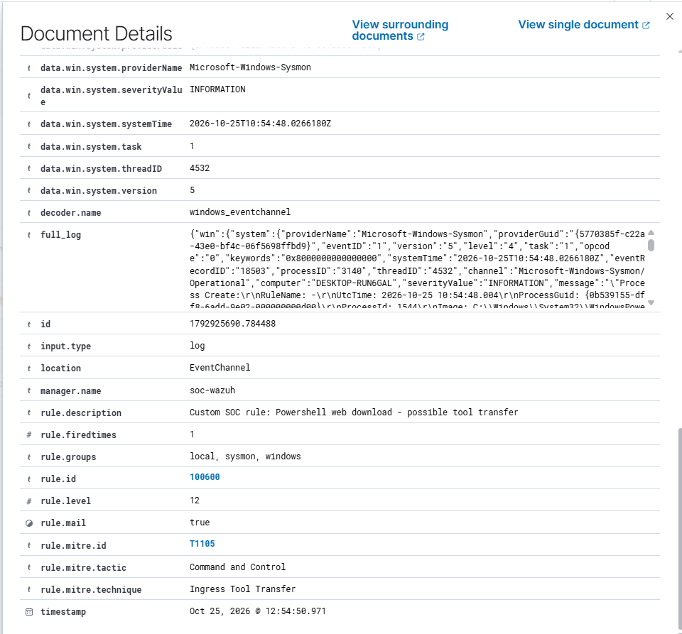

#### 7.3 Tuning false positives

Two built-in rules kept firing on normal Windows activity:

| Rule | Level | Benign cause |
|---|---|---|
| 92213 "Executable file dropped in folder commonly used by malware" | 15 | PowerShell creates a temporary `__PSScriptPolicyTest_*.ps1` file every time it starts, to check execution policy |
| 92058 "Application Compatibility Database launched" | 12 | Windows' Program Compatibility Assistant service (svchost.exe `-s PcaSvc`) runs `sdbinst.exe -m -bg` as routine maintenance |

**Approach:** Before suppressing anything, I opened each alert and checked the exact field values (file name, image, command line, parent process). This showed that not every 92213 alert was the PowerShell test file, so a broad suppression would have hidden real activity.

I then wrote **level 0 child rules** (level 0 = no alert) that only match the exact benign pattern:

```xml
<rule id="100700" level="0">
  <if_sid>92213</if_sid>
  <field name="win.eventdata.image" type="pcre2">(?i)\\(powershell|pwsh)\.exe$</field>
  <field name="win.eventdata.targetFilename" type="pcre2">(?i)\\__PSScriptPolicyTest_[a-z0-9]+\.[a-z0-9]+\.ps1$</field>
  <description>Suppressed FP: PowerShell execution policy test file (benign)</description>
</rule>

<rule id="100710" level="0">
  <if_sid>92058</if_sid>
  <field name="win.eventdata.image" type="pcre2">(?i)^C:\\Windows\\System32\\sdbinst\.exe$</field>
  <field name="win.eventdata.commandLine" type="pcre2">(?i)sdbinst\.exe"?\s+-m\s+-bg\s*$</field>
  <field name="win.eventdata.parentImage" type="pcre2">(?i)^C:\\Windows\\System32\\svchost\.exe$</field>
  <description>Suppressed FP: sdbinst -m -bg run by PcaSvc (benign)</description>
</rule>
```

Why these are narrow:
- 100700 requires **both** the PowerShell process **and** the exact test-file name pattern. Malware dropping a file with that name from another process still alerts.
- 100710 requires the exact command line **and** svchost.exe as the parent. `sdbinst` is a known persistence technique (T1546.011), so running it any other way must still alert.

**Results:**

| Test | Expected | Result |
|---|---|---|
| Opened PowerShell several times | No 92213 alerts | 14 `__PSScriptPolicyTest` events reached the manager, **0 alerts** ✅ |
| Ran `sdbinst.exe -m -bg` from an admin PowerShell (negative test) | 92058 still alerts | **92058 fired at level 12** ✅ |

The negative test matters: it proves the suppression did not create a blind spot.


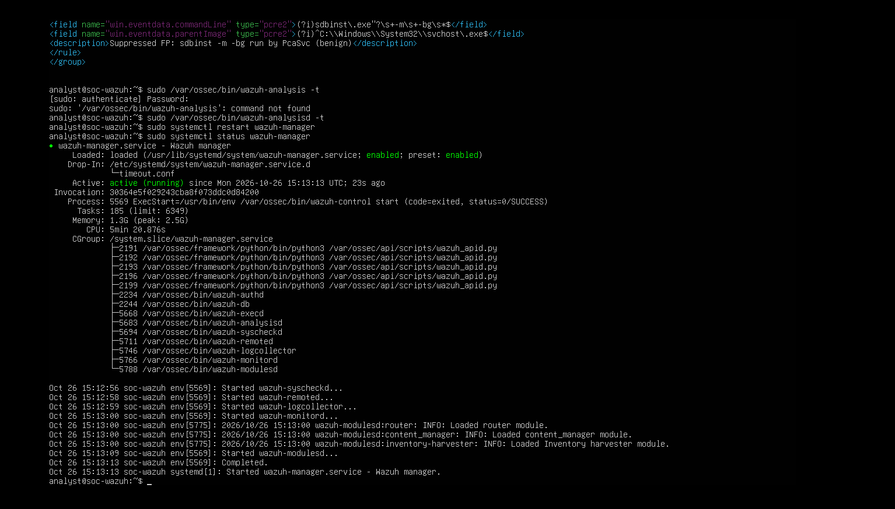


#### 7.4 Investigation: "no alerts" does not mean "no activity"

During the negative test, the expected 92058 alert never appeared. Instead of assuming my rule was wrong, I worked through the log pipeline step by step:

1. **Endpoint:** Queried Sysmon directly on SOC-Win11 with `Get-WinEvent`. The `sdbinst` process creation **was** logged, so Sysmon was fine.
2. **Rule logic:** Read the built-in rule 92058 in `/var/ossec/ruleset/rules/0800-sysmon_id_1.xml`. It should have matched.
3. **Manager:** Temporarily enabled `logall_json` to archive every event the manager received. The archive contained **zero** Windows EventChannel events from the agent, only SCA and rootcheck data.
4. **Root cause:** The Wazuh agent service on the victim had stopped after a failed restart. The manager still showed it as Active for a while, but no Windows logs were being collected.
5. **Fix:** Started the agent service again, confirmed in the agent log that it was reading the Security, System and Sysmon channels, confirmed Windows events were arriving in the archive, and re-ran both tests.

This also showed that my first "suppression works" result was not valid evidence, because no events were arriving at that time. I repeated the test after the fix to get real proof.

I also found that the manager's vulnerability detection module was repeatedly crashing `wazuh-modulesd` (feed download failure), which made the dashboard lose its API connection. It is disabled in this lab since it is not needed for attack detection. Verification during the outage was done directly over SSH using `alerts.json` and `archives.json`.

**Key takeaway:** before trusting the absence of alerts, confirm that the logs are actually reaching the SIEM.

#### 7.5 Attack timeline

All custom detections in this lab, ordered by time. On 13 Oct, a full chain (discovery, then account creation, Run key and scheduled task persistence) was detected within about four minutes.

| Rule | Detection | MITRE ATT&CK | Level |
|---|---|---|---|
| 100100 | New Windows user created | T1136.001 Local Account | 12 |
| 100200 | whoami executed | T1033 System Owner/User Discovery | 10 |
| 100300 | Run key modified | T1547.001 Registry Run Keys | 12 |
| 100400 | Scheduled task created | T1053.005 Scheduled Task | 12 |
| 100500 | Network logon (type 3) | T1021 Remote Services | 12 |
| 100600 | PowerShell web download | T1105 Ingress Tool Transfer | 12 |

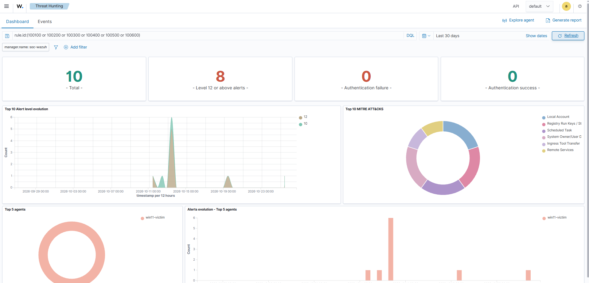
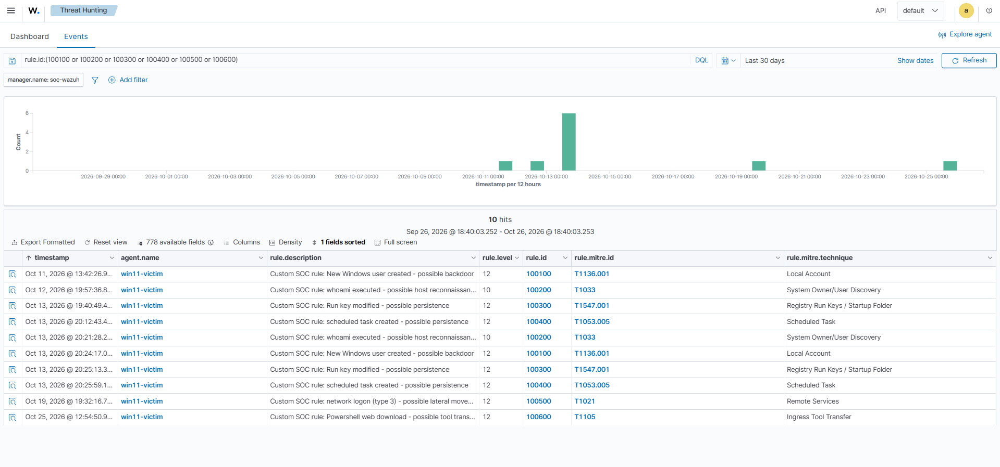

## What I learned
Alert triage, reading rule.id / rule.level / source IP, mapping events to
MITRE ATT&CK, investigating process creation with Sysmon (image, command line,
parent process), finding a detection gap, and writing custom detection rules
in Wazuh. Also troubleshooting a failing wazuh-manager service from its logs.

- Detecting persistence (registry Run keys, scheduled tasks), writing multi-condition rules to limit false positives, building an attack timeline, and triaging alerts (true vs false positive)
- Detecting lateral movement and tool transfer, tuning false positives with narrow suppression rules and negative tests, and troubleshooting a broken log pipeline ("no alerts" is not "no activity")

## Next steps
Continuing the TryHackMe SOC Level 1 path, investigating the remaining unexplained alerts, and adding detections for new attack techniques.
