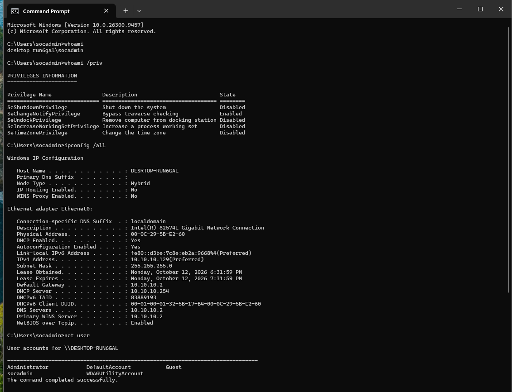

# SOC Home Lab — Detection Engineering with Wazuh

A hands-on Security Operations Center (SOC) home lab built to practice
blue-team detection and alert triage. Three virtual machines on VMware
Workstation Pro: an attacker, a victim endpoint, and a Wazuh SIEM server.

## Lab architecture

| Role     | Machine                          | IP / detail          |
|----------|----------------------------------|----------------------|
| Attacker | Kali Linux                       | 10.10.10.130         |
| Victim   | Windows 11 (agent: win11-victim) | 10.10.10.0/24 (DHCP) |
| SIEM     | Wazuh on Ubuntu Server           | 10.10.10.10          |

Isolated NAT network 10.10.10.0/24. Dashboard: https://10.10.10.10

## Tools
VMware Workstation Pro · Wazuh 4.x (SIEM/XDR) · Kali Linux (nmap, hydra)
· Windows 11 Enterprise (Wazuh agent)
· Sysmon (SwiftOnSecurity config)

## Detections

### 1. Windows logon brute force (Event ID 4625)
Generated repeated failed logons on Windows; Wazuh recorded 5 failures.
- Rule 60122 "Logon Failure - Unknown user or bad password", level 5


### 2. New admin account / privilege escalation (4720 + 4732)
Created a hidden "backdoor" user and added it to the Administrators group.
- 4720 user created (MITRE: Account Manipulation)
- 4732 Administrators Group Changed, rule 60154, level 12


### 3. SSH brute force from Kali
Ran hydra against the Wazuh server's SSH (user analyst).
- Rule 5503 "PAM: User login failed", level 5
- MITRE ATT&CK T1110.001 Password Guessing


### 4. Custom detection rule (my own rule)
Wrote a custom Wazuh rule to flag new Windows user creation faster,
treating it as a possible backdoor.
- Rule id 100100, level 12 (high severity)
- Triggers on Windows Event ID 4720 (a user account was created)
- MITRE ATT&CK T1136.001 (Create Account - Local Account)


### 5. Endpoint telemetry with Sysmon + recon detection
Applied the SwiftOnSecurity Sysmon configuration on the Windows endpoint and
forwarded the Sysmon log to Wazuh for process-level visibility. Then simulated
attacker reconnaissance (`whoami`, `whoami /priv`, `ipconfig /all`, `net user`).

- Sysmon Event ID 1 (process creation) collected by Wazuh
- `net user` was caught by the built-in Wazuh rule 92031 (Discovery activity, level 3)
- `whoami` was logged by Sysmon but produced no Wazuh alert: a detection gap
- Closed the gap with custom rule id 100200, level 10, triggered on whoami.exe execution
- MITRE ATT&CK T1033 (System Owner/User Discovery)

```xml
<group name="local,sysmon,windows,">
<rule id="100200" level="10">
<if_group>sysmon_event1</if_group>
<field name="win.eventdata.image">whoami.exe</field>
<description>Custom SOC rule: whoami executed - possible host reconnaissance</description>
<mitre>
<id>T1033</id>
</mitre>
</rule>
</group>
```

**Troubleshooting:** after adding the rule, wazuh-manager failed to start
(systemd timeout). Validated the rules with `wazuh-analysisd -t` (no errors),
found stuck processes in the service status, cleared them with
`wazuh-control stop`, and the manager started successfully.





## What I learned
Alert triage, reading rule.id / rule.level / source IP, mapping events to
MITRE ATT&CK, investigating process creation with Sysmon (image, command line,
parent process), finding a detection gap, and writing custom detection rules
in Wazuh. Also troubleshooting a failing wazuh-manager service from its logs.

## Next steps
Continuing the TryHackMe SOC Level 1 path, detecting persistence techniques
(Run keys and scheduled tasks) with Sysmon, and chaining an end-to-end attack
from Kali to test all detections together.
