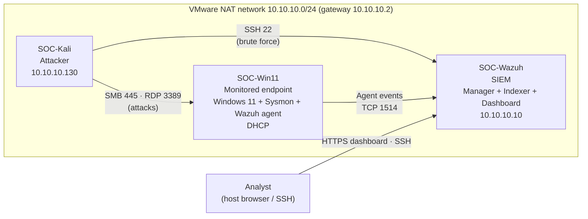
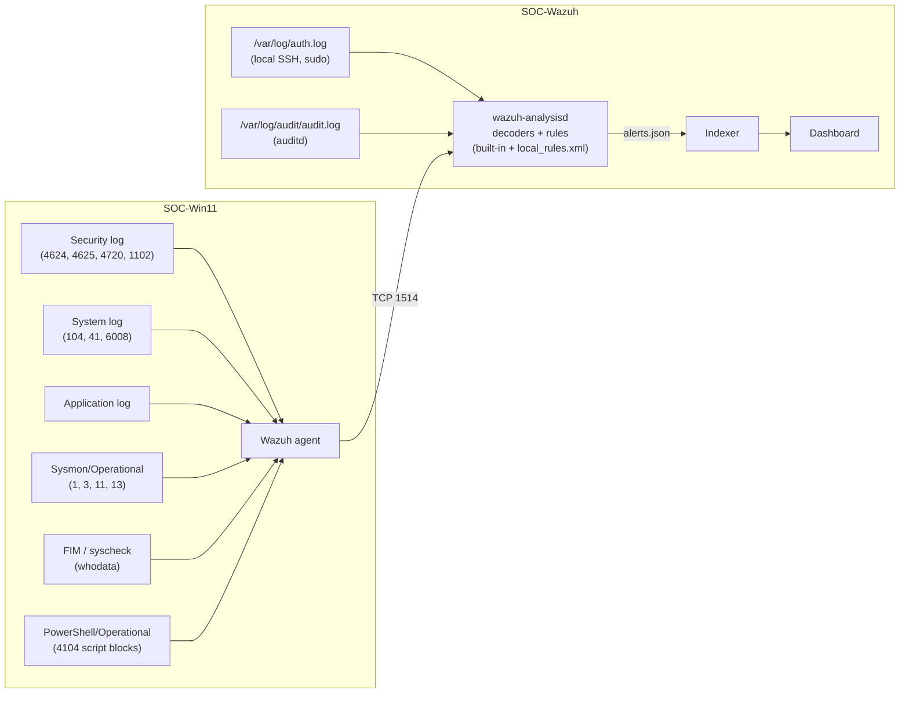

# Lab Architecture

[← Back to README](../README.md)

The lab is a small, isolated SOC environment running on a single laptop with VMware Workstation Pro. An attacker VM generates real techniques against a monitored Windows 11 endpoint and the Wazuh server itself, and every result is verified in the SIEM.

## Network diagram

## Virtual machines

| VM | Role | OS | Resources | Storage |
|---|---|---|---|---|
| SOC-Wazuh | SIEM (all-in-one: manager, indexer, dashboard) | Ubuntu Server 26.04, Wazuh 4.x | 4 vCPU, 6 GB RAM | Host HDD |
| SOC-Win11 | Monitored endpoint (agent name `win11-victim`) | Windows 11 Enterprise, Sysmon (SwiftOnSecurity config) | 2 vCPU, 4 GB RAM | Host SSD (moved in [Exercise 12](../README.md#exercise-12-endpoint-stability-troubleshooting-0x124-whea-crash)) |
| SOC-Kali | Attacker | Kali Linux (nmap, hydra, netexec, xfreerdp3) | n/a | Host HDD |

**Host:** HP OMEN 17 laptop, Intel Core i7-8750H (6 cores / 12 threads), 16 GB RAM, Windows 11, VMware Workstation Pro. The SSD holds the endpoint VM; the HDD holds the other VMs, backups and ISOs.

## Telemetry pipeline

## Collection configuration

| Source | What is collected | Used in |
|---|---|---|
| Windows Security | Logons (4624/4625), account and group changes (4720/4732), audit log cleared (1102) | Exercises 1, 2, 4, 8, 11, 13 |
| Windows System | Service changes, log cleared (104), Kernel-Power 41 / 6008 | Exercises 11, 12 |
| Sysmon | Process creation (1), network connection (3), file create (11), registry (13) | Exercises 5, 6, 8, 10 |
| FIM (whodata, `report_changes`) | `C:\FIM-Test` (sensitive Finance folder) and both Windows Startup folders | Exercise 10 |
| Linux auth log (manager) | SSH logins, PAM, user and group changes | Exercises 3, 9 |
| auditd (manager) | `execve` by login users, `/etc/shadow` reads, sudoers changes ([config](../config/auditd-wazuh-lab.rules)) | Exercise 15 |
| PowerShell/Operational (endpoint) | Event 4104 only: decoded script blocks ([config](../config/powershell-localfile.xml)) | Exercise 16 |

**Audit policy on the endpoint:** Logon auditing (Success and Failure) and File System auditing (Success, required by whodata). Account lockout threshold: 10 attempts. PowerShell Script Block Logging is enabled by policy (`HKLM\SOFTWARE\Policies\Microsoft\Windows\PowerShell\ScriptBlockLogging`, `EnableScriptBlockLogging = 1`) since Exercise 16.

## Operating notes

- **Archives** (`logall_json`) are off by default and enabled only temporarily to prove whether an event reached the manager. They are always switched back off afterwards.
- **Active Response** (automatic IP blocking) is configured on the manager but **disabled** after Exercise 14, so attacker IPs are not blocked during other exercises. Configuration: [config/active-response.xml](../config/active-response.xml).
- **Vulnerability detection** is disabled: its feed download failure kept crashing `wazuh-modulesd` and broke the dashboard API. It is not needed for attack detection in this lab.
- **Manager restarts:** on the slow HDD, `systemctl restart` can time out and leave the manager half-stopped. The reliable sequence is `wazuh-control stop`, remove any leftover `/var/ossec/var/start-script-lock` directory, then `wazuh-control start`.
- **Snapshots** are taken on SOC-Win11 and SOC-Wazuh at the end of every exercise, so each exercise can be reproduced from a known state.
- **Time:** server logs are UTC, the dashboard shows local time (UTC+2). Timelines always state the timezone. The endpoint clock runs ~37 s ahead of the manager (Exercise 17), so timelines use manager time.
- **Endpoint log retention:** the Windows Security log is capped at 20 MB, and File System auditing (for whodata) fills it in under 20 minutes. Wazuh is the durable copy; the agent's default query does not forward 4656/4658.
- **Isolation:** the lab network is NAT only. Test users (`testuser`, `rdptest`) and test files are created for an exercise and removed in its cleanup step, so no real credentials appear anywhere.
