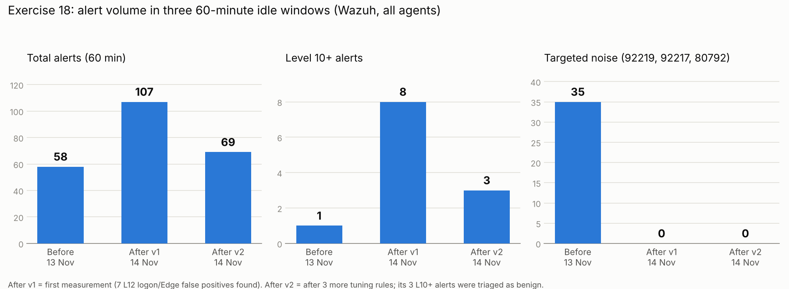

# Alert Tuning (Exercise 18)

How noise was removed from this lab without creating blind spots: the method, every tuning rule with its proof, the before/after measurement, and the alerts that were deliberately **not** tuned.

[← Back to README](../README.md#exercise-18-alert-tuning--less-noise-without-blind-spots)

---

## 1. Method

### The golden rule

> Never silence a rule ID. Silence or lower **one exact pattern** as a child rule, then prove the parent still fires for anything else.

### Workflow for every noisy alert

1. **Investigate a live alert first.** Read the real field values from `alerts.json`, not the dashboard and not a guide. Several guide assumptions were wrong (see §6).
2. **Decide the verdict:** benign, suspicious or unknown. Only benign alerts are tuned.
3. **Pick the tool:**

| Situation | Tool | Example |
|---|---|---|
| Benign and useless to see | Child rule, `level="0"` | Windows Update DLLs (101500) |
| Benign but worth keeping as a record | Child rule, `level="3"` | Logon processes (101540, 101570, 101580) |
| The built-in rule itself is wrong | `overwrite="yes"` with the same parent, options and MITRE | 91823 regex |
| Severity too **low** | Child rule with a higher level | Agent stopped (101550) |
| Rare and high value | **Do not tune.** Triage each time | 92206 print spooler DLL |

4. **Match on at least two exact fields** (process path + file path, or process path + command line), anchored where possible.
5. **Validate** with `wazuh-analysisd -t` before every restart.
6. **Positive test:** the benign activity no longer alerts (or now alerts at the new level).
7. **Negative test:** a similar but malicious-looking action still alerts at full severity.
8. **Measure** over a fixed idle window, before and after.

---

## 2. Tuning rules

All rules are in [`rules/local_rules.xml`](../rules/local_rules.xml). Windows paths are matched with `\\+` because Wazuh stores them with doubled backslashes (§6).

### Level 0: suppressed

| Rule | Parent | Match (all conditions) | Positive test | Negative test |
|---|---|---|---|---|
| 101500 | 92219 DLL search order hijack (L6) | image `\System32\svchost.exe` **and** target in `\Windows\SoftwareDistribution\Download\` or `\Windows\SystemTemp\` | 0 new 92219 after the rule (28 in the baseline hour) | PowerShell dropping `C:\Windows\ex18-negtest.dll` → 92203 L6 still alerts |
| 101510 | 92217 Executable dropped in Windows root (L6) | same image and folders as 101500 (Defender `AM_Delta_Patch_*.exe`) | 0 in both after windows | `mscorsvw.exe` drops in `C:\Windows\assembly\...` still alerted (v2) |
| 101520 | 92213 Executable in malware folder (L15) | image `\Microsoft\Edge\Application\msedge.exe` **and** target contains `\msedge_chrome_Unpacker_BeginUnzipping<n>_<n>\` | ⚠️ not re-triggered (pattern from Exercise 17 live alert) | parent fires for any other process |
| 101530 | 91816 PowerShell script block | the exact SCA line `secedit /export /cfg $env:TEMP\secpol.cfg; Get-Content ...; Remove-Item ...`, anchored `^...$` | agent restart: 0 new 91816 (was 8 per restart) | any other script text still reaches 91816 |
| 100710 | 92058 AppCompat DB (L12) | image `\System32\sdbinst.exe` **and** command `-m -bg` **and** parent `\System32\svchost.exe` | ⚠️ regex fixed in Exercise 18, awaiting next PcaSvc run | `sdbinst -m -bg` from PowerShell → 92058 L12 (Exercise 8) |

### Level 3: severity lowered, still searchable

| Rule | Parent (was) | Match (all conditions) | Positive test | Negative test |
|---|---|---|---|---|
| 101540 | 61632 smss.exe (L12) | image `\Windows\System32\smss.exe` **and** command `smss.exe <8 hex> <8 hex> winlogon.exe` | sign out / in → 101540 L3, no 61632 | other smss command lines stay L12 |
| 101560 | 100300 Run key modified (L12) | image exactly `C:\Program Files (x86)\Microsoft\Edge\Application\msedge.exe` **and** value `\Run\MicrosoftEdgeAutoLaunch_<32 hex>` **and** data ends `--no-startup-window --win-session-start` | open/close Edge → 101560 L3 ×2 | `reg add ...\Run /v EX18NegTest /d notepad.exe` → **100300 L12** |
| 101570 | 61618 svchost.exe (L12) | image exactly `C:\Windows\System32\svchost.exe` **and** command exactly `... svchost.exe -k osprivacy -p -s camsvc` | ⚠️ not re-triggered after the rule | any other svchost command line stays L12 |
| 101580 | 61634 taskhost (L12) | image exactly `C:\Windows\System32\backgroundTaskHost.exe` **and** command ends `-ServerName:<app id>` | sign in → 101580 L3 ×2 (×4 in After v2) | other images or arguments stay L12 |

### Built-in rule fixed

| Rule | Problem | Fix | Test |
|---|---|---|---|
| 91823 (L14) "Invoke-Command on remote computer" | `(ComputerName\|Cn)` with no boundary: "a**cn**e", "**cn**c" fired level 14 | `overwrite="yes"`, regex `-(ComputerName\|Cn)\b`, parent / options / MITRE unchanged | "acne cream, cnc machine" → no alert; `Invoke-Command -ComputerName localhost` → L14 |

### Severity raised

| Rule | Parent | Why | Test |
|---|---|---|---|
| 101550 (L12, T1562.001) | 506 Wazuh agent stopped (L3) | An agent outage blinds the SOC to that endpoint (Exercise 11) | stop/start `WazuhSvc` → 101550 L12 |

### Linux: auditd scope

[`config/auditd-wazuh-lab.rules`](../config/auditd-wazuh-lab.rules)

| | Exercise 15 | Exercise 18 |
|---|---|---|
| Programs | every `execve` by a login user | `sudo`, `su`, `bash`, `curl`, `wget`, `nc`, `python3` only (`perm=x` on the real path) |
| `/etc/shadow` read, sudoers write | watched | unchanged |
| Test (`tee`, `ls`, `curl`) | all logged | only `curl` logged, in `ausearch` **and** Wazuh alerts |

Real paths on Ubuntu 26.04: `sudo` → `/usr/lib/cargo/bin/sudo` (sudo-rs), `python3` → `/usr/bin/python3.14`, `nc` → `/usr/bin/nc.openbsd`. Path rules do not follow symlinks, so a guide's `/usr/bin/sudo` would have removed all sudo visibility. Custom rule 101200 (`audit.exe` ends in `/sudo`) still matches.

---

## 3. Measurement

### Method

- Same start every time: reboot SOC-Win11, log in, open Edge and File Explorer once, close them, then no input on any VM for 60 minutes. Kali off.
- Count every alert in the window from `/var/ossec/logs/alerts/alerts.json` (all agents), grouped by rule ID. Same script each time, only the times change. Output files: [`docs/evidence/`](evidence/) (`ex18-baseline.txt`, `ex18-after.txt`, `ex18-after2.txt`).

```python
import json, collections
START = "2026-11-14T15:13"   # UTC
END   = "2026-11-14T16:13"   # UTC
c = collections.Counter(); lvl = {}; desc = {}
total = high = 0
for l in open("/var/ossec/logs/alerts/alerts.json"):
    try:
        a = json.loads(l)
    except ValueError:
        continue
    t = a["timestamp"][:16]
    if not (START <= t <= END):
        continue
    r = a["rule"]; rid = r["id"]
    c[rid] += 1; lvl[rid] = r["level"]; desc[rid] = r["description"][:60]
    total += 1
    if r["level"] >= 10: high += 1
print("TOTAL", total, "| LEVEL 10+", high)
for rid, n in c.most_common(25):
    print(f"{n:>5} {rid:<7} L{lvl[rid]:<3} {desc[rid]}")
```

### Windows (UTC)

| Window | Time | Note |
|---|---|---|
| Before | 13 Nov 13:45–14:47 | Baseline |
| After v1 | 14 Nov 13:53–14:53 | After the Windows, PowerShell, severity and auditd tuning |
| After v2 | 14 Nov 15:13–16:13 | After 101560/101570/101580; the restart installed a pending Windows Update |

### Results



| Rule | Before | After v1 | After v2 | Notes |
|---|---|---|---|---|
| **Total** | **58** | **107** | **69** | |
| **Level 10+** | **1** | **8** | **3** | |
| 92219 Windows Update DLL | 28 | 0 | 0 | 101500 |
| 80792 `tee` (auditd) | 6 | 0 | 0 | audit scope |
| 92217 (Windows Update / Defender) | 1 | 0 | 0 | 101510 |
| 92217 (`mscorsvw.exe`, .NET) | 0 | 0 | 5 | new source, post-update, not tuned |
| 61634 / 61618 / 100300 Edge (L12) | 0 | 7 | 0 | now 101580 ×4, 101560 ×2 at L3 |
| 92307 + 61104 service changes | 3 | 32 | 2 | likely update preparation |
| SCA output (60608, 19xxx, 92066, 92021) | 0 | 35 | 29 | agent start after reboot |
| 92205 PowerShell created exe in Windows root | 2 | 9 | 10 | ⚠️ not yet investigated |
| Linux alerts from my own check inside v1 | – | ~6 | 0 | measurement error, noted |

### Reading the numbers honestly

The total did not drop below the baseline. Each idle hour had a different Windows workload: Windows Update downloads before, then the SCA scan, servicing and a .NET recompile after a reboot and an update. Raw count is therefore a poor metric for tuning. What can be compared is:

- **The targeted noise:** 35 → 0 → 0.
- **What level 10+ means:** 7 of 8 level 12 alerts in After v1 were normal logon activity. In After v2 all 3 level 10+ alerts were investigated and have a recorded verdict.

---

## 4. Deliberately not tuned

| Alert | Why it stays |
|---|---|
| **92206** "DLL file created by printer spool service" (L12) | The After v2 file (`spool\drivers\x64\3\PrintConfig.dll`) was **Valid, signed CN=Microsoft Windows**, a driver update. But PrintNightmare (CVE-2021-34527) drops its DLL in the same folder through the same process, and an attacker can use any file name. Rare and high value: triage with `Get-AuthenticodeSignature` each time. |
| 92217 from `mscorsvw.exe` | Only after .NET updates, level 6. Documented. |
| 61638 `DllHost.exe /Processid:{...}` (L12) | Seen once. Needs more occurrences before a verdict. |
| SCA alerts after agent start | Compliance results, expected output of the agent. |
| 80730 AppArmor "SELinux permission check" (×11 per SSH login) | Seen during the journald test, low level. Candidate for later. |
| journald + auth.log double source | Adding auth.log to fix the first-login race would duplicate every sudo, PAM and CRON alert. |

---

## 5. Linux: journald first-login race

| | Login | journald "rotation" | Login alert (5715) |
|---|---|---|---|
| Exercise 14 | 12:44:17 | 12:44:18 | missed |
| Exercise 15 | 11:26:28 | 11:26:29 | missed |
| Exercise 18 (archives on) | 13:39:07 | 13:39:09 | **fired** |

A new user's first login makes journald open a new per-user journal, which Wazuh's logcollector reports as a rotation. The events around it are sometimes lost and sometimes not: a timing race. Compensating control: auditd records the login independently (`USER_LOGIN` from `audit.log`). Production fix: read authentication logs from one source only.

---

## 6. Pitfalls found while tuning

| Pitfall | What happened | Rule of thumb |
|---|---|---|
| Fields that do not exist | Guide used `signed` / `signature` on Sysmon Event 11; 61632 has no `parentImage` | Build every rule from a live alert's JSON |
| Doubled backslashes | `^C:\\Windows\\...` matches one backslash; the stored value has two. 100710 never matched (Exercise 8 → 18) | Use `\\+` for every path separator |
| Negative test only | 100710 passed its negative test while doing nothing | Every suppression needs a positive test too |
| Empty `<group>` | Removing the only rule from a group gave `Group 'group' without any rule`; the manager would not start | Run `wazuh-analysisd -t` before every restart |
| Python `re.sub` on XML | `\s` in the replacement raised "bad escape" | Use `tee -a` or line-addressed `sed` |
| `ausearch -ts recent` | Means the last 10 minutes, so it showed events from before the change | Record a start time and use `-ts <time>` |
| sudo-rs path | `/usr/lib/cargo/bin/sudo`, not `/usr/bin/sudo` | Resolve with `readlink -f $(command -v sudo)` |
| Measuring inside the window | A `sudo` check during After v1 added ~6 alerts | Touch nothing during a measurement window |

---

## 7. Checklist for the next tuning change

- [ ] Live alert JSON saved, fields confirmed
- [ ] Verdict written (why it is benign)
- [ ] Child rule with at least two exact fields, `\\+` for paths, anchored
- [ ] `local_rules.xml` backed up, `wazuh-analysisd -t` passes
- [ ] Positive test: benign activity no longer alerts at the old level
- [ ] Negative test: a malicious variant still alerts at full level
- [ ] Before/after count over the same kind of window
- [ ] Rule added to this file and the README tables
